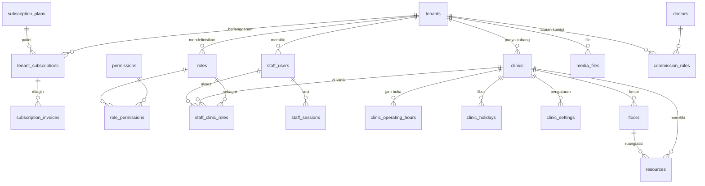
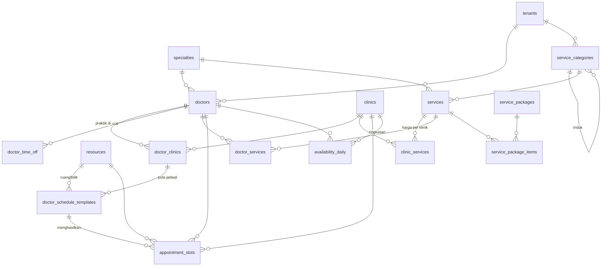
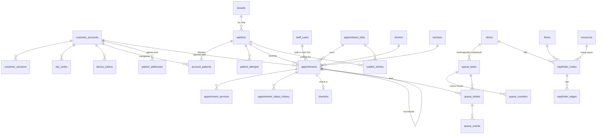
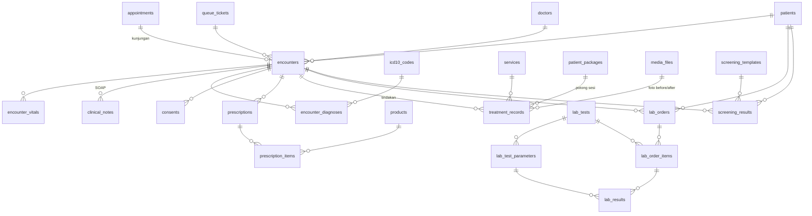

# DigiKlinik — ERD & Skema Database (PostgreSQL 16)

> Dokumen ini adalah **satu-satunya sumber kebenaran** untuk struktur data DigiKlinik. Seluruh SQL di bawah **sudah dieksekusi dan diuji** di PostgreSQL 16.15 (lihat Bagian 7: hasil uji).
> Ringkasan: **92 tabel · 228 foreign key · 376 index · 110 CHECK · 0 enum · 0 uuid** · dimuat dengan **±6 juta baris** (ukuran DB 1,5 GB) dan seluruh query jalur panas berjalan **< 10 ms**.

---

## 1. Prinsip Desain

| Prinsip | Penerapan |
|---|---|
| **Primary key** | `BIGSERIAL id` di semua tabel. Tabel penghubung murni (`role_permissions`, `doctor_services`) memakai PK komposit. **Tidak ada UUID.** |
| **Enum → VARCHAR** | Semua status/tipe adalah `VARCHAR` + `CHECK (... IN (...))`. Menambah nilai baru cukup `ALTER TABLE ... DROP/ADD CONSTRAINT`, tanpa migrasi tipe. **Tidak ada `CREATE TYPE ... AS ENUM`.** |
| **Semua FK terhubung** | 228 FK eksplisit. Skrip verifikasi V1 membuktikan **tidak ada satu pun kolom FK tanpa index** (PostgreSQL tidak membuat index FK otomatis, jadi ini sengaja dilakukan satu per satu). |
| **Uang** | `BIGINT` Rupiah utuh. Tidak ada `FLOAT`/`NUMERIC` untuk uang → tak ada selisih pembulatan. |
| **Waktu** | Event = `TIMESTAMPTZ`. Jadwal praktik = `DATE` + `TIME` (jam dinding klinik; zona waktu per klinik di `clinics.timezone`: WIB/WITA/WIT). |
| **Multi-tenant** | `tenants` → `clinics`. Mode `single` (1 klinik) dan `multi` (banyak cabang) memakai skema yang sama; yang berbeda hanya batas paket langganan. |
| **Akun global, pasien per tenant** | `customer_accounts` (login publik, nomor HP) bersifat global. `patients` (rekam medis, No. RM) milik tenant. Tabel `account_patients` menautkan satu akun ke banyak pasien (diri sendiri, anak, orang tua) lintas klinik. |
| **Anti double-booking** | Kursi diambil dengan **satu `UPDATE ... WHERE booked < capacity`** (fungsi `fn_take_slot`) + `CHECK (booked <= capacity)` sebagai pagar terakhir. Tanpa lock eksplisit, aman untuk ribuan klik bersamaan. |
| **Antrian tanpa celah** | `queue_counters` + `INSERT ... ON CONFLICT DO UPDATE ... RETURNING` (fungsi `fn_next_ticket_number`) → nomor unik, berurutan, per klinik+lane+hari. |
| **Strip tanggal instan** | Tabel `availability_daily` (ringkasan pra-hitung per dokter/hari) menjawab label **Ada Slot / Terbatas / Penuh** tanpa menghitung ulang ratusan ribu slot. |
| **Idempotensi pembayaran** | `payments.idempotency_key` UNIQUE, `payment_webhook_events (provider, external_event_id)` UNIQUE → webhook ganda dari payment gateway tidak membuat pembayaran ganda. |
| **Tidak ada hard delete data medis** | FK default `RESTRICT` pada data klinis/keuangan; `ON DELETE CASCADE` hanya untuk baris anak murni (item, riwayat, token). |
| **Data sensitif (UU PDP)** | NIK disimpan sebagai `nik_hash` (SHA-256 + pepper) untuk deteksi duplikat; NIK asli dienkripsi di level aplikasi. Semua akses data pasien tercatat di `audit_logs`. |

Kolom `*_id` yang sengaja **bukan** FK (hasil V2): `audit_logs.entity_id` dan `stock_movements.ref_id` (referensi polimorfik, dipasangkan dengan `entity_type`/`ref_type`) serta ID eksternal dari pihak ketiga (`deliveries.external_booking_id`, `payment_webhook_events.external_event_id`, `notifications.provider_message_id`).

---

## 2. Peta Domain

| # | Domain | Tabel utama |
|---|---|---|
| 1 | SaaS & tenancy | `subscription_plans`, `tenants`, `tenant_subscriptions`, `subscription_invoices`, `platform_admins` |
| 2 | Staf & RBAC | `staff_users`, `roles`, `permissions`, `role_permissions`, `staff_clinic_roles`, `staff_sessions` |
| 3 | Klinik & fasilitas | `clinics`, `clinic_operating_hours`, `clinic_holidays`, `clinic_settings`, `floors`, `resources`, `media_files` |
| 4 | Dokter/expert | `specialties`, `doctors`, `doctor_clinics`, `doctor_schedule_templates`, `doctor_time_off`, `doctor_services` |
| 5 | Katalog layanan | `service_categories`, `services`, `clinic_services`, `service_packages`, `service_package_items` |
| 6 | Akun, pasien & keluarga | `customer_accounts`, `customer_sessions`, `otp_codes`, `device_tokens`, `patients`, `account_patients`, `patient_allergies`, `patient_addresses` |
| 7 | Slot & booking | `appointment_slots`, `availability_daily`, `appointments`, `appointment_services`, `appointment_status_history`, `waitlist_entries`, `checkins` |
| 8 | Antrian | `queue_lanes`, `queue_counters`, `queue_tickets`, `queue_events` |
| 9 | Wayfinder | `wayfinder_nodes`, `wayfinder_edges` |
| 10 | Klinis | `encounters`, `encounter_vitals`, `clinical_notes`, `icd10_codes`, `encounter_diagnoses`, `consents`, `prescriptions`, `prescription_items`, `treatment_records` |
| 11 | Lab & skrining | `lab_tests`, `lab_test_parameters`, `lab_orders`, `lab_order_items`, `lab_results`, `screening_templates`, `screening_results` |
| 12 | Billing & pembayaran | `payment_methods`, `clinic_payment_methods`, `invoices`, `invoice_items`, `payments`, `payment_webhook_events`, `refunds`, `vouchers`, `voucher_redemptions`, `commission_rules`, `commission_entries`, `patient_packages` |
| 13 | Obat, stok & pengiriman | `suppliers`, `products`, `product_batches`, `inventory_stocks`, `stock_movements`, `fulfillment_orders`, `fulfillment_items`, `deliveries`, `delivery_events` |
| 14 | Engagement & kontrol | `notification_templates`, `notifications`, `reviews`, `banners`, `audit_logs` |

---

## 3. Diagram ERD (Mermaid)

Diagram dipecah per domain agar terbaca. Relasi lintas domain ditandai tabel yang sama di beberapa diagram. Notasi: `||--o{` = satu ke banyak.

### 3.1 Tenant, klinik, staf



### 3.2 Dokter, layanan, jadwal & slot



### 3.3 Akun customer, pasien, booking, antrian, check-in



### 3.4 Klinis, lab, skrining



### 3.5 Billing, obat, pengiriman, engagement

```mermaid
erDiagram
  patients ||--o{ invoices : ""
  appointments ||--o{ invoices : "deposit/visit"
  encounters ||--o{ invoices : ""
  vouchers ||--o{ invoices : ""
  invoices ||--o{ invoice_items : ""
  services ||--o{ invoice_items : ""
  products ||--o{ invoice_items : ""
  service_packages ||--o{ invoice_items : ""
  invoices ||--o{ payments : ""
  payment_methods ||--o{ payments : "QRIS/VA/e-wallet/kartu/tunai"
  payment_methods ||--o{ clinic_payment_methods : ""
  clinics ||--o{ clinic_payment_methods : ""
  payments ||--o{ payment_webhook_events : "idempoten"
  payments ||--o{ refunds : ""
  vouchers ||--o{ voucher_redemptions : ""
  invoices ||--o{ voucher_redemptions : ""
  invoice_items ||--o{ commission_entries : ""
  doctors ||--o{ commission_entries : ""
  invoices ||--o{ patient_packages : "beli paket"
  service_packages ||--o{ patient_packages : ""
  products ||--o{ product_batches : ""
  suppliers ||--o{ product_batches : ""
  clinics ||--o{ inventory_stocks : ""
  products ||--o{ inventory_stocks : ""
  products ||--o{ stock_movements : ""
  prescriptions ||--o{ fulfillment_orders : "tebus obat"
  patient_addresses ||--o{ fulfillment_orders : "alamat"
  fulfillment_orders ||--o{ fulfillment_items : ""
  fulfillment_orders ||--o| deliveries : "GoSend"
  deliveries ||--o{ delivery_events : "tracking"
  customer_accounts ||--o{ notifications : ""
  appointments ||--o{ notifications : "reminder"
  notification_templates ||--o{ notifications : ""
  appointments ||--o| reviews : "ulasan"
  doctors ||--o{ reviews : ""
  tenants ||--o{ audit_logs : ""
  tenants ||--o{ banners : ""
```



---

## 4. Alur Data Kunci

**Booking → kunjungan → pembayaran → obat**

1. `doctor_schedule_templates` (pola mingguan) → `fn_generate_slots()` membuat baris `appointment_slots` per hari (idempoten; dijalankan cron harian untuk 60 hari ke depan).
2. `fn_refresh_availability()` mengisi `availability_daily` → strip tanggal menampilkan **Ada Slot / Terbatas / Penuh**. Label "Waiting List" pada slot penuh berasal dari `appointment_slots` penuh + `waitlist_entries`.
3. Pasien memilih slot → `fn_take_slot(slot_id)` (atomik) → insert `appointments` (`pending_payment` bila perlu deposit, dengan `hold_expires_at`) → `invoices(type='deposit')` + `payments(method='qris')`.
4. Webhook gateway → `payment_webhook_events` (unik per event) → `payments.status='paid'` → `appointments.status='confirmed'` → `notifications` (WhatsApp).
5. Hari-H: `checkins` (QR / geofence / front desk / kiosk) → `queue_tickets` di **lane** sesuai jenis: `appointment` (A-), `walk_in` (W-), `executive` (E-). Skor prioritas lane menentukan urutan panggilan.
6. `wayfinder_nodes/edges` menghitung rute (graf berbobot) dari titik saat ini ke `resources` tujuan.
7. `encounters` → catatan SOAP, diagnosis ICD-10, `prescriptions`, `treatment_records` (foto before/after, potong sesi `patient_packages`), `lab_orders`, `screening_results`.
8. `invoices` final → `payments` → `fulfillment_orders` (`pickup` dengan kode ambil, atau `delivery` → `deliveries` GoSend + `delivery_events`) → `stock_movements`.
9. Public App membaca riwayat lewat `account_patients` → `appointments`, `v_patient_medications`, `v_patient_treatments`, hasil lab/skrining yang `is_published_to_patient = TRUE`.

**Pembeda antrian walk-in vs booking (kunci produk):** `appointments.booking_type` (`online`/`walk_in`) + `appointment_slots` menyimpan kapasitas terpisah (`capacity_online` vs `capacity_walkin`) + `queue_lanes` terpisah dengan `priority_weight` dan `target_wait_minutes` sendiri. Pasien eksekutif memakai `slot_class='executive'`, `clinic_services.executive_price`, dan lane `EXEC` berbobot tertinggi.

**Pola Booking atomik (aman konkurensi):**

```sql
-- 1 statement, tanpa SELECT ... FOR UPDATE
UPDATE appointment_slots SET booked_online = booked_online + 1
 WHERE id = :slot AND status = 'open' AND booked_online < capacity_online;
-- row_count = 1 -> kursi didapat; 0 -> penuh (tampilkan Waiting List)
```

---

## 5. Strategi Index (Ringkas)

| Jalur panas | Index | Catatan |
|---|---|---|
| Cari slot per tanggal | `ix_slots_date_open (slot_date, clinic_id, doctor_id, start_time) WHERE status='open'` | Partial: slot tertutup tidak membebani index |
| Jadwal 1 dokter | `ix_slots_doctor_open (doctor_id, slot_date, start_time) WHERE status='open'` | |
| Strip tanggal | `ix_avail_date_clinic (slot_date, clinic_id) INCLUDE (specialty_id, available_capacity, status)` | Index-only scan |
| Riwayat pasien | `ix_appt_patient (patient_id, appointment_date DESC, id DESC)` | Sudah terurut, tanpa sort |
| Agenda admin | `ix_appt_clinic_day (clinic_id, appointment_date, status, start_time)` | |
| Job hold kadaluarsa | `ix_appt_hold (hold_expires_at) WHERE status='pending_payment'` | Index sangat kecil |
| Layar antrian | `ix_qt_live (clinic_id, queue_date, priority_score DESC, ticket_number) WHERE status IN ('waiting','called')` | Hanya tiket hidup |
| Cari nama pasien/dokter/layanan/obat | GIN `gin_trgm_ops` (`pg_trgm`) | `ILIKE '%kata%'` cepat |
| Omzet harian | `ix_pay_revenue (clinic_id, paid_at) WHERE status='paid'` | |
| Webhook | UNIQUE `(provider, external_event_id)` | Idempotensi + lookup |
| Worker notifikasi | `ix_notif_queue (scheduled_at) WHERE status='queued'` | |
| Log besar | BRIN `ix_audit_brin (created_at)` | Ukuran puluhan KB untuk jutaan baris |
| Anti duplikat | `ux_patients_nik`, `ux_appt_slot_patient_active`, `ux_slots_natural`, `ux_enc_appt` | Integritas bisnis di level DB |

**Skala lanjutan (belum perlu di bawah ±20 juta baris/tabel):** partisi bulanan `RANGE (created_at)` untuk `audit_logs`, `notifications`, `queue_events`, `appointment_status_history`; arsip `appointments` > 3 tahun; read-replica untuk laporan; PgBouncer (transaction pooling) di depan database.

---

## 6. Cara Menjalankan

```bash
createdb digiklinik
psql digiklinik -v ON_ERROR_STOP=1 -f 01_schema.sql        # struktur
psql digiklinik -v ON_ERROR_STOP=1 -f 02_functions.sql     # slot, booking atomik, nomor antrian
psql digiklinik -v ON_ERROR_STOP=1 -f 04_seed_core.sql     # data referensi + 4 tenant demo
psql digiklinik -v ON_ERROR_STOP=1 -f 05_seed_story.sql    # skenario keluarga end-to-end
psql digiklinik -v ON_ERROR_STOP=1 -f 06_seed_volume.sql   # (opsional) ±6 juta baris uji beban, ±2,5 menit
psql digiklinik -f 03_verify.sql                           # audit FK/index/PK/enum
psql digiklinik -f 07_hotpath_tests.sql                    # benchmark jalur panas
```

Bagian 8 berisi isi lengkap tiap file. Salin tiap blok ke file bernama sesuai judulnya.

---

## 7. Hasil Pengujian (benar-benar dijalankan)

Lingkungan uji: PostgreSQL 16.15, 1 sandbox kecil (shared_buffers 256 MB, `fsync=off`), tanpa tuning khusus. Angka produksi dengan disk NVMe dan RAM memadai akan setara atau lebih baik.

### 7.1 Integritas (`03_verify.sql`)

| Pemeriksaan | Hasil |
|---|---|
| V1 — kolom FK tanpa index | **0 baris** (lulus) |
| V2 — kolom `*_id` bukan FK | 5 kolom, seluruhnya polimorfik/ID eksternal yang disengaja (lihat Bagian 1) |
| V3 — tabel tanpa PK | **0** |
| V4 — kolom `uuid` / tipe enum | **0 / 0** |
| Seluruh seed jalan dengan `ON_ERROR_STOP` | Lulus; semua FK, CHECK, dan unique index terpenuhi |
| Kapasitas slot tidak pernah terlampaui | Dijamin `CHECK`; seed 285 ribu booking tanpa pelanggaran |

### 7.2 Volume data setelah seed

| Tabel | Baris | Ukuran total (data+index) |
|---|---:|---:|
| `queue_events` | 835.565 | 112 MB |
| `appointment_status_history` | 554.074 | 87 MB |
| `notifications` | 355.425 | 119 MB |
| `appointment_slots` | 306.576 | 152 MB |
| `audit_logs` | 300.002 | 89 MB |
| `appointments` | 285.459 | 145 MB |
| `invoice_items` | 271.933 | 56 MB |
| `invoices` / `payments` | 208.894 / 208.894 | 91 MB / 84 MB |
| `queue_tickets` / `checkins` / `encounters` | 208.892 / 208.892 / 208.891 | 60 / 29 / 73 MB |
| `payment_webhook_events` | 162.857 | 53 MB |
| `patients` / `account_patients` | 150.008 / 150.008 | 88 / 22 MB |
| `lab_results` | 142.039 | 20 MB |
| **Total semua tabel** | **±6,0 juta** | **1.586 MB (index 786 MB)** |

Komposisi booking: 285.459 total · 90.732 walk-in · 3.164 eksekutif. Rata-rata waktu tunggu hasil simulasi (dari `queue_tickets`): **eksekutif 4,0 mnt · booking 12,0 mnt · walk-in 34,6 mnt** — membuktikan pemisahan lane bekerja pada data.

### 7.3 Latensi query jalur panas (`07_hotpath_tests.sql`, eksekusi hangat, 285 ribu booking)

| # | Query | Waktu |
|---|---|---:|
| Q1 | Strip tanggal 7 hari (kota + spesialis) | 0,59 ms |
| Q2 | Daftar dokter + slot pada tanggal tertentu (layar "Bandung → Dokter") | 0,92 ms |
| Q3 | Jadwal 1 dokter 14 hari | 0,42 ms |
| Q4 | Cari dokter berdasarkan nama (trigram) | 0,05 ms |
| Q5 | Riwayat booking akun (seluruh keluarga) | 0,35 ms |
| Q6 | Agenda admin satu klinik pada hari tersibuk | 7,17 ms |
| Q7 | Panggil antrian berikutnya (prioritas) | 0,01 ms |
| Q8 | Cari pasien nama (FDI, 150 ribu pasien) | 0,77 ms |
| Q9 | Cari pasien nomor HP | 0,02 ms |
| Q10 | Omzet per metode bayar 30 hari | 1,48 ms |
| Q11 | Hasil lab pasien yang dirilis | 3,63 ms |
| Q12 | Worker notifikasi (200 pesan jatuh tempo) | 0,11 ms |
| Q13 | Cek idempotensi webhook | 0,03 ms |
| Q14 | Job hold booking kadaluarsa | 0,01 ms |
| Q15 | Rata-rata waktu tunggu per lane | 0,42 ms |

`Seq Scan` hanya muncul pada tabel kecil (≤ 100 baris: `specialties`, `clinics`, `doctors`, `payment_methods`, `queue_lanes`) — dipilih planner karena lebih murah dari index, bukan kekurangan index.

### 7.4 Uji konkurensi (`pgbench`)

| Skenario | Hasil |
|---|---|
| **Rebutan 1 slot berkapasitas 5**, 50 klien × 20 percobaan = 1.000 percobaan | **Tepat 5 berhasil, 995 ditolak**, `booked_online = 5 = kapasitas`. Tidak ada overbooking, tidak ada deadlock. |
| **Nomor antrian**, 40 klien × 250 = 10.000 tiket pada lane yang sama | **10.000 nomor unik** berurutan 1…10.000, tanpa duplikat/celah, ±11.800 tiket/detik |
| **Baca campuran** (strip tanggal + slot dokter + riwayat pasien), 32 klien paralel | **±4.870 transaksi/detik** (±14.600 query/detik), latensi rata-rata 6,6 ms, pada sandbox kecil |

> Catatan jujur tentang pengujian: satu percobaan awal menunjukkan 33 tps; penyebabnya adalah skrip uji memakai `random()` langsung di `WHERE` (ekspresi volatile mencegah pemakaian index). Setelah diganti variabel `\set` pgbench hasilnya seperti di atas. **Aturan untuk tim aplikasi: jangan taruh fungsi volatile pada predikat kolom ber-index.**

---

## 8. Isi File SQL Lengkap

### 8.1 `01_schema.sql`

Struktur: 92 tabel, FK, CHECK, index, view, trigger.

```sql
-- =====================================================================
-- DigiKlinik — PostgreSQL schema v1.0
-- Konvensi:
--   * PK  : BIGSERIAL "id" (tabel penghubung murni memakai PK komposit)
--   * Enum: VARCHAR + CHECK (mudah diubah dengan ALTER ... DROP/ADD CONSTRAINT)
--   * Uang: BIGINT dalam Rupiah utuh (tanpa desimal -> tidak ada floating error)
--   * Waktu: TIMESTAMPTZ untuk event; DATE + TIME untuk jadwal (jam dinding klinik)
--   * Semua FK dideklarasikan eksplisit dan setiap kolom FK punya index
-- =====================================================================
CREATE EXTENSION IF NOT EXISTS pg_trgm;

-- ---------------------------------------------------------------------
-- 0. Helper
-- ---------------------------------------------------------------------
CREATE OR REPLACE FUNCTION set_updated_at() RETURNS trigger AS $$
BEGIN
  NEW.updated_at := now();
  RETURN NEW;
END $$ LANGUAGE plpgsql;

-- ---------------------------------------------------------------------
-- 1. SaaS & tenancy
-- ---------------------------------------------------------------------
CREATE TABLE subscription_plans (
  id              BIGSERIAL PRIMARY KEY,
  code            VARCHAR(30)  NOT NULL UNIQUE,
  name            VARCHAR(80)  NOT NULL,
  price_monthly   BIGINT       NOT NULL DEFAULT 0 CHECK (price_monthly >= 0),
  price_yearly    BIGINT       NOT NULL DEFAULT 0 CHECK (price_yearly >= 0),
  max_clinics     INT          NOT NULL DEFAULT 1,
  max_staff       INT          NOT NULL DEFAULT 5,
  max_doctors     INT          NOT NULL DEFAULT 3,
  features        JSONB        NOT NULL DEFAULT '{}'::jsonb,
  is_active       BOOLEAN      NOT NULL DEFAULT TRUE,
  created_at      TIMESTAMPTZ  NOT NULL DEFAULT now()
);

CREATE TABLE tenants (
  id              BIGSERIAL PRIMARY KEY,
  code            VARCHAR(40)  NOT NULL UNIQUE,
  name            VARCHAR(150) NOT NULL,
  legal_name      VARCHAR(200),
  owner_name      VARCHAR(120) NOT NULL,
  owner_email     VARCHAR(190) NOT NULL,
  owner_phone     VARCHAR(20),
  mode            VARCHAR(10)  NOT NULL DEFAULT 'single' CHECK (mode IN ('single','multi')),
  logo_url        VARCHAR(500),
  brand_color     VARCHAR(9),
  custom_domain   VARCHAR(190) UNIQUE,
  status          VARCHAR(15)  NOT NULL DEFAULT 'active' CHECK (status IN ('trial','active','suspended','closed')),
  created_at      TIMESTAMPTZ  NOT NULL DEFAULT now(),
  updated_at      TIMESTAMPTZ  NOT NULL DEFAULT now()
);

CREATE TABLE tenant_subscriptions (
  id                    BIGSERIAL PRIMARY KEY,
  tenant_id             BIGINT      NOT NULL REFERENCES tenants(id),
  plan_id               BIGINT      NOT NULL REFERENCES subscription_plans(id),
  status                VARCHAR(15) NOT NULL DEFAULT 'active' CHECK (status IN ('trial','active','past_due','cancelled','expired')),
  billing_cycle         VARCHAR(10) NOT NULL DEFAULT 'monthly' CHECK (billing_cycle IN ('monthly','yearly')),
  current_period_start  DATE        NOT NULL,
  current_period_end    DATE        NOT NULL,
  trial_ends_at         DATE,
  created_at            TIMESTAMPTZ NOT NULL DEFAULT now()
);
CREATE INDEX ix_tsub_tenant ON tenant_subscriptions (tenant_id, status);
CREATE INDEX ix_tsub_plan   ON tenant_subscriptions (plan_id);
CREATE INDEX ix_tsub_due    ON tenant_subscriptions (current_period_end) WHERE status IN ('active','past_due');

CREATE TABLE subscription_invoices (
  id              BIGSERIAL PRIMARY KEY,
  tenant_id       BIGINT      NOT NULL REFERENCES tenants(id),
  subscription_id BIGINT      NOT NULL REFERENCES tenant_subscriptions(id),
  invoice_number  VARCHAR(40) NOT NULL UNIQUE,
  amount          BIGINT      NOT NULL CHECK (amount >= 0),
  status          VARCHAR(10) NOT NULL DEFAULT 'unpaid' CHECK (status IN ('unpaid','paid','void')),
  due_at          TIMESTAMPTZ NOT NULL,
  paid_at         TIMESTAMPTZ,
  created_at      TIMESTAMPTZ NOT NULL DEFAULT now()
);
CREATE INDEX ix_subinv_tenant ON subscription_invoices (tenant_id, created_at DESC);
CREATE INDEX ix_subinv_sub    ON subscription_invoices (subscription_id);

CREATE TABLE platform_admins (
  id            BIGSERIAL PRIMARY KEY,
  email         VARCHAR(190) NOT NULL UNIQUE,
  full_name     VARCHAR(120) NOT NULL,
  password_hash VARCHAR(255) NOT NULL,
  is_active     BOOLEAN NOT NULL DEFAULT TRUE,
  created_at    TIMESTAMPTZ NOT NULL DEFAULT now()
);

-- ---------------------------------------------------------------------
-- 2. Staf internal & RBAC
-- ---------------------------------------------------------------------
CREATE TABLE staff_users (
  id             BIGSERIAL PRIMARY KEY,
  tenant_id      BIGINT       NOT NULL REFERENCES tenants(id),
  email          VARCHAR(190) NOT NULL,
  phone          VARCHAR(20),
  full_name      VARCHAR(120) NOT NULL,
  password_hash  VARCHAR(255) NOT NULL,
  status         VARCHAR(10)  NOT NULL DEFAULT 'active' CHECK (status IN ('invited','active','suspended')),
  mfa_enabled    BOOLEAN      NOT NULL DEFAULT FALSE,
  last_login_at  TIMESTAMPTZ,
  created_at     TIMESTAMPTZ  NOT NULL DEFAULT now(),
  updated_at     TIMESTAMPTZ  NOT NULL DEFAULT now()
);
CREATE UNIQUE INDEX ux_staff_tenant_email ON staff_users (tenant_id, lower(email));

CREATE TABLE roles (
  id          BIGSERIAL PRIMARY KEY,
  tenant_id   BIGINT      NOT NULL REFERENCES tenants(id),
  code        VARCHAR(40) NOT NULL,
  name        VARCHAR(80) NOT NULL,
  is_system   BOOLEAN     NOT NULL DEFAULT FALSE,
  UNIQUE (tenant_id, code)
);

CREATE TABLE permissions (
  id          BIGSERIAL PRIMARY KEY,
  code        VARCHAR(60) NOT NULL UNIQUE,   -- mis. appointment.read, billing.refund
  module      VARCHAR(30) NOT NULL,
  description VARCHAR(200)
);

CREATE TABLE role_permissions (
  role_id       BIGINT NOT NULL REFERENCES roles(id) ON DELETE CASCADE,
  permission_id BIGINT NOT NULL REFERENCES permissions(id) ON DELETE CASCADE,
  PRIMARY KEY (role_id, permission_id)
);
CREATE INDEX ix_roleperm_perm ON role_permissions (permission_id);

CREATE TABLE staff_sessions (
  id            BIGSERIAL PRIMARY KEY,
  staff_user_id BIGINT       NOT NULL REFERENCES staff_users(id) ON DELETE CASCADE,
  token_hash    VARCHAR(64)  NOT NULL UNIQUE,
  ip_address    VARCHAR(45),
  user_agent    VARCHAR(300),
  expires_at    TIMESTAMPTZ  NOT NULL,
  revoked_at    TIMESTAMPTZ,
  created_at    TIMESTAMPTZ  NOT NULL DEFAULT now()
);
CREATE INDEX ix_ssess_user ON staff_sessions (staff_user_id, expires_at DESC);

-- ---------------------------------------------------------------------
-- 3. File / media (dipakai lintas modul)
-- ---------------------------------------------------------------------
CREATE TABLE media_files (
  id             BIGSERIAL PRIMARY KEY,
  tenant_id      BIGINT       NOT NULL REFERENCES tenants(id),
  storage_key    VARCHAR(400) NOT NULL UNIQUE,
  original_name  VARCHAR(255),
  mime_type      VARCHAR(100) NOT NULL,
  size_bytes     BIGINT       NOT NULL CHECK (size_bytes >= 0),
  purpose        VARCHAR(30)  NOT NULL DEFAULT 'general' CHECK (purpose IN ('general','avatar','floor_map','before_after','lab_result','consent','screening_report','banner','clinic_photo')),
  uploaded_by_staff_id BIGINT REFERENCES staff_users(id),
  created_at     TIMESTAMPTZ  NOT NULL DEFAULT now()
);
CREATE INDEX ix_media_tenant   ON media_files (tenant_id, purpose);
CREATE INDEX ix_media_uploader ON media_files (uploaded_by_staff_id);

-- ---------------------------------------------------------------------
-- 4. Klinik & fasilitas
-- ---------------------------------------------------------------------
CREATE TABLE clinics (
  id               BIGSERIAL PRIMARY KEY,
  tenant_id        BIGINT       NOT NULL REFERENCES tenants(id),
  code             VARCHAR(30)  NOT NULL,
  name             VARCHAR(150) NOT NULL,
  slug             VARCHAR(160) NOT NULL UNIQUE,
  category         VARCHAR(20)  NOT NULL CHECK (category IN ('beauty','eye','lab','dental','specialist','general','wellness','other')),
  phone            VARCHAR(20),
  whatsapp         VARCHAR(20),
  email            VARCHAR(190),
  address          VARCHAR(400) NOT NULL,
  district         VARCHAR(100),
  city             VARCHAR(100) NOT NULL,
  province         VARCHAR(100) NOT NULL,
  postal_code      VARCHAR(10),
  latitude         NUMERIC(9,6),
  longitude        NUMERIC(9,6),
  timezone         VARCHAR(40)  NOT NULL DEFAULT 'Asia/Jakarta',
  license_no       VARCHAR(80),
  booking_enabled  BOOLEAN NOT NULL DEFAULT TRUE,
  accepts_walk_in  BOOLEAN NOT NULL DEFAULT TRUE,
  executive_enabled BOOLEAN NOT NULL DEFAULT FALSE,
  is_active        BOOLEAN NOT NULL DEFAULT TRUE,
  created_at       TIMESTAMPTZ NOT NULL DEFAULT now(),
  updated_at       TIMESTAMPTZ NOT NULL DEFAULT now(),
  UNIQUE (tenant_id, code)
);
CREATE INDEX ix_clinics_city_cat ON clinics (city, category) WHERE is_active;
CREATE INDEX ix_clinics_name_trgm ON clinics USING gin (name gin_trgm_ops);

CREATE TABLE clinic_operating_hours (
  id         BIGSERIAL PRIMARY KEY,
  clinic_id  BIGINT   NOT NULL REFERENCES clinics(id) ON DELETE CASCADE,
  weekday    SMALLINT NOT NULL CHECK (weekday BETWEEN 0 AND 6),  -- 0=Minggu
  open_time  TIME,
  close_time TIME,
  is_closed  BOOLEAN  NOT NULL DEFAULT FALSE,
  UNIQUE (clinic_id, weekday)
);

CREATE TABLE clinic_holidays (
  id           BIGSERIAL PRIMARY KEY,
  clinic_id    BIGINT       NOT NULL REFERENCES clinics(id) ON DELETE CASCADE,
  holiday_date DATE         NOT NULL,
  name         VARCHAR(120) NOT NULL,
  UNIQUE (clinic_id, holiday_date)
);

CREATE TABLE clinic_settings (
  id         BIGSERIAL PRIMARY KEY,
  clinic_id  BIGINT       NOT NULL REFERENCES clinics(id) ON DELETE CASCADE,
  key        VARCHAR(60)  NOT NULL,
  value      VARCHAR(500) NOT NULL,
  updated_at TIMESTAMPTZ  NOT NULL DEFAULT now(),
  UNIQUE (clinic_id, key)
);

CREATE TABLE floors (
  id          BIGSERIAL PRIMARY KEY,
  clinic_id   BIGINT      NOT NULL REFERENCES clinics(id) ON DELETE CASCADE,
  level       SMALLINT    NOT NULL,
  name        VARCHAR(60) NOT NULL,
  map_file_id BIGINT REFERENCES media_files(id),
  UNIQUE (clinic_id, level)
);
CREATE INDEX ix_floors_map ON floors (map_file_id);

CREATE TABLE resources (
  id            BIGSERIAL PRIMARY KEY,
  clinic_id     BIGINT       NOT NULL REFERENCES clinics(id) ON DELETE CASCADE,
  floor_id      BIGINT       REFERENCES floors(id),
  code          VARCHAR(30)  NOT NULL,
  name          VARCHAR(100) NOT NULL,
  resource_type VARCHAR(15)  NOT NULL CHECK (resource_type IN ('room','device','lab_station','counter')),
  capacity      SMALLINT     NOT NULL DEFAULT 1,
  is_active     BOOLEAN      NOT NULL DEFAULT TRUE,
  UNIQUE (clinic_id, code)
);
CREATE INDEX ix_resources_floor ON resources (floor_id);

-- Akses staf per klinik (staf bisa punya role berbeda di tiap cabang)
CREATE TABLE staff_clinic_roles (
  id            BIGSERIAL PRIMARY KEY,
  staff_user_id BIGINT NOT NULL REFERENCES staff_users(id) ON DELETE CASCADE,
  clinic_id     BIGINT NOT NULL REFERENCES clinics(id) ON DELETE CASCADE,
  role_id       BIGINT NOT NULL REFERENCES roles(id),
  UNIQUE (staff_user_id, clinic_id, role_id)
);
CREATE INDEX ix_scrole_clinic ON staff_clinic_roles (clinic_id, role_id);
CREATE INDEX ix_scrole_role        ON staff_clinic_roles (role_id);

-- ---------------------------------------------------------------------
-- 5. Dokter / expert
-- ---------------------------------------------------------------------
CREATE TABLE specialties (
  id        BIGSERIAL PRIMARY KEY,
  code      VARCHAR(40)  NOT NULL UNIQUE,
  name      VARCHAR(100) NOT NULL,
  category  VARCHAR(20)  NOT NULL,
  icon      VARCHAR(40)
);

CREATE TABLE doctors (
  id               BIGSERIAL PRIMARY KEY,
  tenant_id        BIGINT       NOT NULL REFERENCES tenants(id),
  staff_user_id    BIGINT       UNIQUE REFERENCES staff_users(id),
  specialty_id     BIGINT       NOT NULL REFERENCES specialties(id),
  full_name        VARCHAR(150) NOT NULL,
  practitioner_type VARCHAR(20) NOT NULL DEFAULT 'doctor' CHECK (practitioner_type IN ('doctor','therapist','beautician','optometrist','lab_analyst','nurse','other')),
  license_no       VARCHAR(60),
  bio              TEXT,
  years_experience SMALLINT,
  photo_file_id    BIGINT REFERENCES media_files(id),
  rating_avg       NUMERIC(3,2) NOT NULL DEFAULT 0,
  rating_count     INT          NOT NULL DEFAULT 0,
  is_verified      BOOLEAN      NOT NULL DEFAULT FALSE,
  is_active        BOOLEAN      NOT NULL DEFAULT TRUE,
  created_at       TIMESTAMPTZ  NOT NULL DEFAULT now(),
  updated_at       TIMESTAMPTZ  NOT NULL DEFAULT now()
);
CREATE INDEX ix_doctors_tenant    ON doctors (tenant_id) WHERE is_active;
CREATE INDEX ix_doctors_specialty ON doctors (specialty_id) WHERE is_active;
CREATE INDEX ix_doctors_photo     ON doctors (photo_file_id);
CREATE INDEX ix_doctors_name_trgm ON doctors USING gin (full_name gin_trgm_ops);

CREATE TABLE doctor_clinics (
  id         BIGSERIAL PRIMARY KEY,
  doctor_id  BIGINT  NOT NULL REFERENCES doctors(id),
  clinic_id  BIGINT  NOT NULL REFERENCES clinics(id),
  is_active  BOOLEAN NOT NULL DEFAULT TRUE,
  UNIQUE (doctor_id, clinic_id)
);
CREATE INDEX ix_docclinic_clinic ON doctor_clinics (clinic_id) WHERE is_active;

CREATE TABLE doctor_schedule_templates (
  id               BIGSERIAL PRIMARY KEY,
  doctor_clinic_id BIGINT   NOT NULL REFERENCES doctor_clinics(id) ON DELETE CASCADE,
  resource_id      BIGINT   REFERENCES resources(id),
  weekday          SMALLINT NOT NULL CHECK (weekday BETWEEN 0 AND 6),
  start_time       TIME     NOT NULL,
  end_time         TIME     NOT NULL,
  slot_minutes     SMALLINT NOT NULL DEFAULT 30 CHECK (slot_minutes BETWEEN 5 AND 480),
  capacity_online  SMALLINT NOT NULL DEFAULT 1 CHECK (capacity_online >= 0),
  capacity_walkin  SMALLINT NOT NULL DEFAULT 0 CHECK (capacity_walkin >= 0),
  slot_class       VARCHAR(10) NOT NULL DEFAULT 'regular' CHECK (slot_class IN ('regular','executive')),
  valid_from       DATE     NOT NULL DEFAULT CURRENT_DATE,
  valid_to         DATE,
  is_active        BOOLEAN  NOT NULL DEFAULT TRUE,
  CHECK (end_time > start_time)
);
CREATE INDEX ix_dst_docclinic ON doctor_schedule_templates (doctor_clinic_id, weekday) WHERE is_active;
CREATE INDEX ix_dst_resource  ON doctor_schedule_templates (resource_id);

CREATE TABLE doctor_time_off (
  id        BIGSERIAL PRIMARY KEY,
  doctor_id BIGINT      NOT NULL REFERENCES doctors(id) ON DELETE CASCADE,
  clinic_id BIGINT      REFERENCES clinics(id),
  start_at  TIMESTAMPTZ NOT NULL,
  end_at    TIMESTAMPTZ NOT NULL,
  reason    VARCHAR(200),
  CHECK (end_at > start_at)
);
CREATE INDEX ix_dto_doctor ON doctor_time_off (doctor_id, start_at, end_at);
CREATE INDEX ix_dto_clinic ON doctor_time_off (clinic_id);

-- ---------------------------------------------------------------------
-- 6. Layanan, treatment & paket
-- ---------------------------------------------------------------------
CREATE TABLE service_categories (
  id         BIGSERIAL PRIMARY KEY,
  tenant_id  BIGINT       NOT NULL REFERENCES tenants(id),
  parent_id  BIGINT       REFERENCES service_categories(id),
  code       VARCHAR(40)  NOT NULL,
  name       VARCHAR(100) NOT NULL,
  sort_order INT          NOT NULL DEFAULT 0,
  UNIQUE (tenant_id, code)
);
CREATE INDEX ix_svccat_parent ON service_categories (parent_id);

CREATE TABLE services (
  id                  BIGSERIAL PRIMARY KEY,
  tenant_id           BIGINT       NOT NULL REFERENCES tenants(id),
  category_id         BIGINT       REFERENCES service_categories(id),
  specialty_id        BIGINT       REFERENCES specialties(id),
  code                VARCHAR(40)  NOT NULL,
  name                VARCHAR(150) NOT NULL,
  description         TEXT,
  service_type        VARCHAR(15)  NOT NULL CHECK (service_type IN ('consultation','treatment','procedure','lab_test','screening')),
  duration_minutes    SMALLINT     NOT NULL DEFAULT 30,
  requires_doctor     BOOLEAN      NOT NULL DEFAULT TRUE,
  requires_resource   BOOLEAN      NOT NULL DEFAULT FALSE,
  base_price          BIGINT       NOT NULL DEFAULT 0 CHECK (base_price >= 0),
  is_bookable_online  BOOLEAN      NOT NULL DEFAULT TRUE,
  preparation_notes   VARCHAR(500),
  is_active           BOOLEAN      NOT NULL DEFAULT TRUE,
  created_at          TIMESTAMPTZ  NOT NULL DEFAULT now(),
  updated_at          TIMESTAMPTZ  NOT NULL DEFAULT now(),
  UNIQUE (tenant_id, code)
);
CREATE INDEX ix_services_cat       ON services (category_id) WHERE is_active;
CREATE INDEX ix_services_specialty ON services (specialty_id) WHERE is_active;
CREATE INDEX ix_services_name_trgm ON services USING gin (name gin_trgm_ops);

CREATE TABLE clinic_services (
  id               BIGSERIAL PRIMARY KEY,
  clinic_id        BIGINT  NOT NULL REFERENCES clinics(id) ON DELETE CASCADE,
  service_id       BIGINT  NOT NULL REFERENCES services(id),
  price            BIGINT  NOT NULL CHECK (price >= 0),
  executive_price  BIGINT  CHECK (executive_price >= 0),
  is_active        BOOLEAN NOT NULL DEFAULT TRUE,
  UNIQUE (clinic_id, service_id)
);
CREATE INDEX ix_clsvc_service ON clinic_services (service_id);

CREATE TABLE doctor_services (
  doctor_id  BIGINT NOT NULL REFERENCES doctors(id) ON DELETE CASCADE,
  service_id BIGINT NOT NULL REFERENCES services(id) ON DELETE CASCADE,
  PRIMARY KEY (doctor_id, service_id)
);
CREATE INDEX ix_docsvc_service ON doctor_services (service_id);

CREATE TABLE service_packages (
  id             BIGSERIAL PRIMARY KEY,
  tenant_id      BIGINT       NOT NULL REFERENCES tenants(id),
  code           VARCHAR(40)  NOT NULL,
  name           VARCHAR(150) NOT NULL,
  description    TEXT,
  total_sessions SMALLINT     NOT NULL CHECK (total_sessions > 0),
  price          BIGINT       NOT NULL CHECK (price >= 0),
  valid_days     INT          NOT NULL DEFAULT 365,
  is_active      BOOLEAN      NOT NULL DEFAULT TRUE,
  UNIQUE (tenant_id, code)
);

CREATE TABLE service_package_items (
  id         BIGSERIAL PRIMARY KEY,
  package_id BIGINT   NOT NULL REFERENCES service_packages(id) ON DELETE CASCADE,
  service_id BIGINT   NOT NULL REFERENCES services(id),
  quantity   SMALLINT NOT NULL DEFAULT 1 CHECK (quantity > 0),
  UNIQUE (package_id, service_id)
);
CREATE INDEX ix_pkgitem_service ON service_package_items (service_id);

-- ---------------------------------------------------------------------
-- 7. Akun customer, pasien & keluarga
-- ---------------------------------------------------------------------
CREATE TABLE customer_accounts (
  id                BIGSERIAL PRIMARY KEY,
  phone             VARCHAR(20)  NOT NULL UNIQUE,   -- format E.164 tanpa '+'
  email             VARCHAR(190),
  full_name         VARCHAR(150) NOT NULL,
  password_hash     VARCHAR(255),                   -- NULL = login OTP saja
  google_sub        VARCHAR(100) UNIQUE,
  phone_verified_at TIMESTAMPTZ,
  marketing_opt_in  BOOLEAN NOT NULL DEFAULT FALSE,
  status            VARCHAR(10) NOT NULL DEFAULT 'active' CHECK (status IN ('active','blocked','deleted')),
  last_login_at     TIMESTAMPTZ,
  created_at        TIMESTAMPTZ NOT NULL DEFAULT now(),
  updated_at        TIMESTAMPTZ NOT NULL DEFAULT now()
);
CREATE INDEX ix_cacc_email ON customer_accounts (lower(email)) WHERE email IS NOT NULL;

CREATE TABLE customer_sessions (
  id          BIGSERIAL PRIMARY KEY,
  account_id  BIGINT      NOT NULL REFERENCES customer_accounts(id) ON DELETE CASCADE,
  token_hash  VARCHAR(64) NOT NULL UNIQUE,
  device_name VARCHAR(100),
  ip_address  VARCHAR(45),
  expires_at  TIMESTAMPTZ NOT NULL,
  revoked_at  TIMESTAMPTZ,
  created_at  TIMESTAMPTZ NOT NULL DEFAULT now()
);
CREATE INDEX ix_csess_account ON customer_sessions (account_id, expires_at DESC);

CREATE TABLE otp_codes (
  id          BIGSERIAL PRIMARY KEY,
  account_id  BIGINT      REFERENCES customer_accounts(id) ON DELETE CASCADE,
  destination VARCHAR(190) NOT NULL,
  channel     VARCHAR(10) NOT NULL CHECK (channel IN ('whatsapp','sms','email')),
  purpose     VARCHAR(20) NOT NULL CHECK (purpose IN ('login','register','verify_phone','reset')),
  code_hash   VARCHAR(64) NOT NULL,
  attempts    SMALLINT    NOT NULL DEFAULT 0,
  expires_at  TIMESTAMPTZ NOT NULL,
  consumed_at TIMESTAMPTZ,
  created_at  TIMESTAMPTZ NOT NULL DEFAULT now()
);
CREATE INDEX ix_otp_dest    ON otp_codes (destination, created_at DESC);
CREATE INDEX ix_otp_account ON otp_codes (account_id);

CREATE TABLE device_tokens (
  id          BIGSERIAL PRIMARY KEY,
  account_id  BIGINT       NOT NULL REFERENCES customer_accounts(id) ON DELETE CASCADE,
  platform    VARCHAR(10)  NOT NULL CHECK (platform IN ('android','ios','web')),
  token       VARCHAR(400) NOT NULL UNIQUE,
  last_seen_at TIMESTAMPTZ NOT NULL DEFAULT now()
);
CREATE INDEX ix_devtok_account ON device_tokens (account_id);

CREATE TABLE patients (
  id                BIGSERIAL PRIMARY KEY,
  tenant_id         BIGINT       NOT NULL REFERENCES tenants(id),
  mrn               VARCHAR(20)  NOT NULL,              -- No. RM per tenant
  full_name         VARCHAR(150) NOT NULL,
  nik_hash          CHAR(64),                           -- SHA-256(NIK + pepper); NIK asli terenkripsi di app
  gender            CHAR(1)      NOT NULL CHECK (gender IN ('M','F')),
  birth_date        DATE         NOT NULL,
  birth_place       VARCHAR(80),
  phone             VARCHAR(20),
  email             VARCHAR(190),
  address           VARCHAR(400),
  city              VARCHAR(100),
  blood_type        VARCHAR(3)   CHECK (blood_type IN ('A','B','AB','O','A+','A-','B+','B-','AB+','AB-','O+','O-')),
  registered_clinic_id BIGINT    REFERENCES clinics(id),
  is_active         BOOLEAN      NOT NULL DEFAULT TRUE,
  created_at        TIMESTAMPTZ  NOT NULL DEFAULT now(),
  updated_at        TIMESTAMPTZ  NOT NULL DEFAULT now(),
  UNIQUE (tenant_id, mrn)
);
CREATE UNIQUE INDEX ux_patients_nik   ON patients (tenant_id, nik_hash) WHERE nik_hash IS NOT NULL;
CREATE INDEX ix_patients_phone        ON patients (tenant_id, phone);
CREATE INDEX ix_patients_birth        ON patients (tenant_id, birth_date);
CREATE INDEX ix_patients_clinic       ON patients (registered_clinic_id);
CREATE INDEX ix_patients_name_trgm    ON patients USING gin (full_name gin_trgm_ops);

CREATE TABLE account_patients (
  id               BIGSERIAL PRIMARY KEY,
  account_id       BIGINT      NOT NULL REFERENCES customer_accounts(id) ON DELETE CASCADE,
  patient_id       BIGINT      NOT NULL REFERENCES patients(id),
  relationship     VARCHAR(10) NOT NULL DEFAULT 'self' CHECK (relationship IN ('self','spouse','child','parent','sibling','other')),
  is_primary       BOOLEAN     NOT NULL DEFAULT FALSE,
  can_book         BOOLEAN     NOT NULL DEFAULT TRUE,
  can_view_results BOOLEAN     NOT NULL DEFAULT TRUE,
  created_at       TIMESTAMPTZ NOT NULL DEFAULT now(),
  UNIQUE (account_id, patient_id)
);
CREATE INDEX ix_accpat_patient ON account_patients (patient_id);

CREATE TABLE patient_allergies (
  id         BIGSERIAL PRIMARY KEY,
  patient_id BIGINT       NOT NULL REFERENCES patients(id) ON DELETE CASCADE,
  allergen   VARCHAR(120) NOT NULL,
  reaction   VARCHAR(200),
  severity   VARCHAR(10)  NOT NULL DEFAULT 'mild' CHECK (severity IN ('mild','moderate','severe')),
  created_at TIMESTAMPTZ  NOT NULL DEFAULT now()
);
CREATE INDEX ix_allergy_patient ON patient_allergies (patient_id);

CREATE TABLE patient_addresses (
  id             BIGSERIAL PRIMARY KEY,
  account_id     BIGINT       NOT NULL REFERENCES customer_accounts(id) ON DELETE CASCADE,
  patient_id     BIGINT       REFERENCES patients(id),
  label          VARCHAR(40)  NOT NULL DEFAULT 'Rumah',
  recipient_name VARCHAR(120) NOT NULL,
  recipient_phone VARCHAR(20) NOT NULL,
  address_line   VARCHAR(400) NOT NULL,
  district       VARCHAR(100),
  city           VARCHAR(100) NOT NULL,
  postal_code    VARCHAR(10),
  latitude       NUMERIC(9,6),
  longitude      NUMERIC(9,6),
  notes          VARCHAR(200),
  is_default     BOOLEAN NOT NULL DEFAULT FALSE
);
CREATE INDEX ix_paddr_account ON patient_addresses (account_id);
CREATE INDEX ix_paddr_patient ON patient_addresses (patient_id);

-- ---------------------------------------------------------------------
-- 8. Slot jadwal & booking
-- ---------------------------------------------------------------------
CREATE TABLE appointment_slots (
  id               BIGSERIAL PRIMARY KEY,
  clinic_id        BIGINT      NOT NULL REFERENCES clinics(id),
  doctor_id        BIGINT      REFERENCES doctors(id),
  resource_id      BIGINT      REFERENCES resources(id),
  template_id      BIGINT      REFERENCES doctor_schedule_templates(id) ON DELETE SET NULL,
  slot_date        DATE        NOT NULL,
  start_time       TIME        NOT NULL,
  end_time         TIME        NOT NULL,
  slot_class       VARCHAR(10) NOT NULL DEFAULT 'regular' CHECK (slot_class IN ('regular','executive')),
  capacity_online  SMALLINT    NOT NULL DEFAULT 1,
  capacity_walkin  SMALLINT    NOT NULL DEFAULT 0,
  booked_online    SMALLINT    NOT NULL DEFAULT 0,
  booked_walkin    SMALLINT    NOT NULL DEFAULT 0,
  status           VARCHAR(10) NOT NULL DEFAULT 'open' CHECK (status IN ('open','closed','blocked')),
  created_at       TIMESTAMPTZ NOT NULL DEFAULT now(),
  CHECK (end_time > start_time),
  CHECK (doctor_id IS NOT NULL OR resource_id IS NOT NULL),
  CHECK (booked_online BETWEEN 0 AND capacity_online),
  CHECK (booked_walkin BETWEEN 0 AND capacity_walkin)
);
CREATE UNIQUE INDEX ux_slots_natural ON appointment_slots
  (clinic_id, COALESCE(doctor_id,0), COALESCE(resource_id,0), slot_date, start_time, slot_class);
-- Hot path #1: cari slot terbuka per tanggal (booking "semudah tiket pesawat")
CREATE INDEX ix_slots_date_open   ON appointment_slots (slot_date, clinic_id, doctor_id, start_time) WHERE status = 'open';
-- Hot path #2: lihat jadwal satu dokter
CREATE INDEX ix_slots_doctor_open ON appointment_slots (doctor_id, slot_date, start_time) WHERE status = 'open';
CREATE INDEX ix_slots_resource    ON appointment_slots (resource_id, slot_date);
CREATE INDEX ix_slots_template    ON appointment_slots (template_id);

-- Ringkasan harian pra-hitung: untuk strip tanggal "Ada Slot / Terbatas / Penuh"
CREATE TABLE availability_daily (
  id                 BIGSERIAL PRIMARY KEY,
  clinic_id          BIGINT      NOT NULL REFERENCES clinics(id),
  doctor_id          BIGINT      REFERENCES doctors(id),
  resource_id        BIGINT      REFERENCES resources(id),
  specialty_id       BIGINT      REFERENCES specialties(id),
  slot_class         VARCHAR(10) NOT NULL DEFAULT 'regular' CHECK (slot_class IN ('regular','executive')),
  slot_date          DATE        NOT NULL,
  total_capacity     INT         NOT NULL,
  available_capacity INT         NOT NULL,
  status             VARCHAR(10) NOT NULL CHECK (status IN ('available','limited','full')),
  updated_at         TIMESTAMPTZ NOT NULL DEFAULT now()
);
CREATE UNIQUE INDEX ux_avail_natural ON availability_daily
  (clinic_id, COALESCE(doctor_id,0), COALESCE(resource_id,0), slot_class, slot_date);
CREATE INDEX ix_avail_date_clinic ON availability_daily (slot_date, clinic_id) INCLUDE (specialty_id, available_capacity, status);
CREATE INDEX ix_avail_doctor      ON availability_daily (doctor_id, slot_date);
CREATE INDEX ix_avail_resource    ON availability_daily (resource_id);
CREATE INDEX ix_avail_specialty   ON availability_daily (specialty_id, slot_date);

CREATE TABLE appointments (
  id                     BIGSERIAL PRIMARY KEY,
  tenant_id              BIGINT       NOT NULL REFERENCES tenants(id),
  clinic_id              BIGINT       NOT NULL REFERENCES clinics(id),
  booking_code           VARCHAR(14)  NOT NULL UNIQUE,    -- kode di tiket/QR, mis. DK-7QX4M2
  patient_id             BIGINT       NOT NULL REFERENCES patients(id),
  booked_by_account_id   BIGINT       REFERENCES customer_accounts(id),
  booked_by_staff_id     BIGINT       REFERENCES staff_users(id),
  doctor_id              BIGINT       REFERENCES doctors(id),
  resource_id            BIGINT       REFERENCES resources(id),
  slot_id                BIGINT       REFERENCES appointment_slots(id),
  service_id             BIGINT       REFERENCES services(id),
  rescheduled_from_id    BIGINT       REFERENCES appointments(id),
  appointment_date       DATE         NOT NULL,
  start_time             TIME         NOT NULL,
  end_time               TIME,
  source                 VARCHAR(12)  NOT NULL DEFAULT 'app' CHECK (source IN ('app','web','walk_in','phone','whatsapp','referral')),
  booking_type           VARCHAR(10)  NOT NULL DEFAULT 'online' CHECK (booking_type IN ('online','walk_in')),
  priority_class         VARCHAR(10)  NOT NULL DEFAULT 'regular' CHECK (priority_class IN ('regular','executive')),
  status                 VARCHAR(16)  NOT NULL DEFAULT 'confirmed' CHECK (status IN ('pending_payment','confirmed','checked_in','in_service','completed','cancelled','no_show','rescheduled')),
  complaint              VARCHAR(500),
  deposit_required       BIGINT       NOT NULL DEFAULT 0,
  hold_expires_at        TIMESTAMPTZ,
  cancelled_at           TIMESTAMPTZ,
  cancel_reason          VARCHAR(200),
  created_at             TIMESTAMPTZ  NOT NULL DEFAULT now(),
  updated_at             TIMESTAMPTZ  NOT NULL DEFAULT now(),
  CHECK (doctor_id IS NOT NULL OR resource_id IS NOT NULL OR service_id IS NOT NULL)
);
CREATE INDEX ix_appt_patient     ON appointments (patient_id, appointment_date DESC, id DESC);   -- riwayat pasien
CREATE INDEX ix_appt_clinic_day  ON appointments (clinic_id, appointment_date, status, start_time); -- agenda admin
CREATE INDEX ix_appt_doctor_day  ON appointments (doctor_id, appointment_date, start_time) WHERE status IN ('pending_payment','confirmed','checked_in','in_service');
CREATE INDEX ix_appt_account     ON appointments (booked_by_account_id, created_at DESC);
CREATE INDEX ix_appt_staff       ON appointments (booked_by_staff_id);
CREATE INDEX ix_appt_resource    ON appointments (resource_id);
CREATE INDEX ix_appt_service     ON appointments (service_id);
CREATE INDEX ix_appt_slot        ON appointments (slot_id);
CREATE INDEX ix_appt_tenant      ON appointments (tenant_id, created_at DESC);
CREATE INDEX ix_appt_resched     ON appointments (rescheduled_from_id);
CREATE INDEX ix_appt_hold        ON appointments (hold_expires_at) WHERE status = 'pending_payment';
CREATE UNIQUE INDEX ux_appt_slot_patient_active ON appointments (slot_id, patient_id)
  WHERE slot_id IS NOT NULL AND status IN ('pending_payment','confirmed','checked_in','in_service');

CREATE TABLE appointment_services (
  id             BIGSERIAL PRIMARY KEY,
  appointment_id BIGINT   NOT NULL REFERENCES appointments(id) ON DELETE CASCADE,
  service_id     BIGINT   NOT NULL REFERENCES services(id),
  quantity       SMALLINT NOT NULL DEFAULT 1 CHECK (quantity > 0),
  unit_price     BIGINT   NOT NULL CHECK (unit_price >= 0),
  UNIQUE (appointment_id, service_id)
);
CREATE INDEX ix_apptsvc_service ON appointment_services (service_id);

CREATE TABLE appointment_status_history (
  id             BIGSERIAL PRIMARY KEY,
  appointment_id BIGINT      NOT NULL REFERENCES appointments(id) ON DELETE CASCADE,
  from_status    VARCHAR(16),
  to_status      VARCHAR(16) NOT NULL,
  changed_by_type VARCHAR(10) NOT NULL CHECK (changed_by_type IN ('customer','staff','system')),
  staff_user_id  BIGINT      REFERENCES staff_users(id),
  account_id     BIGINT      REFERENCES customer_accounts(id),
  reason         VARCHAR(200),
  created_at     TIMESTAMPTZ NOT NULL DEFAULT now()
);
CREATE INDEX ix_apphist_appt  ON appointment_status_history (appointment_id, created_at);
CREATE INDEX ix_apphist_staff ON appointment_status_history (staff_user_id);
CREATE INDEX ix_apphist_acc   ON appointment_status_history (account_id);

CREATE TABLE waitlist_entries (
  id            BIGSERIAL PRIMARY KEY,
  patient_id    BIGINT      NOT NULL REFERENCES patients(id),
  account_id    BIGINT      REFERENCES customer_accounts(id),
  clinic_id     BIGINT      NOT NULL REFERENCES clinics(id),
  doctor_id     BIGINT      REFERENCES doctors(id),
  slot_id       BIGINT      REFERENCES appointment_slots(id),
  desired_date  DATE        NOT NULL,
  desired_from  TIME,
  desired_to    TIME,
  status        VARCHAR(10) NOT NULL DEFAULT 'waiting' CHECK (status IN ('waiting','notified','booked','expired','cancelled')),
  notified_at   TIMESTAMPTZ,
  created_at    TIMESTAMPTZ NOT NULL DEFAULT now()
);
CREATE INDEX ix_wait_match   ON waitlist_entries (doctor_id, desired_date, created_at) WHERE status = 'waiting';
CREATE INDEX ix_wait_clinic  ON waitlist_entries (clinic_id, desired_date) WHERE status = 'waiting';
CREATE INDEX ix_wait_patient ON waitlist_entries (patient_id);
CREATE INDEX ix_wait_account ON waitlist_entries (account_id);
CREATE INDEX ix_wait_slot    ON waitlist_entries (slot_id);

CREATE TABLE checkins (
  id             BIGSERIAL PRIMARY KEY,
  appointment_id BIGINT      NOT NULL UNIQUE REFERENCES appointments(id) ON DELETE CASCADE,
  method         VARCHAR(12) NOT NULL CHECK (method IN ('qr_self','geofence','front_desk','kiosk')),
  checked_in_at  TIMESTAMPTZ NOT NULL DEFAULT now(),
  latitude       NUMERIC(9,6),
  longitude      NUMERIC(9,6),
  staff_user_id  BIGINT      REFERENCES staff_users(id)
);
CREATE INDEX ix_checkin_staff ON checkins (staff_user_id);
CREATE INDEX ix_checkin_time  ON checkins (checked_in_at);

-- ---------------------------------------------------------------------
-- 9. Antrian (lane terpisah: booking / walk-in / eksekutif)
-- ---------------------------------------------------------------------
CREATE TABLE queue_lanes (
  id                  BIGSERIAL PRIMARY KEY,
  clinic_id           BIGINT      NOT NULL REFERENCES clinics(id) ON DELETE CASCADE,
  code                VARCHAR(10) NOT NULL,
  name                VARCHAR(60) NOT NULL,
  prefix              VARCHAR(3)  NOT NULL,
  lane_type           VARCHAR(12) NOT NULL CHECK (lane_type IN ('appointment','walk_in','executive')),
  priority_weight     SMALLINT    NOT NULL DEFAULT 0,
  target_wait_minutes SMALLINT    NOT NULL DEFAULT 15,
  is_active           BOOLEAN     NOT NULL DEFAULT TRUE,
  UNIQUE (clinic_id, code)
);

CREATE TABLE queue_counters (
  id          BIGSERIAL PRIMARY KEY,
  clinic_id   BIGINT NOT NULL REFERENCES clinics(id) ON DELETE CASCADE,
  lane_id     BIGINT NOT NULL REFERENCES queue_lanes(id) ON DELETE CASCADE,
  queue_date  DATE   NOT NULL,
  last_number INT    NOT NULL DEFAULT 0,
  UNIQUE (clinic_id, lane_id, queue_date)
);
CREATE INDEX ix_qcnt_lane ON queue_counters (lane_id);

CREATE TABLE queue_tickets (
  id             BIGSERIAL PRIMARY KEY,
  clinic_id      BIGINT      NOT NULL REFERENCES clinics(id),
  lane_id        BIGINT      NOT NULL REFERENCES queue_lanes(id),
  queue_date     DATE        NOT NULL,
  ticket_number  INT         NOT NULL,
  display_code   VARCHAR(10) NOT NULL,             -- mis. A-014, W-031, E-003
  appointment_id BIGINT      REFERENCES appointments(id),
  patient_id     BIGINT      REFERENCES patients(id),
  walk_in_name   VARCHAR(120),
  walk_in_phone  VARCHAR(20),
  doctor_id      BIGINT      REFERENCES doctors(id),
  resource_id    BIGINT      REFERENCES resources(id),
  status         VARCHAR(10) NOT NULL DEFAULT 'waiting' CHECK (status IN ('waiting','called','serving','done','skipped','cancelled')),
  priority_score INT         NOT NULL DEFAULT 0,
  est_wait_minutes SMALLINT,
  issued_at      TIMESTAMPTZ NOT NULL DEFAULT now(),
  called_at      TIMESTAMPTZ,
  started_at     TIMESTAMPTZ,
  finished_at    TIMESTAMPTZ,
  UNIQUE (clinic_id, lane_id, queue_date, ticket_number)
);
-- Hot path: layar antrian & panggil berikutnya
CREATE INDEX ix_qt_live    ON queue_tickets (clinic_id, queue_date, priority_score DESC, ticket_number) WHERE status IN ('waiting','called');
CREATE INDEX ix_qt_doctor  ON queue_tickets (doctor_id, queue_date) WHERE status IN ('waiting','called','serving');
CREATE INDEX ix_qt_appt    ON queue_tickets (appointment_id);
CREATE INDEX ix_qt_patient ON queue_tickets (patient_id, queue_date);
CREATE INDEX ix_qt_lane    ON queue_tickets (lane_id);
CREATE INDEX ix_qt_res     ON queue_tickets (resource_id);

CREATE TABLE queue_events (
  id            BIGSERIAL PRIMARY KEY,
  ticket_id     BIGINT      NOT NULL REFERENCES queue_tickets(id) ON DELETE CASCADE,
  event_type    VARCHAR(12) NOT NULL CHECK (event_type IN ('issued','called','recalled','started','finished','skipped','cancelled','escalated')),
  staff_user_id BIGINT      REFERENCES staff_users(id),
  created_at    TIMESTAMPTZ NOT NULL DEFAULT now()
);
CREATE INDEX ix_qev_ticket ON queue_events (ticket_id, created_at);
CREATE INDEX ix_qev_staff  ON queue_events (staff_user_id);

-- ---------------------------------------------------------------------
-- 10. Wayfinder (graf lokasi dalam gedung)
-- ---------------------------------------------------------------------
CREATE TABLE wayfinder_nodes (
  id          BIGSERIAL PRIMARY KEY,
  clinic_id   BIGINT       NOT NULL REFERENCES clinics(id) ON DELETE CASCADE,
  floor_id    BIGINT       NOT NULL REFERENCES floors(id),
  resource_id BIGINT       REFERENCES resources(id),
  code        VARCHAR(30)  NOT NULL,
  name        VARCHAR(100) NOT NULL,
  node_type   VARCHAR(15)  NOT NULL CHECK (node_type IN ('entrance','fdi','waiting_area','room','lab','pharmacy','cashier','toilet','elevator','stairs','junction','other')),
  pos_x       NUMERIC(8,2) NOT NULL,
  pos_y       NUMERIC(8,2) NOT NULL,
  is_active   BOOLEAN      NOT NULL DEFAULT TRUE,
  UNIQUE (clinic_id, code)
);
CREATE INDEX ix_wfn_floor    ON wayfinder_nodes (floor_id);
CREATE INDEX ix_wfn_resource ON wayfinder_nodes (resource_id);
CREATE INDEX ix_wfn_type     ON wayfinder_nodes (clinic_id, node_type);

CREATE TABLE wayfinder_edges (
  id            BIGSERIAL PRIMARY KEY,
  clinic_id     BIGINT   NOT NULL REFERENCES clinics(id) ON DELETE CASCADE,
  from_node_id  BIGINT   NOT NULL REFERENCES wayfinder_nodes(id) ON DELETE CASCADE,
  to_node_id    BIGINT   NOT NULL REFERENCES wayfinder_nodes(id) ON DELETE CASCADE,
  distance_m    NUMERIC(7,2) NOT NULL CHECK (distance_m >= 0),
  walk_seconds  INT      NOT NULL CHECK (walk_seconds >= 0),
  is_accessible BOOLEAN  NOT NULL DEFAULT TRUE,        -- ramah kursi roda
  instruction   VARCHAR(200),
  UNIQUE (from_node_id, to_node_id),
  CHECK (from_node_id <> to_node_id)
);
CREATE INDEX ix_wfe_clinic ON wayfinder_edges (clinic_id);
CREATE INDEX ix_wfe_to     ON wayfinder_edges (to_node_id);

-- ---------------------------------------------------------------------
-- 11. Produk, obat & stok
-- ---------------------------------------------------------------------
CREATE TABLE suppliers (
  id        BIGSERIAL PRIMARY KEY,
  tenant_id BIGINT       NOT NULL REFERENCES tenants(id),
  name      VARCHAR(150) NOT NULL,
  phone     VARCHAR(20),
  address   VARCHAR(300),
  is_active BOOLEAN NOT NULL DEFAULT TRUE
);
CREATE INDEX ix_suppliers_tenant ON suppliers (tenant_id);

CREATE TABLE products (
  id                    BIGSERIAL PRIMARY KEY,
  tenant_id             BIGINT       NOT NULL REFERENCES tenants(id),
  sku                   VARCHAR(40)  NOT NULL,
  barcode               VARCHAR(40),
  name                  VARCHAR(180) NOT NULL,
  product_type          VARCHAR(12)  NOT NULL CHECK (product_type IN ('medicine','skincare','consumable','device','other')),
  unit                  VARCHAR(20)  NOT NULL DEFAULT 'pcs',
  requires_prescription BOOLEAN      NOT NULL DEFAULT FALSE,
  price                 BIGINT       NOT NULL CHECK (price >= 0),
  cost                  BIGINT       NOT NULL DEFAULT 0 CHECK (cost >= 0),
  is_deliverable        BOOLEAN      NOT NULL DEFAULT TRUE,
  is_active             BOOLEAN      NOT NULL DEFAULT TRUE,
  UNIQUE (tenant_id, sku)
);
CREATE INDEX ix_products_name_trgm ON products USING gin (name gin_trgm_ops);
CREATE INDEX ix_products_barcode   ON products (barcode) WHERE barcode IS NOT NULL;

CREATE TABLE product_batches (
  id          BIGSERIAL PRIMARY KEY,
  product_id  BIGINT      NOT NULL REFERENCES products(id),
  supplier_id BIGINT      REFERENCES suppliers(id),
  batch_no    VARCHAR(40) NOT NULL,
  expiry_date DATE,
  received_at DATE        NOT NULL DEFAULT CURRENT_DATE,
  cost        BIGINT      NOT NULL DEFAULT 0,
  UNIQUE (product_id, batch_no)
);
CREATE INDEX ix_batch_supplier ON product_batches (supplier_id);
CREATE INDEX ix_batch_expiry   ON product_batches (expiry_date) WHERE expiry_date IS NOT NULL;

CREATE TABLE inventory_stocks (
  id         BIGSERIAL PRIMARY KEY,
  clinic_id  BIGINT NOT NULL REFERENCES clinics(id),
  product_id BIGINT NOT NULL REFERENCES products(id),
  batch_id   BIGINT REFERENCES product_batches(id),
  quantity   INT    NOT NULL DEFAULT 0 CHECK (quantity >= 0),
  min_quantity INT  NOT NULL DEFAULT 0
);
CREATE UNIQUE INDEX ux_stock_natural ON inventory_stocks (clinic_id, product_id, COALESCE(batch_id,0));
CREATE INDEX ix_stock_product ON inventory_stocks (product_id);
CREATE INDEX ix_stock_batch   ON inventory_stocks (batch_id);

CREATE TABLE stock_movements (
  id            BIGSERIAL PRIMARY KEY,
  clinic_id     BIGINT      NOT NULL REFERENCES clinics(id),
  product_id    BIGINT      NOT NULL REFERENCES products(id),
  batch_id      BIGINT      REFERENCES product_batches(id),
  movement_type VARCHAR(14) NOT NULL CHECK (movement_type IN ('receipt','sale','dispense','adjustment','transfer_in','transfer_out','return','expired')),
  quantity      INT         NOT NULL,                  -- + masuk, - keluar
  ref_type      VARCHAR(20),
  ref_id        BIGINT,
  staff_user_id BIGINT      REFERENCES staff_users(id),
  created_at    TIMESTAMPTZ NOT NULL DEFAULT now()
);
CREATE INDEX ix_smov_clinic_prod ON stock_movements (clinic_id, product_id, created_at DESC);
CREATE INDEX ix_smov_product     ON stock_movements (product_id);
CREATE INDEX ix_smov_batch       ON stock_movements (batch_id);
CREATE INDEX ix_smov_staff       ON stock_movements (staff_user_id);
CREATE INDEX ix_smov_ref         ON stock_movements (ref_type, ref_id);

-- ---------------------------------------------------------------------
-- 12. Klinis: kunjungan, catatan, resep, treatment
-- ---------------------------------------------------------------------
CREATE TABLE encounters (
  id               BIGSERIAL PRIMARY KEY,
  tenant_id        BIGINT      NOT NULL REFERENCES tenants(id),
  clinic_id        BIGINT      NOT NULL REFERENCES clinics(id),
  patient_id       BIGINT      NOT NULL REFERENCES patients(id),
  appointment_id   BIGINT      REFERENCES appointments(id),
  queue_ticket_id  BIGINT      REFERENCES queue_tickets(id),
  doctor_id        BIGINT      REFERENCES doctors(id),
  resource_id      BIGINT      REFERENCES resources(id),
  encounter_type   VARCHAR(14) NOT NULL DEFAULT 'consultation' CHECK (encounter_type IN ('consultation','treatment','lab','screening','mixed')),
  status           VARCHAR(12) NOT NULL DEFAULT 'open' CHECK (status IN ('open','in_progress','completed','cancelled')),
  chief_complaint  VARCHAR(500),
  started_at       TIMESTAMPTZ,
  ended_at         TIMESTAMPTZ,
  created_at       TIMESTAMPTZ NOT NULL DEFAULT now(),
  updated_at       TIMESTAMPTZ NOT NULL DEFAULT now()
);
CREATE INDEX ix_enc_patient ON encounters (patient_id, created_at DESC);
CREATE INDEX ix_enc_clinic  ON encounters (clinic_id, created_at DESC);
CREATE INDEX ix_enc_doctor  ON encounters (doctor_id, created_at DESC);
CREATE UNIQUE INDEX ux_enc_appt ON encounters (appointment_id) WHERE appointment_id IS NOT NULL;
CREATE INDEX ix_enc_ticket  ON encounters (queue_ticket_id);
CREATE INDEX ix_enc_tenant  ON encounters (tenant_id);
CREATE INDEX ix_enc_res     ON encounters (resource_id);
CREATE INDEX ix_enc_open    ON encounters (clinic_id, status) WHERE status IN ('open','in_progress');

CREATE TABLE encounter_vitals (
  id            BIGSERIAL PRIMARY KEY,
  encounter_id  BIGINT      NOT NULL REFERENCES encounters(id) ON DELETE CASCADE,
  recorded_at   TIMESTAMPTZ NOT NULL DEFAULT now(),
  height_cm     NUMERIC(5,1),
  weight_kg     NUMERIC(5,1),
  bp_systolic   SMALLINT,
  bp_diastolic  SMALLINT,
  pulse         SMALLINT,
  temperature_c NUMERIC(3,1),
  spo2          SMALLINT
);
CREATE INDEX ix_vitals_enc ON encounter_vitals (encounter_id);

CREATE TABLE clinical_notes (
  id                    BIGSERIAL PRIMARY KEY,
  encounter_id          BIGINT      NOT NULL REFERENCES encounters(id) ON DELETE CASCADE,
  author_doctor_id      BIGINT      REFERENCES doctors(id),
  note_type             VARCHAR(10) NOT NULL DEFAULT 'soap' CHECK (note_type IN ('soap','treatment','progress','summary')),
  subjective            TEXT,
  objective             TEXT,
  assessment            TEXT,
  plan                  TEXT,
  is_visible_to_patient BOOLEAN NOT NULL DEFAULT FALSE,
  signed_at             TIMESTAMPTZ,
  created_at            TIMESTAMPTZ NOT NULL DEFAULT now()
);
CREATE INDEX ix_cnote_enc    ON clinical_notes (encounter_id);
CREATE INDEX ix_cnote_author ON clinical_notes (author_doctor_id);

CREATE TABLE icd10_codes (
  id          BIGSERIAL PRIMARY KEY,
  code        VARCHAR(10)  NOT NULL UNIQUE,
  description VARCHAR(250) NOT NULL
);
CREATE INDEX ix_icd_desc_trgm ON icd10_codes USING gin (description gin_trgm_ops);

CREATE TABLE encounter_diagnoses (
  id             BIGSERIAL PRIMARY KEY,
  encounter_id   BIGINT      NOT NULL REFERENCES encounters(id) ON DELETE CASCADE,
  icd10_id       BIGINT      NOT NULL REFERENCES icd10_codes(id),
  diagnosis_type VARCHAR(10) NOT NULL DEFAULT 'primary' CHECK (diagnosis_type IN ('primary','secondary')),
  notes          VARCHAR(300),
  UNIQUE (encounter_id, icd10_id)
);
CREATE INDEX ix_diag_icd ON encounter_diagnoses (icd10_id);

CREATE TABLE consents (
  id               BIGSERIAL PRIMARY KEY,
  patient_id       BIGINT      NOT NULL REFERENCES patients(id),
  encounter_id     BIGINT      REFERENCES encounters(id),
  consent_type     VARCHAR(30) NOT NULL,       -- mis. treatment, photo_usage, data_sharing
  version          VARCHAR(10) NOT NULL DEFAULT '1.0',
  signature_file_id BIGINT     REFERENCES media_files(id),
  signed_at        TIMESTAMPTZ NOT NULL DEFAULT now()
);
CREATE INDEX ix_consent_patient ON consents (patient_id, signed_at DESC);
CREATE INDEX ix_consent_enc     ON consents (encounter_id);
CREATE INDEX ix_consent_sig     ON consents (signature_file_id);

CREATE TABLE prescriptions (
  id            BIGSERIAL PRIMARY KEY,
  encounter_id  BIGINT      NOT NULL REFERENCES encounters(id),
  patient_id    BIGINT      NOT NULL REFERENCES patients(id),
  doctor_id     BIGINT      NOT NULL REFERENCES doctors(id),
  status        VARCHAR(10) NOT NULL DEFAULT 'issued' CHECK (status IN ('draft','issued','dispensed','cancelled')),
  notes         VARCHAR(500),
  issued_at     TIMESTAMPTZ NOT NULL DEFAULT now()
);
CREATE INDEX ix_rx_patient ON prescriptions (patient_id, issued_at DESC);
CREATE INDEX ix_rx_enc     ON prescriptions (encounter_id);
CREATE INDEX ix_rx_doctor  ON prescriptions (doctor_id);

CREATE TABLE prescription_items (
  id              BIGSERIAL PRIMARY KEY,
  prescription_id BIGINT       NOT NULL REFERENCES prescriptions(id) ON DELETE CASCADE,
  product_id      BIGINT       NOT NULL REFERENCES products(id),
  quantity        INT          NOT NULL CHECK (quantity > 0),
  dosage          VARCHAR(100),
  frequency       VARCHAR(100),
  duration_days   SMALLINT,
  instructions    VARCHAR(300)
);
CREATE INDEX ix_rxitem_rx      ON prescription_items (prescription_id);
CREATE INDEX ix_rxitem_product ON prescription_items (product_id);

-- ---------------------------------------------------------------------
-- 13. Billing & pembayaran multi-channel
-- ---------------------------------------------------------------------
CREATE TABLE payment_methods (
  id           BIGSERIAL PRIMARY KEY,
  code         VARCHAR(30) NOT NULL UNIQUE,     -- qris, va_bca, va_mandiri, gopay, ovo, shopeepay, cc, cash, transfer
  name         VARCHAR(80) NOT NULL,
  method_group VARCHAR(15) NOT NULL CHECK (method_group IN ('qris','virtual_account','ewallet','card','bank_transfer','cash','other')),
  is_online    BOOLEAN     NOT NULL DEFAULT TRUE,
  is_active    BOOLEAN     NOT NULL DEFAULT TRUE
);

CREATE TABLE clinic_payment_methods (
  id                BIGSERIAL PRIMARY KEY,
  clinic_id         BIGINT       NOT NULL REFERENCES clinics(id) ON DELETE CASCADE,
  payment_method_id BIGINT       NOT NULL REFERENCES payment_methods(id),
  gateway_provider  VARCHAR(20),
  fee_percent       NUMERIC(5,2) NOT NULL DEFAULT 0,
  fee_flat          BIGINT       NOT NULL DEFAULT 0,
  is_enabled        BOOLEAN      NOT NULL DEFAULT TRUE,
  sort_order        SMALLINT     NOT NULL DEFAULT 0,
  UNIQUE (clinic_id, payment_method_id)
);
CREATE INDEX ix_cpm_method ON clinic_payment_methods (payment_method_id);

CREATE TABLE vouchers (
  id             BIGSERIAL PRIMARY KEY,
  tenant_id      BIGINT       NOT NULL REFERENCES tenants(id),
  code           VARCHAR(30)  NOT NULL,
  name           VARCHAR(120) NOT NULL,
  discount_type  VARCHAR(8)   NOT NULL CHECK (discount_type IN ('percent','amount')),
  discount_value BIGINT       NOT NULL CHECK (discount_value > 0),
  max_discount   BIGINT,
  min_spend      BIGINT       NOT NULL DEFAULT 0,
  usage_limit    INT,
  used_count     INT          NOT NULL DEFAULT 0,
  valid_from     TIMESTAMPTZ  NOT NULL,
  valid_until    TIMESTAMPTZ  NOT NULL,
  is_active      BOOLEAN      NOT NULL DEFAULT TRUE,
  UNIQUE (tenant_id, code)
);

CREATE TABLE invoices (
  id                  BIGSERIAL PRIMARY KEY,
  tenant_id           BIGINT      NOT NULL REFERENCES tenants(id),
  clinic_id           BIGINT      NOT NULL REFERENCES clinics(id),
  invoice_number      VARCHAR(30) NOT NULL UNIQUE,
  patient_id          BIGINT      NOT NULL REFERENCES patients(id),
  encounter_id        BIGINT      REFERENCES encounters(id),
  appointment_id      BIGINT      REFERENCES appointments(id),
  voucher_id          BIGINT      REFERENCES vouchers(id),
  invoice_type        VARCHAR(10) NOT NULL CHECK (invoice_type IN ('deposit','visit','package','product','lab')),
  status              VARCHAR(10) NOT NULL DEFAULT 'unpaid' CHECK (status IN ('draft','unpaid','partial','paid','void','refunded')),
  subtotal            BIGINT      NOT NULL DEFAULT 0,
  discount_total      BIGINT      NOT NULL DEFAULT 0,
  executive_surcharge BIGINT      NOT NULL DEFAULT 0,
  tax_total           BIGINT      NOT NULL DEFAULT 0,
  total               BIGINT      NOT NULL DEFAULT 0,
  paid_total          BIGINT      NOT NULL DEFAULT 0,
  issued_at           TIMESTAMPTZ NOT NULL DEFAULT now(),
  due_at              TIMESTAMPTZ,
  paid_at             TIMESTAMPTZ,
  created_by_staff_id BIGINT      REFERENCES staff_users(id),
  created_at          TIMESTAMPTZ NOT NULL DEFAULT now(),
  updated_at          TIMESTAMPTZ NOT NULL DEFAULT now(),
  CHECK (paid_total >= 0 AND total >= 0)
);
CREATE INDEX ix_inv_clinic_time ON invoices (clinic_id, issued_at DESC);
CREATE INDEX ix_inv_patient     ON invoices (patient_id, issued_at DESC);
CREATE INDEX ix_inv_open        ON invoices (clinic_id, due_at) WHERE status IN ('unpaid','partial');
CREATE INDEX ix_inv_appt        ON invoices (appointment_id);
CREATE INDEX ix_inv_enc         ON invoices (encounter_id);
CREATE INDEX ix_inv_voucher     ON invoices (voucher_id);
CREATE INDEX ix_inv_tenant      ON invoices (tenant_id, issued_at DESC);
CREATE INDEX ix_inv_staff       ON invoices (created_by_staff_id);

CREATE TABLE lab_tests (
  id               BIGSERIAL PRIMARY KEY,
  tenant_id        BIGINT       NOT NULL REFERENCES tenants(id),
  service_id       BIGINT       REFERENCES services(id),
  code             VARCHAR(30)  NOT NULL,
  name             VARCHAR(150) NOT NULL,
  specimen_type    VARCHAR(40),
  turnaround_hours SMALLINT     NOT NULL DEFAULT 24,
  is_active        BOOLEAN      NOT NULL DEFAULT TRUE,
  UNIQUE (tenant_id, code)
);
CREATE INDEX ix_labtest_service ON lab_tests (service_id);

CREATE TABLE invoice_items (
  id          BIGSERIAL PRIMARY KEY,
  invoice_id  BIGINT       NOT NULL REFERENCES invoices(id) ON DELETE CASCADE,
  item_type   VARCHAR(10)  NOT NULL CHECK (item_type IN ('service','product','package','lab_test','fee','other')),
  service_id  BIGINT       REFERENCES services(id),
  product_id  BIGINT       REFERENCES products(id),
  package_id  BIGINT       REFERENCES service_packages(id),
  lab_test_id BIGINT       REFERENCES lab_tests(id),
  doctor_id   BIGINT       REFERENCES doctors(id),
  description VARCHAR(200) NOT NULL,
  quantity    INT          NOT NULL DEFAULT 1 CHECK (quantity > 0),
  unit_price  BIGINT       NOT NULL CHECK (unit_price >= 0),
  discount    BIGINT       NOT NULL DEFAULT 0,
  total       BIGINT       NOT NULL
);
CREATE INDEX ix_invitem_invoice ON invoice_items (invoice_id);
CREATE INDEX ix_invitem_service ON invoice_items (service_id);
CREATE INDEX ix_invitem_product ON invoice_items (product_id);
CREATE INDEX ix_invitem_package ON invoice_items (package_id);
CREATE INDEX ix_invitem_lab     ON invoice_items (lab_test_id);
CREATE INDEX ix_invitem_doctor  ON invoice_items (doctor_id);

CREATE TABLE payments (
  id                 BIGSERIAL PRIMARY KEY,
  invoice_id         BIGINT      NOT NULL REFERENCES invoices(id),
  clinic_id          BIGINT      NOT NULL REFERENCES clinics(id),
  payment_method_id  BIGINT      NOT NULL REFERENCES payment_methods(id),
  amount             BIGINT      NOT NULL CHECK (amount > 0),
  fee_amount         BIGINT      NOT NULL DEFAULT 0,
  status             VARCHAR(10) NOT NULL DEFAULT 'pending' CHECK (status IN ('pending','paid','failed','expired','refunded')),
  provider           VARCHAR(20),
  provider_ref       VARCHAR(80),
  checkout_url       VARCHAR(500),
  qris_payload       TEXT,
  idempotency_key    VARCHAR(64) NOT NULL UNIQUE,
  expires_at         TIMESTAMPTZ,
  paid_at            TIMESTAMPTZ,
  received_by_staff_id BIGINT    REFERENCES staff_users(id),
  created_at         TIMESTAMPTZ NOT NULL DEFAULT now()
);
CREATE INDEX ix_pay_invoice  ON payments (invoice_id);
CREATE UNIQUE INDEX ux_pay_provider_ref ON payments (provider, provider_ref) WHERE provider_ref IS NOT NULL;
CREATE INDEX ix_pay_pending  ON payments (expires_at) WHERE status = 'pending';
CREATE INDEX ix_pay_revenue  ON payments (clinic_id, paid_at) WHERE status = 'paid';
CREATE INDEX ix_pay_method   ON payments (payment_method_id);
CREATE INDEX ix_pay_staff    ON payments (received_by_staff_id);

CREATE TABLE payment_webhook_events (
  id                BIGSERIAL PRIMARY KEY,
  provider          VARCHAR(20)  NOT NULL,
  external_event_id VARCHAR(100) NOT NULL,
  event_type        VARCHAR(40)  NOT NULL,
  payment_id        BIGINT       REFERENCES payments(id),
  payload           JSONB        NOT NULL,
  status            VARCHAR(10)  NOT NULL DEFAULT 'received' CHECK (status IN ('received','processed','ignored','failed')),
  received_at       TIMESTAMPTZ  NOT NULL DEFAULT now(),
  processed_at      TIMESTAMPTZ,
  UNIQUE (provider, external_event_id)           -- idempotensi webhook
);
CREATE INDEX ix_webhook_payment ON payment_webhook_events (payment_id);
CREATE INDEX ix_webhook_pending ON payment_webhook_events (received_at) WHERE status = 'received';

CREATE TABLE refunds (
  id                   BIGSERIAL PRIMARY KEY,
  payment_id           BIGINT      NOT NULL REFERENCES payments(id),
  amount               BIGINT      NOT NULL CHECK (amount > 0),
  reason               VARCHAR(200),
  status               VARCHAR(10) NOT NULL DEFAULT 'requested' CHECK (status IN ('requested','approved','processed','rejected')),
  processed_by_staff_id BIGINT     REFERENCES staff_users(id),
  created_at           TIMESTAMPTZ NOT NULL DEFAULT now()
);
CREATE INDEX ix_refund_payment ON refunds (payment_id);
CREATE INDEX ix_refund_staff   ON refunds (processed_by_staff_id);

CREATE TABLE voucher_redemptions (
  id              BIGSERIAL PRIMARY KEY,
  voucher_id      BIGINT      NOT NULL REFERENCES vouchers(id),
  invoice_id      BIGINT      NOT NULL REFERENCES invoices(id),
  patient_id      BIGINT      NOT NULL REFERENCES patients(id),
  discount_amount BIGINT      NOT NULL,
  redeemed_at     TIMESTAMPTZ NOT NULL DEFAULT now(),
  UNIQUE (voucher_id, invoice_id)
);
CREATE INDEX ix_vred_invoice ON voucher_redemptions (invoice_id);
CREATE INDEX ix_vred_patient ON voucher_redemptions (patient_id);

CREATE TABLE commission_rules (
  id              BIGSERIAL PRIMARY KEY,
  tenant_id       BIGINT      NOT NULL REFERENCES tenants(id),
  doctor_id       BIGINT      REFERENCES doctors(id),
  service_id      BIGINT      REFERENCES services(id),
  commission_type VARCHAR(8)  NOT NULL CHECK (commission_type IN ('percent','amount')),
  value           BIGINT      NOT NULL CHECK (value >= 0),
  is_active       BOOLEAN     NOT NULL DEFAULT TRUE
);
CREATE INDEX ix_comrule_tenant  ON commission_rules (tenant_id);
CREATE INDEX ix_comrule_doctor  ON commission_rules (doctor_id);
CREATE INDEX ix_comrule_service ON commission_rules (service_id);

CREATE TABLE commission_entries (
  id              BIGSERIAL PRIMARY KEY,
  doctor_id       BIGINT      NOT NULL REFERENCES doctors(id),
  invoice_item_id BIGINT      NOT NULL REFERENCES invoice_items(id),
  amount          BIGINT      NOT NULL,
  period_month    DATE        NOT NULL,
  status          VARCHAR(10) NOT NULL DEFAULT 'accrued' CHECK (status IN ('accrued','approved','paid','void')),
  created_at      TIMESTAMPTZ NOT NULL DEFAULT now(),
  UNIQUE (invoice_item_id, doctor_id)
);
CREATE INDEX ix_comentry_doctor ON commission_entries (doctor_id, period_month);

-- ---------------------------------------------------------------------
-- 14. Paket pasien & treatment
-- ---------------------------------------------------------------------
CREATE TABLE patient_packages (
  id            BIGSERIAL PRIMARY KEY,
  patient_id    BIGINT      NOT NULL REFERENCES patients(id),
  package_id    BIGINT      NOT NULL REFERENCES service_packages(id),
  clinic_id     BIGINT      NOT NULL REFERENCES clinics(id),
  invoice_id    BIGINT      REFERENCES invoices(id),
  sessions_total SMALLINT   NOT NULL,
  sessions_used  SMALLINT   NOT NULL DEFAULT 0,
  status        VARCHAR(10) NOT NULL DEFAULT 'active' CHECK (status IN ('active','completed','expired','cancelled')),
  purchased_at  TIMESTAMPTZ NOT NULL DEFAULT now(),
  expires_at    DATE        NOT NULL,
  CHECK (sessions_used BETWEEN 0 AND sessions_total)
);
CREATE INDEX ix_ppkg_patient ON patient_packages (patient_id, status);
CREATE INDEX ix_ppkg_package ON patient_packages (package_id);
CREATE INDEX ix_ppkg_clinic  ON patient_packages (clinic_id);
CREATE INDEX ix_ppkg_invoice ON patient_packages (invoice_id);
CREATE INDEX ix_ppkg_expiry  ON patient_packages (expires_at) WHERE status = 'active';

CREATE TABLE treatment_records (
  id                  BIGSERIAL PRIMARY KEY,
  encounter_id        BIGINT      NOT NULL REFERENCES encounters(id) ON DELETE CASCADE,
  service_id          BIGINT      NOT NULL REFERENCES services(id),
  performed_by_doctor_id BIGINT   REFERENCES doctors(id),
  resource_id         BIGINT      REFERENCES resources(id),
  patient_package_id  BIGINT      REFERENCES patient_packages(id),
  photo_before_id     BIGINT      REFERENCES media_files(id),
  photo_after_id      BIGINT      REFERENCES media_files(id),
  area                VARCHAR(100),
  notes               VARCHAR(1000),
  is_visible_to_patient BOOLEAN   NOT NULL DEFAULT TRUE,
  performed_at        TIMESTAMPTZ NOT NULL DEFAULT now()
);
CREATE INDEX ix_trec_enc      ON treatment_records (encounter_id);
CREATE INDEX ix_trec_service  ON treatment_records (service_id);
CREATE INDEX ix_trec_doctor   ON treatment_records (performed_by_doctor_id);
CREATE INDEX ix_trec_resource ON treatment_records (resource_id);
CREATE INDEX ix_trec_ppkg     ON treatment_records (patient_package_id);
CREATE INDEX ix_trec_before   ON treatment_records (photo_before_id);
CREATE INDEX ix_trec_after    ON treatment_records (photo_after_id);

-- ---------------------------------------------------------------------
-- 15. Laboratorium & skrining
-- ---------------------------------------------------------------------
CREATE TABLE lab_test_parameters (
  id          BIGSERIAL PRIMARY KEY,
  lab_test_id BIGINT       NOT NULL REFERENCES lab_tests(id) ON DELETE CASCADE,
  code        VARCHAR(30)  NOT NULL,
  name        VARCHAR(100) NOT NULL,
  unit        VARCHAR(30),
  ref_low     NUMERIC(14,4),
  ref_high    NUMERIC(14,4),
  gender_scope VARCHAR(3)  NOT NULL DEFAULT 'all' CHECK (gender_scope IN ('all','M','F')),
  sort_order  SMALLINT     NOT NULL DEFAULT 0,
  UNIQUE (lab_test_id, code, gender_scope)
);

CREATE TABLE lab_orders (
  id                   BIGSERIAL PRIMARY KEY,
  tenant_id            BIGINT      NOT NULL REFERENCES tenants(id),
  clinic_id            BIGINT      NOT NULL REFERENCES clinics(id),
  order_number         VARCHAR(30) NOT NULL UNIQUE,
  patient_id           BIGINT      NOT NULL REFERENCES patients(id),
  encounter_id         BIGINT      REFERENCES encounters(id),
  appointment_id       BIGINT      REFERENCES appointments(id),
  ordered_by_doctor_id BIGINT      REFERENCES doctors(id),
  status               VARCHAR(12) NOT NULL DEFAULT 'ordered' CHECK (status IN ('ordered','collected','processing','resulted','validated','cancelled')),
  is_published_to_patient BOOLEAN  NOT NULL DEFAULT FALSE,
  result_file_id       BIGINT      REFERENCES media_files(id),
  validated_by_staff_id BIGINT     REFERENCES staff_users(id),
  ordered_at           TIMESTAMPTZ NOT NULL DEFAULT now(),
  collected_at         TIMESTAMPTZ,
  resulted_at          TIMESTAMPTZ,
  validated_at         TIMESTAMPTZ
);
CREATE INDEX ix_lab_patient ON lab_orders (patient_id, ordered_at DESC);
CREATE INDEX ix_lab_work    ON lab_orders (clinic_id, status, ordered_at) WHERE status NOT IN ('validated','cancelled');
CREATE INDEX ix_lab_tenant  ON lab_orders (tenant_id);
CREATE INDEX ix_lab_enc     ON lab_orders (encounter_id);
CREATE INDEX ix_lab_appt    ON lab_orders (appointment_id);
CREATE INDEX ix_lab_doctor  ON lab_orders (ordered_by_doctor_id);
CREATE INDEX ix_lab_file    ON lab_orders (result_file_id);
CREATE INDEX ix_lab_valid   ON lab_orders (validated_by_staff_id);

CREATE TABLE lab_order_items (
  id           BIGSERIAL PRIMARY KEY,
  lab_order_id BIGINT      NOT NULL REFERENCES lab_orders(id) ON DELETE CASCADE,
  lab_test_id  BIGINT      NOT NULL REFERENCES lab_tests(id),
  price        BIGINT      NOT NULL DEFAULT 0,
  status       VARCHAR(10) NOT NULL DEFAULT 'pending' CHECK (status IN ('pending','resulted','validated','cancelled')),
  UNIQUE (lab_order_id, lab_test_id)
);
CREATE INDEX ix_laboi_test ON lab_order_items (lab_test_id);

CREATE TABLE lab_results (
  id                BIGSERIAL PRIMARY KEY,
  lab_order_item_id BIGINT      NOT NULL REFERENCES lab_order_items(id) ON DELETE CASCADE,
  parameter_id      BIGINT      NOT NULL REFERENCES lab_test_parameters(id),
  value_numeric     NUMERIC(14,4),
  value_text        VARCHAR(200),
  unit              VARCHAR(30),
  flag              VARCHAR(2)  CHECK (flag IN ('N','L','H','LL','HH','A')),
  resulted_at       TIMESTAMPTZ NOT NULL DEFAULT now(),
  UNIQUE (lab_order_item_id, parameter_id)
);
CREATE INDEX ix_labres_param ON lab_results (parameter_id);
CREATE INDEX ix_labres_abn   ON lab_results (lab_order_item_id) WHERE flag IS NOT NULL AND flag <> 'N';

CREATE TABLE screening_templates (
  id         BIGSERIAL PRIMARY KEY,
  tenant_id  BIGINT       NOT NULL REFERENCES tenants(id),
  code       VARCHAR(40)  NOT NULL,
  name       VARCHAR(120) NOT NULL,
  category   VARCHAR(10)  NOT NULL CHECK (category IN ('skin','eye','general','custom')),
  version    SMALLINT     NOT NULL DEFAULT 1,
  form_schema JSONB       NOT NULL DEFAULT '{}'::jsonb,
  is_active  BOOLEAN      NOT NULL DEFAULT TRUE,
  UNIQUE (tenant_id, code, version)
);

CREATE TABLE screening_results (
  id                  BIGSERIAL PRIMARY KEY,
  tenant_id           BIGINT      NOT NULL REFERENCES tenants(id),
  clinic_id           BIGINT      NOT NULL REFERENCES clinics(id),
  patient_id          BIGINT      NOT NULL REFERENCES patients(id),
  template_id         BIGINT      NOT NULL REFERENCES screening_templates(id),
  encounter_id        BIGINT      REFERENCES encounters(id),
  performed_by_doctor_id BIGINT   REFERENCES doctors(id),
  report_file_id      BIGINT      REFERENCES media_files(id),
  score               NUMERIC(6,2),
  risk_level          VARCHAR(8)  CHECK (risk_level IN ('low','medium','high','n/a')),
  summary             VARCHAR(1000),
  answers             JSONB       NOT NULL DEFAULT '{}'::jsonb,
  recommendation      VARCHAR(1000),
  is_published_to_patient BOOLEAN NOT NULL DEFAULT FALSE,
  performed_at        TIMESTAMPTZ NOT NULL DEFAULT now()
);
CREATE INDEX ix_scr_patient  ON screening_results (patient_id, performed_at DESC);
CREATE INDEX ix_scr_tenant   ON screening_results (tenant_id);
CREATE INDEX ix_scr_clinic   ON screening_results (clinic_id, performed_at DESC);
CREATE INDEX ix_scr_template ON screening_results (template_id);
CREATE INDEX ix_scr_enc      ON screening_results (encounter_id);
CREATE INDEX ix_scr_doctor   ON screening_results (performed_by_doctor_id);
CREATE INDEX ix_scr_file     ON screening_results (report_file_id);

-- ---------------------------------------------------------------------
-- 16. Pengambilan obat / pengiriman (GoSend)
-- ---------------------------------------------------------------------
CREATE TABLE fulfillment_orders (
  id              BIGSERIAL PRIMARY KEY,
  tenant_id       BIGINT      NOT NULL REFERENCES tenants(id),
  clinic_id       BIGINT      NOT NULL REFERENCES clinics(id),
  order_number    VARCHAR(30) NOT NULL UNIQUE,
  patient_id      BIGINT      NOT NULL REFERENCES patients(id),
  encounter_id    BIGINT      REFERENCES encounters(id),
  prescription_id BIGINT      REFERENCES prescriptions(id),
  invoice_id      BIGINT      REFERENCES invoices(id),
  address_id      BIGINT      REFERENCES patient_addresses(id),
  fulfillment_type VARCHAR(10) NOT NULL CHECK (fulfillment_type IN ('pickup','delivery')),
  status          VARCHAR(18) NOT NULL DEFAULT 'pending' CHECK (status IN ('pending','preparing','ready','out_for_delivery','completed','cancelled','failed')),
  pickup_code     VARCHAR(8),
  notes           VARCHAR(300),
  requested_at    TIMESTAMPTZ NOT NULL DEFAULT now(),
  ready_at        TIMESTAMPTZ,
  completed_at    TIMESTAMPTZ,
  CHECK (fulfillment_type <> 'delivery' OR address_id IS NOT NULL)
);
CREATE INDEX ix_ful_clinic_work ON fulfillment_orders (clinic_id, status, requested_at) WHERE status IN ('pending','preparing','ready','out_for_delivery');
CREATE INDEX ix_ful_patient     ON fulfillment_orders (patient_id, requested_at DESC);
CREATE INDEX ix_ful_tenant      ON fulfillment_orders (tenant_id);
CREATE INDEX ix_ful_enc         ON fulfillment_orders (encounter_id);
CREATE INDEX ix_ful_rx          ON fulfillment_orders (prescription_id);
CREATE INDEX ix_ful_invoice     ON fulfillment_orders (invoice_id);
CREATE INDEX ix_ful_address     ON fulfillment_orders (address_id);

CREATE TABLE fulfillment_items (
  id                   BIGSERIAL PRIMARY KEY,
  fulfillment_order_id BIGINT NOT NULL REFERENCES fulfillment_orders(id) ON DELETE CASCADE,
  product_id           BIGINT NOT NULL REFERENCES products(id),
  batch_id             BIGINT REFERENCES product_batches(id),
  prescription_item_id BIGINT REFERENCES prescription_items(id),
  quantity             INT    NOT NULL CHECK (quantity > 0)
);
CREATE INDEX ix_fitem_order   ON fulfillment_items (fulfillment_order_id);
CREATE INDEX ix_fitem_product ON fulfillment_items (product_id);
CREATE INDEX ix_fitem_batch   ON fulfillment_items (batch_id);
CREATE INDEX ix_fitem_rxitem  ON fulfillment_items (prescription_item_id);

CREATE TABLE deliveries (
  id                   BIGSERIAL PRIMARY KEY,
  fulfillment_order_id BIGINT      NOT NULL UNIQUE REFERENCES fulfillment_orders(id),
  provider             VARCHAR(10) NOT NULL DEFAULT 'gosend' CHECK (provider IN ('gosend','grab','manual')),
  service_type         VARCHAR(15) NOT NULL DEFAULT 'instant' CHECK (service_type IN ('instant','same_day')),
  external_booking_id  VARCHAR(60),
  status               VARCHAR(15) NOT NULL DEFAULT 'requested' CHECK (status IN ('requested','finding_driver','driver_assigned','picked_up','delivered','cancelled','failed')),
  fee                  BIGINT      NOT NULL DEFAULT 0,
  distance_km          NUMERIC(6,2),
  driver_name          VARCHAR(100),
  driver_phone         VARCHAR(20),
  vehicle_plate        VARCHAR(15),
  tracking_url         VARCHAR(500),
  cancel_reason        VARCHAR(200),
  requested_at         TIMESTAMPTZ NOT NULL DEFAULT now(),
  picked_up_at         TIMESTAMPTZ,
  delivered_at         TIMESTAMPTZ
);
CREATE UNIQUE INDEX ux_deliv_ext ON deliveries (provider, external_booking_id) WHERE external_booking_id IS NOT NULL;
CREATE INDEX ix_deliv_active ON deliveries (status, requested_at) WHERE status IN ('requested','finding_driver','driver_assigned','picked_up');

CREATE TABLE delivery_events (
  id          BIGSERIAL PRIMARY KEY,
  delivery_id BIGINT      NOT NULL REFERENCES deliveries(id) ON DELETE CASCADE,
  status      VARCHAR(15) NOT NULL,
  payload     JSONB,
  occurred_at TIMESTAMPTZ NOT NULL DEFAULT now()
);
CREATE INDEX ix_delev_delivery ON delivery_events (delivery_id, occurred_at);

-- ---------------------------------------------------------------------
-- 17. Notifikasi, ulasan, banner, audit
-- ---------------------------------------------------------------------
CREATE TABLE notification_templates (
  id        BIGSERIAL PRIMARY KEY,
  tenant_id BIGINT      REFERENCES tenants(id),          -- NULL = template default platform
  code      VARCHAR(40) NOT NULL,                        -- booking_confirmed, reminder_h1, queue_called, ...
  channel   VARCHAR(10) NOT NULL CHECK (channel IN ('whatsapp','sms','email','push','inapp')),
  locale    VARCHAR(5)  NOT NULL DEFAULT 'id',
  title     VARCHAR(150),
  body      TEXT        NOT NULL,
  is_active BOOLEAN     NOT NULL DEFAULT TRUE
);
CREATE UNIQUE INDEX ux_ntpl ON notification_templates (COALESCE(tenant_id,0), code, channel, locale);
CREATE INDEX ix_ntpl_tenant ON notification_templates (tenant_id);

CREATE TABLE notifications (
  id            BIGSERIAL PRIMARY KEY,
  tenant_id     BIGINT      NOT NULL REFERENCES tenants(id),
  clinic_id     BIGINT      REFERENCES clinics(id),
  account_id    BIGINT      REFERENCES customer_accounts(id),
  patient_id    BIGINT      REFERENCES patients(id),
  appointment_id BIGINT     REFERENCES appointments(id),
  template_id   BIGINT      REFERENCES notification_templates(id),
  channel       VARCHAR(10) NOT NULL CHECK (channel IN ('whatsapp','sms','email','push','inapp')),
  category      VARCHAR(20) NOT NULL,                    -- booking, reminder, queue, payment, result, delivery, promo
  title         VARCHAR(150),
  body          TEXT        NOT NULL,
  status        VARCHAR(10) NOT NULL DEFAULT 'queued' CHECK (status IN ('queued','sent','delivered','read','failed')),
  provider_message_id VARCHAR(80),
  scheduled_at  TIMESTAMPTZ NOT NULL DEFAULT now(),
  sent_at       TIMESTAMPTZ,
  read_at       TIMESTAMPTZ,
  created_at    TIMESTAMPTZ NOT NULL DEFAULT now()
);
CREATE INDEX ix_notif_queue   ON notifications (scheduled_at) WHERE status = 'queued';
CREATE INDEX ix_notif_account ON notifications (account_id, created_at DESC);
CREATE INDEX ix_notif_patient ON notifications (patient_id);
CREATE INDEX ix_notif_appt    ON notifications (appointment_id);
CREATE INDEX ix_notif_tenant  ON notifications (tenant_id, created_at DESC);
CREATE INDEX ix_notif_clinic  ON notifications (clinic_id);
CREATE INDEX ix_notif_tpl     ON notifications (template_id);

CREATE TABLE reviews (
  id             BIGSERIAL PRIMARY KEY,
  appointment_id BIGINT      NOT NULL UNIQUE REFERENCES appointments(id),
  patient_id     BIGINT      NOT NULL REFERENCES patients(id),
  doctor_id      BIGINT      REFERENCES doctors(id),
  clinic_id      BIGINT      NOT NULL REFERENCES clinics(id),
  rating         SMALLINT    NOT NULL CHECK (rating BETWEEN 1 AND 5),
  comment        VARCHAR(1000),
  is_published   BOOLEAN     NOT NULL DEFAULT TRUE,
  created_at     TIMESTAMPTZ NOT NULL DEFAULT now()
);
CREATE INDEX ix_review_doctor  ON reviews (doctor_id, created_at DESC) WHERE is_published;
CREATE INDEX ix_review_clinic  ON reviews (clinic_id, created_at DESC) WHERE is_published;
CREATE INDEX ix_review_patient ON reviews (patient_id);

CREATE TABLE banners (
  id            BIGSERIAL PRIMARY KEY,
  tenant_id     BIGINT       NOT NULL REFERENCES tenants(id),
  clinic_id     BIGINT       REFERENCES clinics(id),
  image_file_id BIGINT       REFERENCES media_files(id),
  title         VARCHAR(150) NOT NULL,
  link_url      VARCHAR(500),
  sort_order    SMALLINT     NOT NULL DEFAULT 0,
  starts_at     TIMESTAMPTZ  NOT NULL,
  ends_at       TIMESTAMPTZ  NOT NULL,
  is_active     BOOLEAN      NOT NULL DEFAULT TRUE
);
CREATE INDEX ix_banner_tenant ON banners (tenant_id, starts_at, ends_at) WHERE is_active;
CREATE INDEX ix_banner_clinic ON banners (clinic_id);
CREATE INDEX ix_banner_image  ON banners (image_file_id);

CREATE TABLE audit_logs (
  id            BIGSERIAL PRIMARY KEY,
  tenant_id     BIGINT       REFERENCES tenants(id),
  clinic_id     BIGINT       REFERENCES clinics(id),
  actor_type    VARCHAR(10)  NOT NULL CHECK (actor_type IN ('staff','customer','system','platform')),
  staff_user_id BIGINT       REFERENCES staff_users(id),
  account_id    BIGINT       REFERENCES customer_accounts(id),
  action        VARCHAR(40)  NOT NULL,            -- create, update, view_record, export, refund, login ...
  entity_type   VARCHAR(40)  NOT NULL,
  entity_id     BIGINT,
  changes       JSONB,
  ip_address    VARCHAR(45),
  created_at    TIMESTAMPTZ  NOT NULL DEFAULT now()
);
CREATE INDEX ix_audit_entity ON audit_logs (entity_type, entity_id, created_at DESC);
CREATE INDEX ix_audit_tenant ON audit_logs (tenant_id, created_at DESC);
CREATE INDEX ix_audit_clinic ON audit_logs (clinic_id);
CREATE INDEX ix_audit_staff  ON audit_logs (staff_user_id, created_at DESC);
CREATE INDEX ix_audit_acc    ON audit_logs (account_id);
CREATE INDEX ix_audit_brin   ON audit_logs USING brin (created_at);

-- ---------------------------------------------------------------------
-- 18. View untuk Public App (riwayat, obat, treatment, hasil)
-- ---------------------------------------------------------------------
CREATE VIEW v_patient_medications AS
SELECT rx.patient_id, rx.id AS prescription_id, rx.issued_at, d.full_name AS doctor_name,
       p.name AS product_name, pi.dosage, pi.frequency, pi.duration_days, pi.quantity, pi.instructions
FROM prescriptions rx
JOIN prescription_items pi ON pi.prescription_id = rx.id
JOIN products p ON p.id = pi.product_id
JOIN doctors d ON d.id = rx.doctor_id
WHERE rx.status IN ('issued','dispensed');

CREATE VIEW v_patient_treatments AS
SELECT e.patient_id, tr.id AS treatment_record_id, tr.performed_at, s.name AS treatment_name,
       tr.area, tr.notes, d.full_name AS performed_by, tr.photo_before_id, tr.photo_after_id
FROM treatment_records tr
JOIN encounters e ON e.id = tr.encounter_id
JOIN services s ON s.id = tr.service_id
LEFT JOIN doctors d ON d.id = tr.performed_by_doctor_id
WHERE tr.is_visible_to_patient;

-- ---------------------------------------------------------------------
-- 19. Trigger updated_at
-- ---------------------------------------------------------------------
DO $$
DECLARE t text;
BEGIN
  FOR t IN SELECT table_name FROM information_schema.columns
           WHERE table_schema='public' AND column_name='updated_at'
             AND table_name IN (SELECT table_name FROM information_schema.tables WHERE table_type='BASE TABLE')
  LOOP
    EXECUTE format('CREATE TRIGGER trg_%I_updated BEFORE UPDATE ON %I FOR EACH ROW EXECUTE FUNCTION set_updated_at()', t, t);
  END LOOP;
END $$;
```

### 8.2 `02_functions.sql`

Fungsi inti: generate slot, ringkasan ketersediaan, booking atomik, nomor antrian atomik.

```sql
-- =====================================================================
-- Fungsi inti: generate slot, ringkasan ketersediaan, booking atomik, nomor antrian atomik
-- =====================================================================

-- Generate slot dari template jadwal (idempoten, aman dijalankan ulang oleh cron harian)
CREATE OR REPLACE FUNCTION fn_generate_slots(p_from DATE, p_to DATE) RETURNS BIGINT AS $$
DECLARE v_rows BIGINT;
BEGIN
  INSERT INTO appointment_slots (clinic_id, doctor_id, resource_id, template_id, slot_date, start_time, end_time,
                                 slot_class, capacity_online, capacity_walkin)
  SELECT dc.clinic_id, dc.doctor_id, t.resource_id, t.id, d::date,
         (t.start_time + (n * t.slot_minutes) * interval '1 minute')::time,
         (t.start_time + ((n + 1) * t.slot_minutes) * interval '1 minute')::time,
         t.slot_class, t.capacity_online, t.capacity_walkin
  FROM doctor_schedule_templates t
  JOIN doctor_clinics dc ON dc.id = t.doctor_clinic_id AND dc.is_active
  CROSS JOIN generate_series(p_from, p_to, interval '1 day') d
  CROSS JOIN LATERAL generate_series(0, (floor(extract(epoch FROM (t.end_time - t.start_time)) / 60 / t.slot_minutes)::int) - 1) n
  WHERE t.is_active
    AND extract(dow FROM d) = t.weekday
    AND d::date >= t.valid_from AND (t.valid_to IS NULL OR d::date <= t.valid_to)
    AND NOT EXISTS (SELECT 1 FROM clinic_holidays h WHERE h.clinic_id = dc.clinic_id AND h.holiday_date = d::date)
  ON CONFLICT (clinic_id, COALESCE(doctor_id,0), COALESCE(resource_id,0), slot_date, start_time, slot_class) DO NOTHING;
  GET DIAGNOSTICS v_rows = ROW_COUNT;
  RETURN v_rows;
END $$ LANGUAGE plpgsql;

-- Hitung ulang ringkasan harian (dipanggil setelah generate / setelah booking-cancel via job debounce)
CREATE OR REPLACE FUNCTION fn_refresh_availability(p_from DATE, p_to DATE) RETURNS BIGINT AS $$
DECLARE v_rows BIGINT;
BEGIN
  INSERT INTO availability_daily (clinic_id, doctor_id, resource_id, specialty_id, slot_class, slot_date,
                                  total_capacity, available_capacity, status, updated_at)
  SELECT s.clinic_id, s.doctor_id, s.resource_id, d.specialty_id, s.slot_class, s.slot_date,
         SUM(s.capacity_online)::int AS total,
         SUM(CASE WHEN s.status = 'open' THEN s.capacity_online - s.booked_online ELSE 0 END)::int AS avail,
         CASE
           WHEN SUM(CASE WHEN s.status = 'open' THEN s.capacity_online - s.booked_online ELSE 0 END) = 0 THEN 'full'
           WHEN SUM(CASE WHEN s.status = 'open' THEN s.capacity_online - s.booked_online ELSE 0 END)
                <= 0.25 * SUM(s.capacity_online) THEN 'limited'
           ELSE 'available' END,
         now()
  FROM appointment_slots s
  LEFT JOIN doctors d ON d.id = s.doctor_id
  WHERE s.slot_date BETWEEN p_from AND p_to
  GROUP BY s.clinic_id, s.doctor_id, s.resource_id, d.specialty_id, s.slot_class, s.slot_date
  ON CONFLICT (clinic_id, COALESCE(doctor_id,0), COALESCE(resource_id,0), slot_class, slot_date)
  DO UPDATE SET total_capacity = EXCLUDED.total_capacity, available_capacity = EXCLUDED.available_capacity,
                status = EXCLUDED.status, specialty_id = EXCLUDED.specialty_id, updated_at = now();
  GET DIAGNOSTICS v_rows = ROW_COUNT;
  RETURN v_rows;
END $$ LANGUAGE plpgsql;

-- Booking atomik: 1 statement, tanpa SELECT FOR UPDATE, aman untuk ribuan klik bersamaan pada slot yang sama.
-- Mengembalikan TRUE bila kursi berhasil diambil, FALSE bila sudah penuh/ditutup.
CREATE OR REPLACE FUNCTION fn_take_slot(p_slot_id BIGINT, p_walk_in BOOLEAN DEFAULT FALSE) RETURNS BOOLEAN AS $$
DECLARE v_ok BIGINT;
BEGIN
  IF p_walk_in THEN
    UPDATE appointment_slots SET booked_walkin = booked_walkin + 1
     WHERE id = p_slot_id AND status = 'open' AND booked_walkin < capacity_walkin;
  ELSE
    UPDATE appointment_slots SET booked_online = booked_online + 1
     WHERE id = p_slot_id AND status = 'open' AND booked_online < capacity_online;
  END IF;
  GET DIAGNOSTICS v_ok = ROW_COUNT;
  RETURN v_ok = 1;
END $$ LANGUAGE plpgsql;

CREATE OR REPLACE FUNCTION fn_release_slot(p_slot_id BIGINT, p_walk_in BOOLEAN DEFAULT FALSE) RETURNS VOID AS $$
BEGIN
  IF p_walk_in THEN
    UPDATE appointment_slots SET booked_walkin = GREATEST(booked_walkin - 1, 0) WHERE id = p_slot_id;
  ELSE
    UPDATE appointment_slots SET booked_online = GREATEST(booked_online - 1, 0) WHERE id = p_slot_id;
  END IF;
END $$ LANGUAGE plpgsql;

-- Nomor antrian atomik per klinik + lane + hari (tanpa celah, tanpa duplikat)
CREATE OR REPLACE FUNCTION fn_next_ticket_number(p_clinic BIGINT, p_lane BIGINT, p_date DATE) RETURNS INT AS $$
DECLARE v_no INT;
BEGIN
  INSERT INTO queue_counters (clinic_id, lane_id, queue_date, last_number)
  VALUES (p_clinic, p_lane, p_date, 1)
  ON CONFLICT (clinic_id, lane_id, queue_date)
  DO UPDATE SET last_number = queue_counters.last_number + 1
  RETURNING last_number INTO v_no;
  RETURN v_no;
END $$ LANGUAGE plpgsql;
```

### 8.3 `03_verify.sql`

Skrip audit integritas.

```sql
-- V1: kolom FK yang BELUM punya index dengan kolom depan yang sama (harus 0 baris)
SELECT c.conrelid::regclass AS tabel, a.attname AS kolom_fk, c.conname
FROM pg_constraint c
JOIN pg_attribute a ON a.attrelid=c.conrelid AND a.attnum=c.conkey[1]
WHERE c.contype='f' AND c.connamespace='public'::regnamespace
AND NOT EXISTS (
  SELECT 1 FROM pg_index i
  WHERE i.indrelid=c.conrelid AND i.indisvalid AND i.indkey[0]=c.conkey[1]
)
ORDER BY 1,2;

-- V2: kolom bernama *_id yang BUKAN FK (harus 0 baris, kecuali kolom polimorfik yang disengaja)
SELECT cl.table_name, cl.column_name
FROM information_schema.columns cl
JOIN information_schema.tables t ON t.table_name=cl.table_name AND t.table_schema=cl.table_schema AND t.table_type='BASE TABLE'
WHERE cl.table_schema='public' AND cl.column_name LIKE '%\_id' AND cl.column_name <> 'id'
AND NOT EXISTS (
  SELECT 1 FROM pg_constraint c JOIN pg_attribute a ON a.attrelid=c.conrelid AND a.attnum = ANY(c.conkey)
  WHERE c.contype='f' AND c.conrelid=format('%I.%I',cl.table_schema,cl.table_name)::regclass AND a.attname=cl.column_name)
ORDER BY 1,2;

-- V3: tabel tanpa PK atau PK bukan bigint (harus 0 baris)
SELECT t.table_name FROM information_schema.tables t
WHERE t.table_schema='public' AND t.table_type='BASE TABLE'
AND NOT EXISTS (SELECT 1 FROM pg_constraint c WHERE c.conrelid=format('%I',t.table_name)::regclass AND c.contype='p');

-- V4: tipe uuid / enum (harus 0 baris)
SELECT table_name, column_name, data_type FROM information_schema.columns
WHERE table_schema='public' AND (data_type='uuid' OR data_type='USER-DEFINED' AND udt_name NOT IN ('gtrgm'));
SELECT count(*) AS jumlah_enum_type FROM pg_type WHERE typtype='e';
```

### 8.4 `04_seed_core.sql`

Seed inti: paket SaaS, 4 tenant, 7 klinik, 17 dokter/expert, katalog layanan, harga, jadwal, QRIS & metode bayar, lane antrian, wayfinder, lab, skrining, template notifikasi.

```sql
-- =====================================================================
-- SEED CORE — data referensi + 4 tenant demo + cerita pasien end-to-end
-- Idempoten bila dijalankan pada database kosong. Tanggal relatif CURRENT_DATE.
-- =====================================================================

-- 1. Paket langganan SaaS (harga usulan, bisa diubah)
INSERT INTO subscription_plans (code,name,price_monthly,price_yearly,max_clinics,max_staff,max_doctors,features) VALUES
 ('lite',   'Lite',          149000,  1490000, 1,  5,   3, '{"booking":true,"queue":true,"qris":true,"wayfinder":false,"gosend":false,"executive":false}'),
 ('pro',    'Pro',           249000,  2490000, 1, 15,  15, '{"booking":true,"queue":true,"qris":true,"wayfinder":true,"gosend":true,"executive":true}'),
 ('network','Multi-Cabang',  499000,  4990000, 5, 50,  60, '{"booking":true,"queue":true,"qris":true,"wayfinder":true,"gosend":true,"executive":true,"multi_clinic":true,"commission":true}'),
 ('enterprise','Enterprise', 0,       0,      99,500, 999, '{"custom":true,"sla":"99.9"}');

-- 2. Tenant
INSERT INTO tenants (code,name,legal_name,owner_name,owner_email,owner_phone,mode,brand_color,status) VALUES
 ('aurora',   'Aurora Aesthetic Clinic', 'PT Aurora Estetika Medika',  'dr. Anindya Prameswari', 'owner@auroraclinic.example',   '6281311100001','multi','#C2185B','active'),
 ('nusamata', 'Klinik Mata Nusantara',   'PT Nusantara Visi Sehat',    'dr. Hendra Gunawan, Sp.M','owner@nusamata.example',      '6281311100002','multi','#0277BD','active'),
 ('cendana',  'Cendana Diagnostik',      'PT Cendana Lab Utama',       'Yohanes Setiabudi',       'owner@cendanalab.example',    '6281311100003','single','#2E7D32','active'),
 ('pelangi',  'Klinik Anak Pelangi',     'PT Pelangi Tumbuh Kembang',  'dr. Ratna Kusumawardhani, Sp.A','owner@klinikpelangi.example','6281311100004','single','#F9A825','trial');

INSERT INTO tenant_subscriptions (tenant_id,plan_id,status,billing_cycle,current_period_start,current_period_end,trial_ends_at)
SELECT t.id, p.id, s.st, s.cyc, CURRENT_DATE-20, CURRENT_DATE+10, s.trial
FROM (VALUES ('aurora','network','active','monthly',NULL::date),('nusamata','network','active','yearly',NULL),
             ('cendana','pro','active','monthly',NULL),('pelangi','lite','trial','monthly',CURRENT_DATE+10)) s(tc,pc,st,cyc,trial)
JOIN tenants t ON t.code=s.tc JOIN subscription_plans p ON p.code=s.pc;

INSERT INTO subscription_invoices (tenant_id,subscription_id,invoice_number,amount,status,due_at,paid_at)
SELECT ts.tenant_id, ts.id, 'SUB-'||to_char(CURRENT_DATE,'YYYYMM')||'-'||lpad(ts.id::text,4,'0'),
       CASE WHEN ts.billing_cycle='yearly' THEN p.price_yearly ELSE p.price_monthly END, 'paid', now()-interval '19 days', now()-interval '20 days'
FROM tenant_subscriptions ts JOIN subscription_plans p ON p.id=ts.plan_id WHERE ts.status='active';

INSERT INTO platform_admins (email,full_name,password_hash) VALUES
 ('ops@digiklinik.example','Tim Operasional DigiKlinik','$2b$12$kJv9mYQwFq8nXzC0pQe3UOd1h9s0m3o8gXrQ0nZp6lVwq1uJt7y2K');

-- 3. Permission + role + staf
INSERT INTO permissions (code,module,description) VALUES
 ('tenant.manage','tenant','Kelola profil & langganan'),('clinic.manage','clinic','Kelola cabang/klinik'),
 ('staff.manage','staff','Kelola staf'),('role.manage','staff','Kelola role & akses'),
 ('doctor.manage','doctor','Kelola dokter/expert'),('schedule.manage','doctor','Kelola jadwal & slot'),
 ('service.manage','catalog','Kelola layanan & harga'),
 ('appointment.read','booking','Lihat booking'),('appointment.create','booking','Buat booking'),
 ('appointment.update','booking','Ubah/reschedule booking'),('appointment.cancel','booking','Batalkan booking'),
 ('checkin.manage','booking','Check-in pasien'),('queue.manage','queue','Kelola antrian'),('queue.display','queue','Layar antrian'),
 ('patient.read','patient','Lihat pasien'),('patient.create','patient','Daftar pasien'),
 ('patient.update','patient','Ubah data pasien'),('patient.merge','patient','Gabung data ganda'),
 ('encounter.read','clinical','Lihat rekam medis'),('encounter.write','clinical','Tulis rekam medis'),
 ('prescription.write','clinical','Tulis resep'),('prescription.read','clinical','Lihat resep'),
 ('lab.order','lab','Buat order lab'),('lab.process','lab','Input hasil lab'),('lab.validate','lab','Validasi & rilis hasil lab'),
 ('screening.manage','clinical','Kelola hasil skrining'),
 ('billing.read','billing','Lihat tagihan'),('billing.create','billing','Buat tagihan'),('payment.receive','billing','Terima pembayaran'),
 ('billing.refund','billing','Proses refund'),('billing.void','billing','Void tagihan'),('voucher.manage','marketing','Kelola voucher'),
 ('inventory.read','inventory','Lihat stok'),('inventory.manage','inventory','Kelola stok'),
 ('fulfillment.manage','inventory','Kelola pengambilan/pengiriman obat'),
 ('report.read','report','Lihat laporan'),('report.export','report','Ekspor laporan'),
 ('notification.manage','marketing','Kelola template notifikasi'),('banner.manage','marketing','Kelola banner/promo'),
 ('wayfinder.manage','facility','Kelola peta wayfinder'),('audit.read','security','Lihat audit log'),('settings.manage','tenant','Pengaturan sistem');

INSERT INTO roles (tenant_id,code,name,is_system)
SELECT t.id, r.code, r.name, TRUE FROM tenants t
CROSS JOIN (VALUES ('owner','Owner'),('admin','Admin Klinik'),('front_desk','Front Desk / FDI'),('doctor','Dokter / Expert'),
                   ('cashier','Kasir'),('pharmacist','Apoteker / Gudang'),('lab_analyst','Analis Lab'),('marketing','Marketing')) r(code,name);

INSERT INTO role_permissions (role_id, permission_id)
SELECT r.id, p.id FROM roles r JOIN permissions p ON
  (r.code='owner') OR
  (r.code='admin'       AND p.code NOT IN ('tenant.manage')) OR
  (r.code='front_desk'  AND (p.code LIKE 'appointment.%' OR p.code IN ('checkin.manage','queue.manage','queue.display','patient.read','patient.create','patient.update','billing.read','schedule.manage'))) OR
  (r.code='doctor'      AND (p.code LIKE 'encounter.%' OR p.code IN ('prescription.write','prescription.read','lab.order','screening.manage','patient.read','appointment.read','queue.manage'))) OR
  (r.code='cashier'     AND (p.code LIKE 'billing.%' OR p.code IN ('payment.receive','patient.read','appointment.read','report.read')) AND p.code NOT IN ('billing.refund','billing.void')) OR
  (r.code='pharmacist'  AND (p.code LIKE 'inventory.%' OR p.code IN ('fulfillment.manage','prescription.read','patient.read'))) OR
  (r.code='lab_analyst' AND (p.code LIKE 'lab.%' OR p.code IN ('patient.read'))) OR
  (r.code='marketing'   AND (p.code IN ('voucher.manage','banner.manage','notification.manage','report.read')));

INSERT INTO staff_users (tenant_id,email,phone,full_name,password_hash,status,mfa_enabled)
SELECT t.id, s.local||'@'||split_part(t.owner_email,'@',2), '62812'||lpad((t.id*100+s.n)::text,8,'0'), s.nm,
       '$2b$12$kJv9mYQwFq8nXzC0pQe3UOd1h9s0m3o8gXrQ0nZp6lVwq1uJt7y2K', 'active', s.local='owner'
FROM tenants t CROSS JOIN (VALUES (1,'owner','Pemilik'),(2,'admin','Siti Rahmawati'),(3,'fdi.1','Dewi Lestari'),(4,'fdi.2','Rizky Fauzan'),
                                  (5,'kasir','Maya Anggraini'),(6,'apotek','Fajar Nugroho'),(7,'marketing','Putri Amelia')) s(n,local,nm);

-- 4. Klinik / cabang
INSERT INTO clinics (tenant_id,code,name,slug,category,phone,whatsapp,email,address,district,city,province,postal_code,latitude,longitude,license_no,executive_enabled,accepts_walk_in)
SELECT t.id, c.code, c.name, c.slug, c.cat, c.phone, c.phone, c.email, c.addr, c.dist, c.city, c.prov, c.zip, c.lat, c.lng, c.lic, c.exec, TRUE
FROM (VALUES
 ('aurora','BDG-DAGO','Aurora Aesthetic Dago','aurora-aesthetic-dago-bandung','beauty','62227100101','dago@auroraclinic.example','Jl. Ir. H. Juanda No. 118','Coblong','Bandung','Jawa Barat','40135',-6.8935,107.6140,'449/KLN-EST/DPMPTSP/2024',TRUE),
 ('aurora','JKT-KNG','Aurora Aesthetic Kuningan','aurora-aesthetic-kuningan-jakarta','beauty','62215200102','kuningan@auroraclinic.example','Jl. H.R. Rasuna Said Kav. C-22','Setiabudi','Jakarta Selatan','DKI Jakarta','12940',-6.2259,106.8306,'1021/KLN-EST/DPMPTSP/2023',TRUE),
 ('aurora','SBY-GBG','Aurora Aesthetic Gubeng','aurora-aesthetic-gubeng-surabaya','beauty','62315000103','gubeng@auroraclinic.example','Jl. Raya Gubeng No. 45','Gubeng','Surabaya','Jawa Timur','60281',-7.2756,112.7508,'330/KLN-EST/DPMPTSP/2024',FALSE),
 ('nusamata','BDG-BTR','Klinik Mata Nusantara Batununggal','nusamata-batununggal-bandung','eye','62227300201','batununggal@nusamata.example','Jl. Batununggal Indah Raya No. 9','Bandung Kidul','Bandung','Jawa Barat','40266',-6.9498,107.6361,'512/KLN-SPM/DPMPTSP/2022',TRUE),
 ('nusamata','JKT-CKN','Klinik Mata Nusantara Cipete','nusamata-cipete-jakarta','eye','62217500202','cipete@nusamata.example','Jl. Cipete Raya No. 77','Cilandak','Jakarta Selatan','DKI Jakarta','12410',-6.2771,106.7981,'877/KLN-SPM/DPMPTSP/2023',TRUE),
 ('cendana','BDG-LAB','Cendana Diagnostik Riau','cendana-diagnostik-riau-bandung','lab','62227600301','info@cendanalab.example','Jl. L.L.R.E. Martadinata No. 52','Citarum','Bandung','Jawa Barat','40115',-6.9068,107.6179,'205/LAB-KLN/DPMPTSP/2021',FALSE),
 ('pelangi','BDG-PLG','Klinik Anak Pelangi Setiabudi','klinik-anak-pelangi-setiabudi-bandung','specialist','62222000401','halo@klinikpelangi.example','Jl. Setiabudi No. 201','Sukasari','Bandung','Jawa Barat','40154',-6.8681,107.5960,'651/KLN-SPA/DPMPTSP/2024',FALSE)
) c(tc,code,name,slug,cat,phone,email,addr,dist,city,prov,zip,lat,lng,lic,exec)
JOIN tenants t ON t.code=c.tc;

-- jam operasional (Senin-Sabtu; Minggu tutup kecuali lab)
INSERT INTO clinic_operating_hours (clinic_id,weekday,open_time,close_time,is_closed)
SELECT c.id, w, CASE WHEN c.category='lab' THEN '07:00' ELSE '09:00' END::time,
       CASE WHEN w=6 THEN '15:00' WHEN c.category='lab' THEN '20:00' ELSE '20:00' END::time,
       (w=0 AND c.category<>'lab')
FROM clinics c CROSS JOIN generate_series(0,6) w;

INSERT INTO clinic_holidays (clinic_id,holiday_date,name)
SELECT c.id, h.d, h.n FROM clinics c CROSS JOIN (VALUES (DATE '2026-12-25','Hari Raya Natal'),(DATE '2027-01-01','Tahun Baru Masehi')) h(d,n);

INSERT INTO clinic_settings (clinic_id,key,value)
SELECT c.id, s.k, s.v FROM clinics c CROSS JOIN (VALUES
 ('booking.max_days_ahead','60'),('booking.hold_minutes','15'),('booking.cancel_cutoff_hours','3'),
 ('deposit.beauty_percent','20'),('queue.noshow_grace_minutes','15'),('checkin.geofence_meters','300'),
 ('reminder.h1','true'),('reminder.h3','true'),('executive.surcharge_percent','50')) s(k,v);

-- Lantai & resource (ruang, alat, stasiun lab, loket)
INSERT INTO floors (clinic_id,level,name)
SELECT c.id, l.lv, l.nm FROM clinics c CROSS JOIN (VALUES (1,'Lantai 1'),(2,'Lantai 2')) l(lv,nm) WHERE c.code IN ('BDG-DAGO','JKT-KNG','BDG-BTR','BDG-LAB');
INSERT INTO floors (clinic_id,level,name) SELECT c.id,1,'Lantai 1' FROM clinics c WHERE c.code NOT IN ('BDG-DAGO','JKT-KNG','BDG-BTR','BDG-LAB');

INSERT INTO resources (clinic_id,floor_id,code,name,resource_type,capacity)
SELECT c.id, (SELECT f.id FROM floors f WHERE f.clinic_id=c.id AND f.level=r.lv), r.code, r.nm, r.typ, 1
FROM clinics c JOIN (VALUES
 ('beauty','R-KONS-1','Ruang Konsultasi 1','room',1),('beauty','R-KONS-2','Ruang Konsultasi 2','room',1),
 ('beauty','R-TRT-1','Ruang Treatment 1','room',2),('beauty','R-TRT-2','Ruang Treatment 2 (VIP)','room',2),
 ('beauty','D-LASER-1','Laser Fraksional','device',2),('beauty','D-LASER-2','Laser Toning Q-Switch','device',2),
 ('eye','R-KONS-1','Ruang Periksa Mata 1','room',1),('eye','R-KONS-2','Ruang Periksa Mata 2','room',1),
 ('eye','D-OCT-1','OCT & Fundus Camera','device',1),('eye','R-OPT-1','Ruang Optometri','room',1),
 ('lab','L-DRAW-1','Bilik Pengambilan Sampel 1','lab_station',1),('lab','L-DRAW-2','Bilik Pengambilan Sampel 2','lab_station',1),
 ('lab','L-DRAW-3','Bilik Pengambilan Sampel 3','lab_station',1),
 ('specialist','R-KONS-1','Ruang Periksa Anak 1','room',1),('specialist','R-KONS-2','Ruang Periksa Anak 2','room',1)
) r(cat,code,nm,typ,lv) ON r.cat=c.category
WHERE TRUE;

-- 5. Akses staf: owner/admin semua klinik tenant; FDI/kasir/apotek/marketing di semua klinik tenant
INSERT INTO staff_clinic_roles (staff_user_id, clinic_id, role_id)
SELECT s.id, c.id, r.id
FROM staff_users s
JOIN clinics c ON c.tenant_id = s.tenant_id
JOIN roles r ON r.tenant_id = s.tenant_id AND r.code = CASE split_part(s.email,'@',1)
     WHEN 'owner' THEN 'owner' WHEN 'admin' THEN 'admin' WHEN 'fdi.1' THEN 'front_desk' WHEN 'fdi.2' THEN 'front_desk'
     WHEN 'kasir' THEN 'cashier' WHEN 'apotek' THEN 'pharmacist' WHEN 'marketing' THEN 'marketing' END;

-- 6. Wayfinder: Aurora Dago (graf 2 lantai)
INSERT INTO wayfinder_nodes (clinic_id,floor_id,resource_id,code,name,node_type,pos_x,pos_y)
SELECT c.id, f.id, (SELECT r.id FROM resources r WHERE r.clinic_id=c.id AND r.code=n.rcode), n.code, n.nm, n.typ, n.x, n.y
FROM clinics c JOIN (VALUES
 (1,NULL,'ENT','Pintu Masuk Utama','entrance',10,50),(1,NULL,'FDI','Front Desk / Registrasi','fdi',30,50),
 (1,NULL,'WAIT-1','Ruang Tunggu Lantai 1','waiting_area',50,40),(1,NULL,'CSH','Kasir','cashier',60,70),
 (1,NULL,'PHR','Apotek & Skincare','pharmacy',80,70),(1,NULL,'WC-1','Toilet Lantai 1','toilet',80,20),
 (1,NULL,'ELV-1','Lift Lantai 1','elevator',90,45),(2,NULL,'ELV-2','Lift Lantai 2','elevator',90,45),
 (2,NULL,'J-2','Persimpangan Lantai 2','junction',60,45),(2,'R-KONS-1','KONS-1','Ruang Konsultasi 1','room',40,20),
 (2,'R-KONS-2','KONS-2','Ruang Konsultasi 2','room',40,70),(2,'R-TRT-1','TRT-1','Ruang Treatment 1','room',20,20),
 (2,'R-TRT-2','TRT-2','Ruang Treatment 2 (VIP)','room',20,70),(2,'D-LASER-1','LASER-1','Ruang Laser','room',60,10)
) n(lv,rcode,code,nm,typ,x,y) ON TRUE
JOIN floors f ON f.clinic_id=c.id AND f.level=n.lv WHERE c.code='BDG-DAGO';

WITH e(a,b,m,s,ins) AS (VALUES
 ('ENT','FDI',20,25,'Dari pintu masuk, lurus ke Front Desk di depan Anda'),
 ('FDI','WAIT-1',20,25,'Belok kanan menuju ruang tunggu'),
 ('FDI','CSH',32,40,'Kasir berada di sisi kanan Front Desk'),
 ('CSH','PHR',20,25,'Apotek tepat di sebelah kasir'),
 ('WAIT-1','WC-1',22,28,'Toilet di ujung ruang tunggu'),
 ('WAIT-1','ELV-1',40,50,'Lift berada di sisi timur ruang tunggu'),
 ('ELV-1','ELV-2',4,20,'Naik lift ke Lantai 2'),
 ('ELV-2','J-2',30,38,'Keluar lift, belok kiri'),
 ('J-2','KONS-1',30,36,'Ruang Konsultasi 1 di sisi kiri lorong'),
 ('J-2','KONS-2',30,36,'Ruang Konsultasi 2 di sisi kanan lorong'),
 ('J-2','TRT-1',45,55,'Lurus hingga ujung, Ruang Treatment 1 di kiri'),
 ('J-2','TRT-2',45,55,'Lurus hingga ujung, Ruang Treatment 2 (VIP) di kanan'),
 ('J-2','LASER-1',25,32,'Ruang Laser berada di depan lorong'))
INSERT INTO wayfinder_edges (clinic_id,from_node_id,to_node_id,distance_m,walk_seconds,is_accessible,instruction)
SELECT n1.clinic_id, n1.id, n2.id, e.m, e.s, TRUE, e.ins
FROM e JOIN wayfinder_nodes n1 ON n1.code=e.a JOIN wayfinder_nodes n2 ON n2.code=e.b AND n2.clinic_id=n1.clinic_id
UNION ALL
SELECT n1.clinic_id, n2.id, n1.id, e.m, e.s, TRUE, 'Kembali: '||e.ins
FROM e JOIN wayfinder_nodes n1 ON n1.code=e.a JOIN wayfinder_nodes n2 ON n2.code=e.b AND n2.clinic_id=n1.clinic_id;

-- 7. Spesialisasi & dokter
INSERT INTO specialties (code,name,category,icon) VALUES
 ('derm','Dokter Kulit & Kelamin (Sp.KK)','beauty','skin'),('est-med','Dokter Estetika Medis','beauty','sparkle'),
 ('therapist','Terapis Kecantikan','beauty','spa'),('mata','Spesialis Mata (Sp.M)','eye','eye'),
 ('optometri','Optometri','eye','glasses'),('patklin','Patologi Klinik (Sp.PK)','lab','microscope'),
 ('lab-analis','Analis Laboratorium','lab','flask'),('anak','Spesialis Anak (Sp.A)','specialist','baby'),
 ('umum','Dokter Umum','general','stethoscope');

INSERT INTO doctors (tenant_id,specialty_id,full_name,practitioner_type,license_no,bio,years_experience,rating_avg,rating_count,is_verified)
SELECT t.id, sp.id, d.nm, d.typ, d.str, d.bio, d.yrs, d.rt, d.rc, TRUE
FROM (VALUES
 ('aurora','derm','dr. Anindya Prameswari, Sp.KK','doctor','3173012012-0412','Fokus pada melasma, jerawat dewasa, dan peremajaan kulit berbasis laser.',12,4.90,812),
 ('aurora','est-med','dr. Clarissa Tan','doctor','3273012018-1190','Estetika medis non-bedah: filler, botulinum, dan skin booster.',6,4.70,344),
 ('aurora','derm','dr. Michael Santoso, Sp.DVE','doctor','3174012015-0877','Dermatovenereologi dan estetika, minat pada bekas jerawat.',9,4.80,527),
 ('aurora','est-med','dr. Nadya Kusuma','doctor','3578012020-0311','Perawatan wajah dan anti-aging.',5,4.60,198),
 ('aurora','derm','dr. Bayu Aditama, Sp.KK','doctor','3578012013-0650','Penanganan kulit sensitif dan alergi kulit.',11,4.50,421),
 ('aurora','therapist','Sari Dewanti, A.Md.Kes','therapist','TRP-2017-3321','Terapis facial bersertifikat, spesialis brightening dan hydrafacial.',7,4.80,1204),
 ('aurora','est-med','dr. Stefanie Wirawan','doctor','3173012016-0922','Body contouring dan laser rejuvenation.',8,4.80,389),
 ('nusamata','mata','dr. Hendra Gunawan, Sp.M','doctor','3273012004-0188','Katarak, glaukoma, dan bedah refraktif.',20,4.90,1320),
 ('nusamata','mata','dr. Laras Ayuningtyas, Sp.M(K)','doctor','3273012010-0554','Konsultan retina dan vitreus.',14,4.80,645),
 ('nusamata','mata','dr. Reza Mahendra, Sp.M','doctor','3174012014-0731','Mata kering, infeksi mata, dan lensa kontak.',10,4.60,410),
 ('nusamata','optometri','Wulan Pertiwi, S.Tr.Kes','optometrist','OPT-2018-1180','Refraksi dan fitting lensa kontak.',6,4.70,578),
 ('nusamata','mata','dr. Adrian Halim, Sp.M','doctor','3174012016-0299','Mata anak dan strabismus.',8,4.40,233),
 ('cendana','patklin','dr. Kartika Sari, Sp.PK','doctor','3273012009-0417','Penanggung jawab laboratorium dan validasi hasil.',15,4.80,260),
 ('cendana','lab-analis','Bambang Hermawan, A.Md.AK','lab_analyst','ATLM-2012-0066','Flebotomis dan analis senior.',12,4.70,1890),
 ('pelangi','anak','dr. Ratna Kusumawardhani, Sp.A','doctor','3273012008-0123','Tumbuh kembang dan imunisasi.',16,4.90,1022),
 ('pelangi','anak','dr. Dimas Prakoso, Sp.A','doctor','3273012017-0788','Alergi dan infeksi anak.',7,4.70,356),
 ('pelangi','anak','dr. Felicia Gunadi, Sp.A(K)','doctor','3273012012-0334','Konsultan tumbuh kembang dan perilaku anak.',12,4.80,498)
) d(tc,sc,nm,typ,str,bio,yrs,rt,rc)
JOIN tenants t ON t.code=d.tc JOIN specialties sp ON sp.code=d.sc;

INSERT INTO doctor_clinics (doctor_id,clinic_id)
SELECT d.id, c.id FROM (VALUES
 ('dr. Anindya Prameswari, Sp.KK','BDG-DAGO'),('dr. Anindya Prameswari, Sp.KK','JKT-KNG'),
 ('dr. Clarissa Tan','BDG-DAGO'),('dr. Michael Santoso, Sp.DVE','JKT-KNG'),('dr. Nadya Kusuma','SBY-GBG'),
 ('dr. Bayu Aditama, Sp.KK','SBY-GBG'),('dr. Bayu Aditama, Sp.KK','JKT-KNG'),
 ('Sari Dewanti, A.Md.Kes','BDG-DAGO'),('Sari Dewanti, A.Md.Kes','JKT-KNG'),
 ('dr. Stefanie Wirawan','JKT-KNG'),('dr. Stefanie Wirawan','BDG-DAGO'),
 ('dr. Hendra Gunawan, Sp.M','BDG-BTR'),('dr. Laras Ayuningtyas, Sp.M(K)','BDG-BTR'),('dr. Laras Ayuningtyas, Sp.M(K)','JKT-CKN'),
 ('dr. Reza Mahendra, Sp.M','JKT-CKN'),('Wulan Pertiwi, S.Tr.Kes','BDG-BTR'),('Wulan Pertiwi, S.Tr.Kes','JKT-CKN'),
 ('dr. Adrian Halim, Sp.M','JKT-CKN'),
 ('dr. Kartika Sari, Sp.PK','BDG-LAB'),('Bambang Hermawan, A.Md.AK','BDG-LAB'),
 ('dr. Ratna Kusumawardhani, Sp.A','BDG-PLG'),('dr. Dimas Prakoso, Sp.A','BDG-PLG'),('dr. Felicia Gunadi, Sp.A(K)','BDG-PLG')
) m(dn,cc) JOIN doctors d ON d.full_name=m.dn JOIN clinics c ON c.code=m.cc;

-- 8. Katalog layanan
INSERT INTO service_categories (tenant_id,code,name,sort_order)
SELECT t.id,c.code,c.nm,c.so FROM (VALUES
 ('aurora','konsultasi','Konsultasi',1),('aurora','wajah','Perawatan Wajah',2),('aurora','laser','Laser',3),('aurora','injeksi','Injeksi Estetik',4),
 ('nusamata','konsultasi','Konsultasi',1),('nusamata','pemeriksaan','Pemeriksaan Penunjang',2),('nusamata','tindakan','Tindakan',3),
 ('cendana','hematologi','Hematologi',1),('cendana','kimia','Kimia Klinik',2),('cendana','hormon','Hormon',3),('cendana','paket','Paket MCU',4),
 ('pelangi','konsultasi','Konsultasi',1),('pelangi','imunisasi','Imunisasi',2),('pelangi','tumbuh','Tumbuh Kembang',3)
) c(tc,code,nm,so) JOIN tenants t ON t.code=c.tc;

INSERT INTO services (tenant_id,category_id,specialty_id,code,name,description,service_type,duration_minutes,requires_doctor,requires_resource,base_price,is_bookable_online,preparation_notes)
SELECT t.id, sc.id, sp.id, s.code, s.nm, s.descr, s.typ, s.dur, s.reqd, s.reqr, s.price, TRUE, s.prep
FROM (VALUES
 ('aurora','konsultasi','derm','AUR-KONS-DERM','Konsultasi Dokter Kulit (Sp.KK)','Evaluasi kondisi kulit, rencana perawatan personal.','consultation',30,TRUE,FALSE,350000,'Datang tanpa makeup bila memungkinkan.'),
 ('aurora','konsultasi','est-med','AUR-KONS-EST','Konsultasi Estetika Medis','Konsultasi tindakan estetika non-bedah.','consultation',30,TRUE,FALSE,250000,NULL),
 ('aurora','wajah','therapist','AUR-FACIAL-BRT','Facial Brightening','Pembersihan, eksfoliasi lembut, dan serum pencerah.','treatment',60,FALSE,TRUE,385000,'Hindari scrub 3 hari sebelumnya.'),
 ('aurora','wajah','therapist','AUR-HYDRAFACIAL','Hydrafacial Signature','Cleansing, ekstraksi, dan hidrasi intensif.','treatment',60,FALSE,TRUE,750000,NULL),
 ('aurora','wajah','derm','AUR-PEELING','Chemical Peeling Ringan','Peeling untuk tekstur dan noda ringan.','treatment',45,TRUE,TRUE,550000,'Hentikan retinoid 3 hari sebelum treatment.'),
 ('aurora','wajah','derm','AUR-MICRONEEDLE','Microneedling + Serum','Stimulasi kolagen untuk bekas jerawat.','treatment',60,TRUE,TRUE,1250000,'Tidak dianjurkan saat ada jerawat meradang aktif.'),
 ('aurora','laser','derm','AUR-LASER-TONING','Laser Toning Q-Switch','Melasma dan pigmentasi tidak merata.','treatment',45,TRUE,TRUE,950000,'Hindari paparan matahari langsung 1 minggu sebelumnya.'),
 ('aurora','laser','derm','AUR-LASER-CO2','Laser CO2 Fractional','Bekas jerawat dan peremajaan kulit.','procedure',75,TRUE,TRUE,2500000,'Wajib konsultasi sebelumnya.'),
 ('aurora','laser','est-med','AUR-LASER-IPL','IPL Photofacial','Kemerahan dan flek halus.','treatment',45,TRUE,TRUE,1100000,NULL),
 ('aurora','injeksi','est-med','AUR-BOTOX','Botulinum Toxin (per area)','Garis ekspresi dahi dan glabella.','procedure',30,TRUE,FALSE,2800000,'Hindari aspirin dan alkohol 24 jam sebelumnya.'),
 ('aurora','injeksi','est-med','AUR-FILLER','Filler Hyaluronic Acid (per 1 ml)','Kontur wajah dan hidrasi dalam.','procedure',45,TRUE,FALSE,4500000,NULL),
 ('aurora','injeksi','est-med','AUR-SKINBOOSTER','Skin Booster Rejuran-type','Perbaikan kualitas kulit.','procedure',45,TRUE,FALSE,3200000,NULL),
 ('nusamata','konsultasi','mata','MTA-KONS-SPM','Konsultasi Dokter Spesialis Mata','Pemeriksaan mata komprehensif.','consultation',20,TRUE,FALSE,300000,'Bawa kacamata/lensa kontak yang sedang dipakai.'),
 ('nusamata','konsultasi','mata','MTA-KONS-ANAK','Pemeriksaan Mata Anak','Pemeriksaan refraksi dan juling pada anak.','consultation',30,TRUE,FALSE,350000,NULL),
 ('nusamata','pemeriksaan','optometri','MTA-REFRAKSI','Pemeriksaan Refraksi (Optometri)','Ukur minus, plus, silinder.','screening',20,FALSE,TRUE,150000,NULL),
 ('nusamata','pemeriksaan','mata','MTA-TONOMETRI','Tonometri & Skrining Glaukoma','Ukur tekanan bola mata.','screening',15,TRUE,TRUE,175000,NULL),
 ('nusamata','pemeriksaan','mata','MTA-FUNDUS','Fundus Photo & OCT','Pemindaian retina dan saraf optik.','screening',30,TRUE,TRUE,650000,'Pupil mungkin dilebarkan; jangan menyetir sendiri.'),
 ('nusamata','tindakan','mata','MTA-LASIK-KONS','Konsultasi & Evaluasi LASIK','Kelayakan bedah refraktif.','consultation',45,TRUE,TRUE,500000,'Hentikan lensa kontak 2 minggu sebelumnya.'),
 ('nusamata','tindakan','mata','MTA-KONTROL','Kontrol Pasca Tindakan','Kontrol rutin pasca operasi.','consultation',15,TRUE,FALSE,150000,NULL),
 ('cendana','hematologi','lab-analis','LAB-HEM','Hematologi Lengkap','Hemoglobin, leukosit, trombosit, hematokrit.','lab_test',15,FALSE,TRUE,95000,'Tidak perlu puasa.'),
 ('cendana','kimia','lab-analis','LAB-GDP','Gula Darah Puasa','Skrining diabetes.','lab_test',15,FALSE,TRUE,35000,'Puasa 8-10 jam, air putih boleh.'),
 ('cendana','kimia','lab-analis','LAB-HBA1C','HbA1c','Rata-rata gula darah 3 bulan.','lab_test',15,FALSE,TRUE,185000,NULL),
 ('cendana','kimia','lab-analis','LAB-LIPID','Profil Lipid','Kolesterol total, LDL, HDL, trigliserida.','lab_test',15,FALSE,TRUE,195000,'Puasa 10-12 jam.'),
 ('cendana','kimia','lab-analis','LAB-LIVER','Fungsi Hati (SGOT/SGPT)','Skrining fungsi hati.','lab_test',15,FALSE,TRUE,120000,NULL),
 ('cendana','kimia','lab-analis','LAB-KIDNEY','Fungsi Ginjal (Ureum/Kreatinin)','Skrining fungsi ginjal.','lab_test',15,FALSE,TRUE,110000,NULL),
 ('cendana','hormon','lab-analis','LAB-TSH','TSH Sewaktu','Skrining fungsi tiroid.','lab_test',15,FALSE,TRUE,165000,NULL),
 ('cendana','paket','lab-analis','LAB-MCU-BASIC','Paket MCU Basic','Hematologi, GDP, lipid, SGOT/SGPT, ureum/kreatinin.','screening',30,FALSE,TRUE,495000,'Puasa 10-12 jam.'),
 ('pelangi','konsultasi','anak','PLG-KONS-SPA','Konsultasi Spesialis Anak','Pemeriksaan dan konsultasi anak.','consultation',30,TRUE,FALSE,275000,NULL),
 ('pelangi','imunisasi','anak','PLG-IMUN','Imunisasi + Konsultasi','Imunisasi sesuai jadwal IDAI.','treatment',30,TRUE,FALSE,225000,'Bawa buku KIA/vaksin.'),
 ('pelangi','tumbuh','anak','PLG-TUMBANG','Asesmen Tumbuh Kembang','Skrining perkembangan sesuai usia.','screening',45,TRUE,FALSE,450000,NULL)
) s(tc,cc,sc,code,nm,descr,typ,dur,reqd,reqr,price,prep)
JOIN tenants t ON t.code=s.tc
JOIN service_categories sc ON sc.tenant_id=t.id AND sc.code=s.cc
JOIN specialties sp ON sp.code=s.sc;

-- harga per klinik (Jakarta +10%), harga eksekutif +50% untuk klinik yang mengaktifkan
INSERT INTO clinic_services (clinic_id,service_id,price,executive_price)
SELECT c.id, s.id,
       (CASE WHEN c.city LIKE 'Jakarta%' THEN round(s.base_price*1.10, -3) ELSE s.base_price END)::bigint,
       CASE WHEN c.executive_enabled AND s.service_type IN ('consultation','treatment')
            THEN (round((CASE WHEN c.city LIKE 'Jakarta%' THEN s.base_price*1.10 ELSE s.base_price END)*1.5, -3))::bigint END
FROM clinics c JOIN services s ON s.tenant_id=c.tenant_id;

INSERT INTO doctor_services (doctor_id,service_id)
SELECT d.id, s.id FROM doctors d JOIN services s ON s.tenant_id=d.tenant_id AND s.specialty_id=d.specialty_id
UNION
SELECT d.id, s.id FROM doctors d JOIN services s ON s.tenant_id=d.tenant_id AND s.service_type='consultation' AND d.practitioner_type='doctor' AND d.specialty_id=s.specialty_id;

INSERT INTO service_packages (tenant_id,code,name,description,total_sessions,price,valid_days)
SELECT t.id,p.code,p.nm,p.descr,p.n,p.price,p.vd FROM (VALUES
 ('aurora','PKG-FACIAL-5','Paket Facial Brightening 5x','5 sesi facial brightening, hemat 22%.',5,1500000,180),
 ('aurora','PKG-TONING-6','Paket Laser Toning 6x','6 sesi laser toning untuk melasma.',6,4800000,240),
 ('nusamata','PKG-LASIK-CTRL','Paket Kontrol Pasca-LASIK 4x','4 kali kontrol pasca tindakan.',4,450000,120),
 ('pelangi','PKG-IMUN-DASAR','Paket Imunisasi Dasar Lengkap','Seri imunisasi dasar 0-18 bulan.',8,1650000,540)
) p(tc,code,nm,descr,n,price,vd) JOIN tenants t ON t.code=p.tc;

INSERT INTO service_package_items (package_id,service_id,quantity)
SELECT p.id, s.id, p.total_sessions FROM service_packages p JOIN services s ON s.tenant_id=p.tenant_id AND s.code =
  CASE p.code WHEN 'PKG-FACIAL-5' THEN 'AUR-FACIAL-BRT' WHEN 'PKG-TONING-6' THEN 'AUR-LASER-TONING'
              WHEN 'PKG-LASIK-CTRL' THEN 'MTA-KONTROL' WHEN 'PKG-IMUN-DASAR' THEN 'PLG-IMUN' END;

-- 9. Template jadwal dokter
-- Pola hari kerja bergantung id dokter: 0 => Sen/Rab/Jum, 1 => Sel/Kam/Sab, 2 => Sen-Jum
INSERT INTO doctor_schedule_templates (doctor_clinic_id,weekday,start_time,end_time,slot_minutes,capacity_online,capacity_walkin,slot_class,valid_from)
SELECT dc.id, w.wd, w.st, w.en,
       CASE sp.code WHEN 'mata' THEN 20 WHEN 'optometri' THEN 20 ELSE 30 END,
       CASE WHEN d.practitioner_type='therapist' THEN 2 ELSE 1 END, 1, 'regular', CURRENT_DATE-60
FROM doctor_clinics dc JOIN doctors d ON d.id=dc.doctor_id JOIN specialties sp ON sp.id=d.specialty_id
JOIN LATERAL (VALUES (1,'09:00'::time,'12:00'::time),(1,'13:00','16:00'),(2,'09:00','12:00'),(2,'13:00','16:00'),(3,'09:00','12:00'),(3,'13:00','16:00'),
                     (4,'09:00','12:00'),(4,'13:00','16:00'),(5,'09:00','12:00'),(5,'13:00','16:00'),(6,'09:00','13:00')) w(wd,st,en)
  ON (d.id % 3 = 2 AND w.wd BETWEEN 1 AND 5) OR (d.id % 3 = 0 AND w.wd IN (1,3,5)) OR (d.id % 3 = 1 AND w.wd IN (2,4,6))
WHERE d.practitioner_type <> 'lab_analyst';

-- Slot eksekutif Sabtu siang untuk dokter di klinik yang mengaktifkan eksekutif
INSERT INTO doctor_schedule_templates (doctor_clinic_id,weekday,start_time,end_time,slot_minutes,capacity_online,capacity_walkin,slot_class,valid_from)
SELECT dc.id, 6, '14:00', '17:00', 45, 1, 0, 'executive', CURRENT_DATE-60
FROM doctor_clinics dc JOIN clinics c ON c.id=dc.clinic_id JOIN doctors d ON d.id=dc.doctor_id
WHERE c.executive_enabled AND d.practitioner_type='doctor' AND d.id % 2 = 1;

-- Analis lab: slot berbasis stasiun (bilik) tiap 15 menit, Sen-Sab
INSERT INTO doctor_schedule_templates (doctor_clinic_id,resource_id,weekday,start_time,end_time,slot_minutes,capacity_online,capacity_walkin,slot_class,valid_from)
SELECT dc.id, r.id, w, '07:00', '12:00', 15, 2, 1, 'regular', CURRENT_DATE-60
FROM doctor_clinics dc JOIN doctors d ON d.id=dc.doctor_id AND d.practitioner_type='lab_analyst'
JOIN resources r ON r.clinic_id=dc.clinic_id AND r.resource_type='lab_station' CROSS JOIN generate_series(1,6) w;

SELECT fn_generate_slots(CURRENT_DATE-45, CURRENT_DATE+45) AS slot_dibuat;

-- 10. Metode pembayaran (multi-channel termasuk QRIS) & lane antrian
INSERT INTO payment_methods (code,name,method_group,is_online) VALUES
 ('qris','QRIS (semua e-wallet & m-banking)','qris',TRUE),('va_bca','Virtual Account BCA','virtual_account',TRUE),
 ('va_mandiri','Virtual Account Mandiri','virtual_account',TRUE),('va_bni','Virtual Account BNI','virtual_account',TRUE),
 ('va_bri','Virtual Account BRI','virtual_account',TRUE),('gopay','GoPay','ewallet',TRUE),('ovo','OVO','ewallet',TRUE),
 ('shopeepay','ShopeePay','ewallet',TRUE),('dana','DANA','ewallet',TRUE),('cc','Kartu Kredit','card',TRUE),
 ('edc_debit','Kartu Debit (EDC)','card',FALSE),('cash','Tunai','cash',FALSE),('transfer_manual','Transfer Manual','bank_transfer',FALSE);

INSERT INTO clinic_payment_methods (clinic_id,payment_method_id,gateway_provider,fee_percent,fee_flat,is_enabled,sort_order)
SELECT c.id, pm.id, CASE WHEN pm.is_online THEN 'xendit' END,
       CASE pm.code WHEN 'qris' THEN 0.70 WHEN 'cc' THEN 2.90 WHEN 'gopay' THEN 2.00 WHEN 'ovo' THEN 2.00 WHEN 'shopeepay' THEN 2.00 WHEN 'dana' THEN 1.50 ELSE 0 END,
       CASE WHEN pm.method_group='virtual_account' THEN 4000 ELSE 0 END,
       NOT (pm.code='cc' AND c.tenant_id IN (SELECT id FROM tenants WHERE code='pelangi')),
       CASE pm.code WHEN 'qris' THEN 1 WHEN 'va_bca' THEN 2 WHEN 'gopay' THEN 3 ELSE 9 END
FROM clinics c CROSS JOIN payment_methods pm;

INSERT INTO queue_lanes (clinic_id,code,name,prefix,lane_type,priority_weight,target_wait_minutes)
SELECT c.id, l.code, l.nm, l.pf, l.typ, l.pw, l.tw FROM clinics c
JOIN (VALUES ('APPT','Antrian Booking','A','appointment',50,10,FALSE),('WALK','Antrian Walk-in','W','walk_in',10,30,FALSE),('EXEC','Antrian Eksekutif','E','executive',100,5,TRUE)) l(code,nm,pf,typ,pw,tw,ex)
  ON (NOT l.ex OR c.executive_enabled);

-- 11. Produk, batch, stok
INSERT INTO suppliers (tenant_id,name,phone,address)
SELECT t.id,s.nm,s.ph,s.ad FROM (VALUES
 ('aurora','PT Dermatama Distribusi','6221555010','Jl. Pulogadung Raya 12, Jakarta Timur'),
 ('nusamata','PT Optima Farma Mata','6221555020','Jl. Kebon Jeruk 3, Jakarta Barat'),
 ('pelangi','PT Kimia Sehat Anak','6222555030','Jl. Soekarno-Hatta 400, Bandung')) s(tc,nm,ph,ad) JOIN tenants t ON t.code=s.tc;

INSERT INTO products (tenant_id,sku,barcode,name,product_type,unit,requires_prescription,price,cost,is_deliverable)
SELECT t.id,p.sku,p.bc,p.nm,p.typ,p.unit,p.rx,p.price,p.cost,TRUE FROM (VALUES
 ('aurora','SKN-SUN50','8991234500011','Sunscreen Gel SPF50+ PA++++ 40ml','skincare','tube',FALSE,189000,98000),
 ('aurora','SKN-RETINOL','8991234500028','Retinol Serum 0.25% 30ml','skincare','botol',FALSE,325000,170000),
 ('aurora','RX-TRETINOIN','8991234500035','Tretinoin Cream 0.025% 15g','medicine','tube',TRUE,95000,41000),
 ('aurora','RX-CLINDA','8991234500042','Clindamycin Gel 1% 15g','medicine','tube',TRUE,68000,29000),
 ('aurora','RX-DOXY','8991234500059','Doxycycline 100 mg','medicine','kapsul',TRUE,6500,2100),
 ('aurora','SKN-BARRIER','8991234500066','Barrier Repair Moisturizer 50ml','skincare','tube',FALSE,215000,112000),
 ('aurora','SKN-POSTLASER','8991234500073','Post-Laser Healing Cream 20g','skincare','tube',FALSE,145000,70000),
 ('nusamata','MTA-ARTTEARS','8992234500010','Air Mata Buatan 0,5 ml (box 20)','medicine','box',FALSE,78000,41000),
 ('nusamata','RX-TIMOLOL','8992234500027','Timolol 0,5% Tetes Mata 5ml','medicine','botol',TRUE,56000,24000),
 ('nusamata','RX-ABX-MATA','8992234500034','Levofloxacin 0,5% Tetes Mata 5ml','medicine','botol',TRUE,72000,33000),
 ('nusamata','MTA-LENSSOL','8992234500041','Cairan Lensa Kontak 360ml','consumable','botol',FALSE,98000,55000),
 ('pelangi','RX-PCT-SYR','8993234500019','Paracetamol Sirup 120mg/5ml 60ml','medicine','botol',FALSE,32000,14500),
 ('pelangi','RX-ZINC','8993234500026','Zinc Sirup 20mg/5ml 60ml','medicine','botol',FALSE,45000,21000),
 ('pelangi','SUP-VITD','8993234500033','Vitamin D3 Tetes 400 IU 10ml','medicine','botol',FALSE,89000,48000),
 ('pelangi','RX-ORS','8993234500040','Oralit Sachet','medicine','sachet',FALSE,4500,1800)
) p(tc,sku,bc,nm,typ,unit,rx,price,cost) JOIN tenants t ON t.code=p.tc;

INSERT INTO product_batches (product_id,supplier_id,batch_no,expiry_date,received_at,cost)
SELECT p.id, (SELECT s.id FROM suppliers s WHERE s.tenant_id=p.tenant_id LIMIT 1),
       'B'||to_char(CURRENT_DATE - (b.n*45),'YYMM')||'-'||lpad(p.id::text,3,'0'),
       CURRENT_DATE + (360 - b.n*120), CURRENT_DATE - (b.n*45), p.cost
FROM products p CROSS JOIN generate_series(0,1) b(n) WHERE p.tenant_id IN (SELECT id FROM tenants WHERE code<>'cendana');

INSERT INTO inventory_stocks (clinic_id,product_id,batch_id,quantity,min_quantity)
SELECT c.id, b.product_id, b.id, 20 + (b.id*7 % 60), 10
FROM product_batches b JOIN products p ON p.id=b.product_id JOIN clinics c ON c.tenant_id=p.tenant_id;

-- 12. ICD-10, lab, skrining
INSERT INTO icd10_codes (code,description) VALUES
 ('L70.0','Acne vulgaris'),('L70.9','Acne, unspecified'),('L81.1','Chloasma (melasma)'),('L81.4','Other melanin hyperpigmentation'),
 ('L90.5','Scar conditions and fibrosis of skin'),('L20.9','Atopic dermatitis, unspecified'),('L21.9','Seborrhoeic dermatitis, unspecified'),
 ('H52.1','Myopia'),('H52.0','Hypermetropia'),('H52.2','Astigmatism'),('H25.9','Senile cataract, unspecified'),
 ('H40.9','Glaucoma, unspecified'),('H04.12','Dry eye syndrome'),('H10.9','Conjunctivitis, unspecified'),
 ('E11.9','Type 2 diabetes mellitus without complications'),('E78.5','Hyperlipidaemia, unspecified'),
 ('Z00.0','General adult medical examination'),('Z00.1','Routine child health examination'),('Z23','Encounter for immunization'),
 ('J06.9','Acute upper respiratory infection, unspecified'),('R50.9','Fever, unspecified');

INSERT INTO lab_tests (tenant_id,service_id,code,name,specimen_type,turnaround_hours)
SELECT t.id, s.id, s.code, s.name, x.sp, x.tat FROM tenants t JOIN services s ON s.tenant_id=t.id
JOIN (VALUES ('LAB-HEM','Darah EDTA',4),('LAB-GDP','Serum/Plasma',4),('LAB-HBA1C','Darah EDTA',8),('LAB-LIPID','Serum',6),
             ('LAB-LIVER','Serum',6),('LAB-KIDNEY','Serum',6),('LAB-TSH','Serum',24)) x(code,sp,tat) ON x.code=s.code
WHERE t.code='cendana';

INSERT INTO lab_test_parameters (lab_test_id,code,name,unit,ref_low,ref_high,gender_scope,sort_order)
SELECT lt.id, p.code, p.nm, p.unit, p.lo, p.hi, p.g, p.so FROM lab_tests lt JOIN (VALUES
 ('LAB-HEM','HGB','Hemoglobin','g/dL',13.0,17.0,'M',1),('LAB-HEM','HGB','Hemoglobin','g/dL',12.0,15.0,'F',1),
 ('LAB-HEM','WBC','Leukosit','10^3/uL',4.0,10.0,'all',2),('LAB-HEM','PLT','Trombosit','10^3/uL',150,400,'all',3),
 ('LAB-HEM','HCT','Hematokrit','%',40,50,'M',4),('LAB-HEM','HCT','Hematokrit','%',36,46,'F',4),
 ('LAB-GDP','GLU','Glukosa Puasa','mg/dL',70,99,'all',1),
 ('LAB-HBA1C','HBA1C','HbA1c','%',4.0,5.6,'all',1),
 ('LAB-LIPID','CHOL','Kolesterol Total','mg/dL',NULL,200,'all',1),('LAB-LIPID','LDL','LDL','mg/dL',NULL,100,'all',2),
 ('LAB-LIPID','HDL','HDL','mg/dL',40,NULL,'all',3),('LAB-LIPID','TG','Trigliserida','mg/dL',NULL,150,'all',4),
 ('LAB-LIVER','SGOT','SGOT (AST)','U/L',NULL,35,'all',1),('LAB-LIVER','SGPT','SGPT (ALT)','U/L',NULL,45,'all',2),
 ('LAB-KIDNEY','UREA','Ureum','mg/dL',15,40,'all',1),('LAB-KIDNEY','CREA','Kreatinin','mg/dL',0.7,1.3,'M',2),('LAB-KIDNEY','CREA','Kreatinin','mg/dL',0.6,1.1,'F',2),
 ('LAB-TSH','TSH','TSH','uIU/mL',0.4,4.0,'all',1)
) p(tcode,code,nm,unit,lo,hi,g,so) ON lt.code=p.tcode;

INSERT INTO screening_templates (tenant_id,code,name,category,version,form_schema)
SELECT t.id,s.code,s.nm,s.cat,1,s.f::jsonb FROM (VALUES
 ('aurora','SKIN-ANALYSIS','Analisis Kulit Digital','skin','{"fields":[{"k":"hydration","label":"Hidrasi","type":"score","max":100},{"k":"sebum","label":"Sebum","type":"score","max":100},{"k":"pigmentation","label":"Pigmentasi","type":"score","max":100},{"k":"pores","label":"Pori","type":"score","max":100},{"k":"skin_type","label":"Tipe kulit","type":"select","options":["Normal","Berminyak","Kering","Kombinasi","Sensitif"]}]}'),
 ('nusamata','EYE-SCREEN-BASIC','Skrining Mata Dasar','eye','{"fields":[{"k":"va_od","label":"Visus OD","type":"text"},{"k":"va_os","label":"Visus OS","type":"text"},{"k":"iop_od","label":"TIO OD (mmHg)","type":"number"},{"k":"iop_os","label":"TIO OS (mmHg)","type":"number"},{"k":"color_vision","label":"Buta warna","type":"select","options":["Normal","Terdeteksi"]}]}'),
 ('cendana','RISK-DM','Skor Risiko Diabetes','general','{"fields":[{"k":"age","type":"number"},{"k":"bmi","type":"number"},{"k":"family_history","type":"bool"},{"k":"waist_cm","type":"number"}]}'),
 ('pelangi','TUMBANG-KPSP','Skrining Perkembangan (KPSP)','general','{"fields":[{"k":"age_months","type":"number"},{"k":"yes_count","type":"number","max":10}]}')
) s(tc,code,nm,cat,f) JOIN tenants t ON t.code=s.tc;

-- 13. Voucher, komisi, template notifikasi
INSERT INTO vouchers (tenant_id,code,name,discount_type,discount_value,max_discount,min_spend,usage_limit,valid_from,valid_until)
SELECT t.id,v.code,v.nm,v.dt,v.dv,v.md,v.ms,v.ul,now()-interval '10 days',now()+interval '60 days' FROM (VALUES
 ('aurora','BARU20','Pasien baru diskon 20%','percent',20,150000,300000,500),('aurora','SKINWEEK','Skin Week potongan Rp100.000','amount',100000,NULL,500000,300),
 ('nusamata','MATASEHAT','Skrining mata hemat Rp50.000','amount',50000,NULL,250000,400),
 ('cendana','MCU10','MCU Basic diskon 10%','percent',10,75000,400000,1000)) v(tc,code,nm,dt,dv,md,ms,ul) JOIN tenants t ON t.code=v.tc;

INSERT INTO commission_rules (tenant_id,doctor_id,service_id,commission_type,value)
SELECT d.tenant_id, d.id, NULL, 'percent', CASE WHEN d.practitioner_type='therapist' THEN 10 ELSE 30 END
FROM doctors d WHERE d.tenant_id=(SELECT id FROM tenants WHERE code='aurora');

INSERT INTO notification_templates (tenant_id,code,channel,title,body) VALUES
 (NULL,'booking_confirmed','whatsapp','Booking Terkonfirmasi','Halo {{nama}}, booking Anda di {{klinik}} dengan {{dokter}} pada {{tanggal}} pukul {{jam}} sudah terkonfirmasi. Kode booking: {{kode}}. Tunjukkan QR check-in saat tiba.'),
 (NULL,'payment_pending','whatsapp','Selesaikan Pembayaran','Halo {{nama}}, selesaikan pembayaran Rp{{jumlah}} sebelum {{batas}} agar slot {{jam}} tetap aman untuk Anda. Bayar via QRIS: {{link}}'),
 (NULL,'reminder_h1','whatsapp','Pengingat Jadwal Besok','Halo {{nama}}, pengingat: besok {{jam}} Anda ada jadwal di {{klinik}}. Check-in dari rumah lewat tautan: {{link}}'),
 (NULL,'reminder_h3','push','Jadwal 3 Jam Lagi','Jadwal Anda di {{klinik}} 3 jam lagi. Sudah di perjalanan? Tekan "Saya Sudah Dekat" untuk check-in otomatis.'),
 (NULL,'queue_called','push','Giliran Anda','Nomor {{antrian}} dipanggil. Silakan menuju {{ruang}}. Lihat petunjuk arah di aplikasi.'),
 (NULL,'delivery_update','whatsapp','Obat Anda Dalam Perjalanan','Pesanan obat {{order}} diantar driver {{driver}}. Lacak: {{link}}'),
 (NULL,'result_ready','whatsapp','Hasil Pemeriksaan Siap','Hasil {{pemeriksaan}} untuk {{nama}} sudah tersedia. Lihat di aplikasi DigiKlinik, bagian Hasil & Riwayat.'),
 (NULL,'waitlist_slot_open','push','Slot Kosong!','Slot {{dokter}} pukul {{jam}} baru saja terbuka. Booking sekarang sebelum diambil orang lain.');
```

### 8.5 `05_seed_story.sql`

Seed skenario: satu keluarga lintas 4 klinik (booking, eksekutif, walk-in, deposit QRIS, check-in, antrian, resep, GoSend, paket treatment, hasil lab, waiting list, refund, no-show).

```sql
-- =====================================================================
-- SEED STORY — skenario end-to-end satu keluarga (dipakai juga untuk demo UI)
--   Rina (akun customer) mengelola: dirinya, anak (Aditya), ibu (Siti) lintas 4 klinik/tenant
--   Mencakup: booking, eksekutif, walk-in, deposit QRIS, check-in, antrian, rekam medis, resep,
--             GoSend, paket treatment, hasil lab, skrining, waiting list, refund, no-show.
-- =====================================================================

-- ---------- helper sementara (hilang saat sesi berakhir) ----------
CREATE FUNCTION pg_temp.pick_slot(p_clinic TEXT, p_doctor TEXT, p_class TEXT, p_dir TEXT, p_skip INT) RETURNS BIGINT AS $$
  SELECT s.id FROM appointment_slots s
  JOIN clinics c ON c.id = s.clinic_id
  JOIN doctors d ON d.id = s.doctor_id
  WHERE c.code = p_clinic AND d.full_name LIKE p_doctor AND s.slot_class = p_class
    AND s.status = 'open' AND s.booked_online < s.capacity_online AND s.capacity_online > 0
    AND ((p_dir = 'past' AND s.slot_date <= CURRENT_DATE - p_skip) OR (p_dir = 'today' AND s.slot_date = CURRENT_DATE)
      OR (p_dir = 'future' AND s.slot_date > CURRENT_DATE))
  ORDER BY CASE WHEN p_dir = 'past' THEN s.slot_date END DESC, CASE WHEN p_dir <> 'past' THEN s.slot_date END, s.start_time
  OFFSET CASE WHEN p_dir = 'past' THEN 0 ELSE p_skip END LIMIT 1
$$ LANGUAGE sql;

CREATE FUNCTION pg_temp.mk_patient(p_tenant TEXT, p_mrn TEXT, p_name TEXT, p_g CHAR, p_dob DATE, p_phone TEXT, p_city TEXT, p_clinic TEXT, p_nik TEXT) RETURNS BIGINT AS $$
  INSERT INTO patients (tenant_id, mrn, full_name, nik_hash, gender, birth_date, phone, city, registered_clinic_id)
  VALUES ((SELECT id FROM tenants WHERE code = p_tenant), p_mrn, p_name,
          encode(sha256(convert_to('pepper:' || p_nik, 'UTF8')), 'hex'), p_g, p_dob, p_phone, p_city,
          (SELECT id FROM clinics WHERE code = p_clinic))
  RETURNING id
$$ LANGUAGE sql;

CREATE FUNCTION pg_temp.mk_appt(p_slot BIGINT, p_patient BIGINT, p_acc BIGINT, p_service TEXT, p_status TEXT,
                                p_source TEXT, p_type TEXT, p_prio TEXT, p_deposit BIGINT DEFAULT 0) RETURNS BIGINT AS $$
DECLARE s appointment_slots%ROWTYPE; v_svc BIGINT; v_id BIGINT; v_tenant BIGINT;
BEGIN
  SELECT * INTO s FROM appointment_slots WHERE id = p_slot;
  SELECT tenant_id INTO v_tenant FROM clinics WHERE id = s.clinic_id;
  IF p_service IS NOT NULL THEN
    SELECT id INTO v_svc FROM services WHERE tenant_id = v_tenant AND code = p_service;
  ELSE
    SELECT sv.id INTO v_svc FROM doctor_services ds JOIN services sv ON sv.id = ds.service_id
     WHERE ds.doctor_id = s.doctor_id AND sv.service_type IN ('consultation','lab_test') ORDER BY sv.base_price LIMIT 1;
  END IF;
  INSERT INTO appointments (tenant_id, clinic_id, booking_code, patient_id, booked_by_account_id, doctor_id, resource_id, slot_id, service_id,
                            appointment_date, start_time, end_time, source, booking_type, priority_class, status, deposit_required,
                            hold_expires_at, created_at)
  VALUES (v_tenant, s.clinic_id, 'DK-' || upper(substr(md5(random()::text || clock_timestamp()::text), 1, 6)), p_patient, p_acc,
          s.doctor_id, s.resource_id, s.id, v_svc, s.slot_date, s.start_time, s.end_time, p_source, p_type, p_prio, p_status, p_deposit,
          CASE WHEN p_status = 'pending_payment' THEN now() + interval '15 minutes' END,
          LEAST(now(), (s.slot_date + s.start_time) - interval '3 days'))
  RETURNING id INTO v_id;
  IF p_status NOT IN ('cancelled') THEN PERFORM fn_take_slot(s.id, p_type = 'walk_in'); END IF;
  INSERT INTO appointment_services (appointment_id, service_id, unit_price)
    SELECT v_id, v_svc, CASE WHEN p_prio = 'executive' THEN COALESCE(cs.executive_price, cs.price) ELSE cs.price END
    FROM clinic_services cs WHERE cs.clinic_id = s.clinic_id AND cs.service_id = v_svc;
  INSERT INTO appointment_status_history (appointment_id, from_status, to_status, changed_by_type, account_id)
    VALUES (v_id, NULL, CASE WHEN p_status IN ('pending_payment') THEN 'pending_payment' ELSE 'confirmed' END,
            CASE WHEN p_acc IS NULL THEN 'staff' ELSE 'customer' END, p_acc);
  IF p_status NOT IN ('pending_payment','confirmed') THEN
    INSERT INTO appointment_status_history (appointment_id, from_status, to_status, changed_by_type)
      VALUES (v_id, 'confirmed', p_status, 'system');
  END IF;
  RETURN v_id;
END $$ LANGUAGE plpgsql;

CREATE FUNCTION pg_temp.mk_ticket(p_appt BIGINT, p_status TEXT, p_name TEXT DEFAULT NULL) RETURNS BIGINT AS $$
DECLARE a appointments%ROWTYPE; l queue_lanes%ROWTYPE; v_no INT; v_id BIGINT; v_issued TIMESTAMPTZ;
BEGIN
  SELECT * INTO a FROM appointments WHERE id = p_appt;
  SELECT * INTO l FROM queue_lanes WHERE clinic_id = a.clinic_id AND lane_type =
    CASE WHEN a.priority_class = 'executive' THEN 'executive' WHEN a.booking_type = 'walk_in' THEN 'walk_in' ELSE 'appointment' END;
  v_no := fn_next_ticket_number(a.clinic_id, l.id, a.appointment_date);
  v_issued := (a.appointment_date + a.start_time) - interval '20 minutes';
  INSERT INTO queue_tickets (clinic_id, lane_id, queue_date, ticket_number, display_code, appointment_id, patient_id, walk_in_name, doctor_id, resource_id,
                             status, priority_score, issued_at, called_at, started_at, finished_at)
  VALUES (a.clinic_id, l.id, a.appointment_date, v_no, l.prefix || '-' || lpad(v_no::text, 3, '0'), a.id, a.patient_id, p_name, a.doctor_id, a.resource_id,
          p_status, l.priority_weight, v_issued,
          CASE WHEN p_status IN ('called','serving','done') THEN v_issued + interval '15 minutes' END,
          CASE WHEN p_status IN ('serving','done') THEN v_issued + interval '17 minutes' END,
          CASE WHEN p_status = 'done' THEN v_issued + interval '45 minutes' END)
  RETURNING id INTO v_id;
  INSERT INTO queue_events (ticket_id, event_type, created_at) SELECT v_id, 'issued', v_issued;
  IF p_status IN ('called','serving','done') THEN INSERT INTO queue_events (ticket_id, event_type, created_at) SELECT v_id, 'called', v_issued + interval '15 minutes'; END IF;
  IF p_status IN ('serving','done') THEN INSERT INTO queue_events (ticket_id, event_type, created_at) SELECT v_id, 'started', v_issued + interval '17 minutes'; END IF;
  IF p_status = 'done' THEN INSERT INTO queue_events (ticket_id, event_type, created_at) SELECT v_id, 'finished', v_issued + interval '45 minutes'; END IF;
  RETURN v_id;
END $$ LANGUAGE plpgsql;

CREATE FUNCTION pg_temp.mk_checkin(p_appt BIGINT, p_method TEXT) RETURNS VOID AS $$
  INSERT INTO checkins (appointment_id, method, checked_in_at, latitude, longitude)
  SELECT a.id, p_method, (a.appointment_date + a.start_time) - interval '22 minutes', c.latitude, c.longitude
  FROM appointments a JOIN clinics c ON c.id = a.clinic_id WHERE a.id = p_appt
$$ LANGUAGE sql;

CREATE FUNCTION pg_temp.mk_enc(p_appt BIGINT, p_ticket BIGINT, p_status TEXT, p_type TEXT, p_cc TEXT) RETURNS BIGINT AS $$
  INSERT INTO encounters (tenant_id, clinic_id, patient_id, appointment_id, queue_ticket_id, doctor_id, resource_id, encounter_type, status, chief_complaint, started_at, ended_at, created_at)
  SELECT a.tenant_id, a.clinic_id, a.patient_id, a.id, p_ticket, a.doctor_id, a.resource_id, p_type, p_status, p_cc,
         (a.appointment_date + a.start_time) + interval '2 minutes',
         CASE WHEN p_status = 'completed' THEN (a.appointment_date + a.start_time) + interval '30 minutes' END,
         (a.appointment_date + a.start_time)
  FROM appointments a WHERE a.id = p_appt RETURNING id
$$ LANGUAGE sql;

-- invoice 1 item + (opsional) 1 pembayaran
CREATE FUNCTION pg_temp.mk_invoice(p_appt BIGINT, p_enc BIGINT, p_type TEXT, p_inv_status TEXT, p_desc TEXT, p_service TEXT,
                                   p_price BIGINT, p_surcharge BIGINT, p_method TEXT, p_pay_status TEXT, p_patient BIGINT, p_clinic BIGINT, p_tenant BIGINT, p_when TIMESTAMPTZ) RETURNS BIGINT AS $$
DECLARE v_inv BIGINT; v_pay BIGINT; v_total BIGINT := p_price + p_surcharge; v_online BOOLEAN;
BEGIN
  INSERT INTO invoices (tenant_id, clinic_id, invoice_number, patient_id, encounter_id, appointment_id, invoice_type, status, subtotal, executive_surcharge, total, paid_total, issued_at, due_at, paid_at)
  VALUES (p_tenant, p_clinic, 'INV-' || to_char(p_when, 'YYMMDD') || '-' || upper(substr(md5(random()::text), 1, 6)), p_patient, p_enc, p_appt, p_type, p_inv_status,
          p_price, p_surcharge, v_total, CASE WHEN p_inv_status IN ('paid','refunded') THEN v_total ELSE 0 END, p_when, p_when + interval '1 day',
          CASE WHEN p_inv_status IN ('paid','refunded') THEN p_when + interval '2 minutes' END)
  RETURNING id INTO v_inv;
  INSERT INTO invoice_items (invoice_id, item_type, service_id, doctor_id, description, quantity, unit_price, total)
  VALUES (v_inv, CASE WHEN p_service IS NULL THEN 'fee' ELSE 'service' END,
          (SELECT id FROM services WHERE tenant_id = p_tenant AND code = p_service),
          (SELECT doctor_id FROM appointments WHERE id = p_appt), p_desc, 1, p_price, p_price);
  IF p_surcharge > 0 THEN
    INSERT INTO invoice_items (invoice_id, item_type, description, quantity, unit_price, total) VALUES (v_inv, 'fee', 'Biaya layanan pasien eksekutif', 1, p_surcharge, p_surcharge);
  END IF;
  IF p_method IS NOT NULL THEN
    SELECT is_online INTO v_online FROM payment_methods WHERE code = p_method;
    INSERT INTO payments (invoice_id, clinic_id, payment_method_id, amount, fee_amount, status, provider, provider_ref, checkout_url, qris_payload, idempotency_key, expires_at, paid_at, created_at)
    VALUES (v_inv, p_clinic, (SELECT id FROM payment_methods WHERE code = p_method), v_total, round(v_total * 0.007),
            p_pay_status, CASE WHEN v_online THEN 'xendit' END, CASE WHEN v_online THEN 'XND-' || upper(substr(md5(random()::text), 1, 12)) END,
            CASE WHEN v_online THEN 'https://pay.digiklinik.example/c/' || substr(md5(random()::text), 1, 10) END,
            CASE WHEN p_method = 'qris' THEN '00020101021226670016COM.DIGIKLINIK0118' || substr(md5(random()::text), 1, 18) || '5204599953033605802ID6304ABCD' END,
            md5(v_inv::text || p_method), p_when + interval '15 minutes',
            CASE WHEN p_pay_status IN ('paid','refunded') THEN p_when + interval '2 minutes' END, p_when)
    RETURNING id INTO v_pay;
    IF v_online THEN
      INSERT INTO payment_webhook_events (provider, external_event_id, event_type, payment_id, payload, status, processed_at, received_at)
      SELECT 'xendit', 'evt_' || substr(md5(v_pay::text), 1, 16), 'payment.' || p_pay_status, v_pay,
             jsonb_build_object('id', 'evt_' || substr(md5(v_pay::text), 1, 16), 'status', upper(p_pay_status), 'amount', v_total, 'channel', p_method),
             'processed', p_when + interval '2 minutes', p_when + interval '2 minutes'
      WHERE p_pay_status <> 'pending';
    END IF;
  END IF;
  RETURN v_inv;
END $$ LANGUAGE plpgsql;

-- =====================================================================
DO $story$
DECLARE
  t_aur BIGINT; t_mta BIGINT; t_cdn BIGINT; t_plg BIGINT;
  acc_rina BIGINT; acc_kevin BIGINT; acc_maya BIGINT;
  p_rina_a BIGINT; p_rina_m BIGINT; p_rina_c BIGINT; p_siti_m BIGINT; p_siti_c BIGINT; p_adit BIGINT; p_kevin BIGINT; p_maya BIGINT;
  c_dago BIGINT; c_kng BIGINT; c_btr BIGINT; c_lab BIGINT; c_plg BIGINT;
  addr_rina BIGINT;
  s BIGINT; a BIGINT; tk BIGINT; en BIGINT; inv BIGINT; rx BIGINT; fo BIGINT; dl BIGINT; lo BIGINT; li1 BIGINT; li2 BIGINT; pk BIGINT;
  doc_anin BIGINT; doc_laras BIGINT; doc_ratna BIGINT; doc_kartika BIGINT; doc_bambang BIGINT;
  f_before BIGINT; f_after BIGINT; v_t TIMESTAMPTZ; pm_qris BIGINT; v_slot_date DATE;
BEGIN
  SELECT id INTO t_aur FROM tenants WHERE code = 'aurora';   SELECT id INTO t_mta FROM tenants WHERE code = 'nusamata';
  SELECT id INTO t_cdn FROM tenants WHERE code = 'cendana';  SELECT id INTO t_plg FROM tenants WHERE code = 'pelangi';
  SELECT id INTO c_dago FROM clinics WHERE code = 'BDG-DAGO'; SELECT id INTO c_kng FROM clinics WHERE code = 'JKT-KNG';
  SELECT id INTO c_btr FROM clinics WHERE code = 'BDG-BTR';   SELECT id INTO c_lab FROM clinics WHERE code = 'BDG-LAB';
  SELECT id INTO c_plg FROM clinics WHERE code = 'BDG-PLG';
  SELECT id INTO doc_anin FROM doctors WHERE full_name LIKE 'dr. Anindya%';
  SELECT id INTO doc_laras FROM doctors WHERE full_name LIKE 'dr. Hendra%';
  SELECT id INTO doc_ratna FROM doctors WHERE full_name LIKE 'dr. Ratna%';
  SELECT id INTO doc_kartika FROM doctors WHERE full_name LIKE 'dr. Kartika%';
  SELECT id INTO doc_bambang FROM doctors WHERE full_name LIKE 'Bambang%';
  SELECT id INTO pm_qris FROM payment_methods WHERE code = 'qris';

  -- Akun customer
  INSERT INTO customer_accounts (phone, email, full_name, password_hash, phone_verified_at, marketing_opt_in, last_login_at)
    VALUES ('6281220010001', 'rina.marlina@example.com', 'Rina Marlina', NULL, now() - interval '200 days', TRUE, now() - interval '2 hours') RETURNING id INTO acc_rina;
  INSERT INTO customer_accounts (phone, email, full_name, phone_verified_at, last_login_at)
    VALUES ('6281220010002', 'kevin.wijaya@example.com', 'Kevin Wijaya', now() - interval '90 days', now() - interval '1 day') RETURNING id INTO acc_kevin;
  INSERT INTO customer_accounts (phone, full_name, phone_verified_at) VALUES ('6281220010003', 'Maya Kartika', now() - interval '1 day') RETURNING id INTO acc_maya;
  INSERT INTO device_tokens (account_id, platform, token) VALUES (acc_rina, 'android', 'fcm_demo_' || md5('rina')), (acc_kevin, 'ios', 'apns_demo_' || md5('kevin'));
  INSERT INTO customer_sessions (account_id, token_hash, device_name, ip_address, expires_at)
    VALUES (acc_rina, md5('sess-rina'), 'Pixel 8 - Chrome', '114.125.10.21', now() + interval '29 days');
  INSERT INTO otp_codes (account_id, destination, channel, purpose, code_hash, expires_at, consumed_at)
    VALUES (acc_rina, '6281220010001', 'whatsapp', 'login', md5('482913'), now() - interval '2 hours' + interval '5 minutes', now() - interval '2 hours' + interval '1 minute');

  -- Pasien (per tenant), keluarga terhubung ke satu akun
  p_rina_a  := pg_temp.mk_patient('aurora',   'AUR-000001', 'Rina Marlina',        'F', DATE '1993-04-12', '6281220010001', 'Bandung', 'BDG-DAGO', '3273055204930002');
  p_kevin   := pg_temp.mk_patient('aurora',   'AUR-000002', 'Kevin Wijaya',        'M', DATE '1988-09-30', '6281220010002', 'Jakarta Selatan', 'JKT-KNG', '3171013009880004');
  p_maya    := pg_temp.mk_patient('aurora',   'AUR-000003', 'Maya Kartika',        'F', DATE '1990-01-25', '6281220010003', 'Bandung', 'BDG-DAGO', '3273116501900001');
  p_rina_m  := pg_temp.mk_patient('nusamata', 'NEY-000001', 'Rina Marlina',        'F', DATE '1993-04-12', '6281220010001', 'Bandung', 'BDG-BTR', '3273055204930002');
  p_siti_m  := pg_temp.mk_patient('nusamata', 'NEY-000002', 'Siti Aminah',         'F', DATE '1962-02-17', '6281220010001', 'Bandung', 'BDG-BTR', '3273025702620001');
  p_rina_c  := pg_temp.mk_patient('cendana',  'CDN-000001', 'Rina Marlina',        'F', DATE '1993-04-12', '6281220010001', 'Bandung', 'BDG-LAB', '3273055204930002');
  p_siti_c  := pg_temp.mk_patient('cendana',  'CDN-000002', 'Siti Aminah',         'F', DATE '1962-02-17', '6281220010001', 'Bandung', 'BDG-LAB', '3273025702620001');
  p_adit    := pg_temp.mk_patient('pelangi',  'PLG-000001', 'Aditya Pratama Putra','M', DATE '2020-03-08', '6281220010001', 'Bandung', 'BDG-PLG', '3273060803200003');

  INSERT INTO account_patients (account_id, patient_id, relationship, is_primary) VALUES
    (acc_rina, p_rina_a, 'self', TRUE), (acc_rina, p_rina_m, 'self', TRUE), (acc_rina, p_rina_c, 'self', TRUE),
    (acc_rina, p_siti_m, 'parent', FALSE), (acc_rina, p_siti_c, 'parent', FALSE), (acc_rina, p_adit, 'child', FALSE),
    (acc_kevin, p_kevin, 'self', TRUE), (acc_maya, p_maya, 'self', TRUE);
  INSERT INTO patient_allergies (patient_id, allergen, reaction, severity) VALUES
    (p_rina_a, 'Penisilin', 'Ruam kulit dan gatal', 'moderate'), (p_rina_m, 'Penisilin', 'Ruam kulit dan gatal', 'moderate'),
    (p_adit, 'Susu sapi', 'Diare ringan', 'mild');
  INSERT INTO patient_addresses (account_id, patient_id, label, recipient_name, recipient_phone, address_line, district, city, postal_code, latitude, longitude, notes, is_default)
    VALUES (acc_rina, p_rina_a, 'Rumah', 'Rina Marlina', '6281220010001', 'Jl. Cipaganti No. 88, Perumahan Cipaganti Residence Blok C-3', 'Sukajadi', 'Bandung', '40162', -6.8872, 107.5955, 'Titip ke satpam bila tidak ada orang', TRUE)
    RETURNING id INTO addr_rina;

  -- Media (foto before/after, hasil lab PDF)
  INSERT INTO media_files (tenant_id, storage_key, original_name, mime_type, size_bytes, purpose)
    VALUES (t_aur, 'aurora/before_after/rina-0001-before.jpg', 'before.jpg', 'image/jpeg', 482113, 'before_after') RETURNING id INTO f_before;
  INSERT INTO media_files (tenant_id, storage_key, original_name, mime_type, size_bytes, purpose)
    VALUES (t_aur, 'aurora/before_after/rina-0001-after.jpg', 'after.jpg', 'image/jpeg', 451920, 'before_after') RETURNING id INTO f_after;

  -- ========== A1: Rina - konsultasi kulit (selesai) + resep + GoSend ==========
  s := pg_temp.pick_slot('BDG-DAGO', 'dr. Anindya%', 'regular', 'past', 9);
  a := pg_temp.mk_appt(s, p_rina_a, acc_rina, 'AUR-KONS-DERM', 'completed', 'app', 'online', 'regular');
  SELECT appointment_date + start_time INTO v_t FROM appointments WHERE id = a;
  PERFORM pg_temp.mk_checkin(a, 'qr_self');
  tk := pg_temp.mk_ticket(a, 'done');
  en := pg_temp.mk_enc(a, tk, 'completed', 'consultation', 'Flek hitam di pipi makin jelas sejak 6 bulan, jerawat kadang muncul');
  INSERT INTO encounter_vitals (encounter_id, height_cm, weight_kg, bp_systolic, bp_diastolic, pulse, temperature_c) VALUES (en, 160.0, 54.5, 112, 74, 78, 36.6);
  INSERT INTO clinical_notes (encounter_id, author_doctor_id, note_type, subjective, objective, assessment, plan, is_visible_to_patient, signed_at)
    VALUES (en, doc_anin, 'soap', 'Flek pipi bilateral memburuk, sering terpapar matahari, belum rutin sunscreen.',
            'Makula hiperpigmentasi simetris regio malar, Fitzpatrick IV. Beberapa komedo tertutup.', 'Melasma tipe epidermal, akne ringan.',
            'Tretinoin malam, sunscreen SPF50 pagi, laser toning 6 sesi.', TRUE, v_t);
  INSERT INTO encounter_diagnoses (encounter_id, icd10_id, diagnosis_type)
    SELECT en, id, CASE code WHEN 'L81.1' THEN 'primary' ELSE 'secondary' END FROM icd10_codes WHERE code IN ('L81.1', 'L70.0');
  INSERT INTO consents (patient_id, encounter_id, consent_type) VALUES (p_rina_a, en, 'treatment');
  INSERT INTO prescriptions (encounter_id, patient_id, doctor_id, status, notes, issued_at) VALUES (en, p_rina_a, doc_anin, 'dispensed', 'Gunakan tretinoin malam hari, hindari kehamilan.', v_t) RETURNING id INTO rx;
  INSERT INTO prescription_items (prescription_id, product_id, quantity, dosage, frequency, duration_days, instructions)
    SELECT rx, p.id, 1, x.dose, x.freq, x.dur, x.ins FROM products p JOIN (VALUES
      ('RX-TRETINOIN', 'Tipis, seukuran biji jagung', '1x malam', 30, 'Hindari area mata dan bibir'),
      ('SKN-SUN50', '2 jari penuh', 'Setiap pagi', 30, 'Ulang tiap 3-4 jam bila di luar ruangan')) x(sku, dose, freq, dur, ins) ON x.sku = p.sku AND p.tenant_id = t_aur;
  inv := pg_temp.mk_invoice(a, en, 'visit', 'paid', 'Konsultasi Dokter Kulit (Sp.KK)', 'AUR-KONS-DERM', 350000, 0, 'qris', 'paid', p_rina_a, c_dago, t_aur, v_t);
  INSERT INTO invoice_items (invoice_id, item_type, product_id, description, quantity, unit_price, total)
    SELECT inv, 'product', p.id, p.name, 1, p.price, p.price FROM products p WHERE p.tenant_id = t_aur AND p.sku IN ('RX-TRETINOIN', 'SKN-SUN50');
  UPDATE invoices SET subtotal = 350000 + 95000 + 189000, total = 350000 + 95000 + 189000, paid_total = 350000 + 95000 + 189000 WHERE id = inv;
  UPDATE payments SET amount = 634000 WHERE invoice_id = inv;
  INSERT INTO fulfillment_orders (tenant_id, clinic_id, order_number, patient_id, encounter_id, prescription_id, invoice_id, address_id, fulfillment_type, status, requested_at, ready_at, completed_at)
    VALUES (t_aur, c_dago, 'FUL-' || to_char(v_t, 'YYMMDD') || '-0001', p_rina_a, en, rx, inv, addr_rina, 'delivery', 'completed', v_t, v_t + interval '20 minutes', v_t + interval '75 minutes') RETURNING id INTO fo;
  INSERT INTO fulfillment_items (fulfillment_order_id, product_id, batch_id, prescription_item_id, quantity)
    SELECT fo, pi.product_id, (SELECT b.id FROM product_batches b WHERE b.product_id = pi.product_id ORDER BY b.expiry_date LIMIT 1), pi.id, 1 FROM prescription_items pi WHERE pi.prescription_id = rx;
  INSERT INTO deliveries (fulfillment_order_id, provider, service_type, external_booking_id, status, fee, distance_km, driver_name, driver_phone, vehicle_plate, tracking_url, requested_at, picked_up_at, delivered_at)
    VALUES (fo, 'gosend', 'instant', 'GK-' || upper(substr(md5('d1'), 1, 10)), 'delivered', 18000, 4.2, 'Agus Setiawan', '6285700112233', 'D 4521 XYZ', 'https://gosend.example/track/demo1',
            v_t + interval '25 minutes', v_t + interval '40 minutes', v_t + interval '75 minutes') RETURNING id INTO dl;
  INSERT INTO delivery_events (delivery_id, status, occurred_at, payload) VALUES
    (dl, 'finding_driver', v_t + interval '25 minutes', NULL), (dl, 'driver_assigned', v_t + interval '30 minutes', '{"driver":"Agus S."}'),
    (dl, 'picked_up', v_t + interval '40 minutes', NULL), (dl, 'delivered', v_t + interval '75 minutes', '{"photo":"proof.jpg"}');
  INSERT INTO stock_movements (clinic_id, product_id, batch_id, movement_type, quantity, ref_type, ref_id, created_at)
    SELECT c_dago, fi.product_id, fi.batch_id, 'dispense', -fi.quantity, 'fulfillment_order', fo, v_t FROM fulfillment_items fi WHERE fi.fulfillment_order_id = fo;
  INSERT INTO reviews (appointment_id, patient_id, doctor_id, clinic_id, rating, comment) VALUES (a, p_rina_a, doc_anin, c_dago, 5, 'Dokternya telaten, antrian rapi, obat langsung diantar. Tidak ada drama antri!');
  INSERT INTO screening_results (tenant_id, clinic_id, patient_id, template_id, encounter_id, performed_by_doctor_id, score, risk_level, summary, answers, recommendation, is_published_to_patient, performed_at)
    SELECT t_aur, c_dago, p_rina_a, st.id, en, doc_anin, 62.50, 'medium', 'Pigmentasi tinggi, hidrasi cukup, sebum normal.',
           '{"hydration":71,"sebum":55,"pigmentation":38,"pores":64,"skin_type":"Kombinasi"}'::jsonb, 'Sunscreen wajib, retinoid malam, ulangi analisis 8 minggu.', TRUE, v_t
    FROM screening_templates st WHERE st.tenant_id = t_aur AND st.code = 'SKIN-ANALYSIS';

  -- ========== A2: paket Laser Toning 6x + sesi pertama ==========
  inv := pg_temp.mk_invoice(NULL, NULL, 'package', 'paid', 'Paket Laser Toning 6x', NULL, 4800000, 0, 'va_bca', 'paid', p_rina_a, c_dago, t_aur, now() - interval '8 days');
  INSERT INTO invoice_items (invoice_id, item_type, package_id, description, quantity, unit_price, total)
    SELECT inv, 'package', id, name, 1, price, price FROM service_packages WHERE tenant_id = t_aur AND code = 'PKG-TONING-6';
  DELETE FROM invoice_items WHERE invoice_id = inv AND item_type = 'fee';
  INSERT INTO patient_packages (patient_id, package_id, clinic_id, invoice_id, sessions_total, sessions_used, status, purchased_at, expires_at)
    SELECT p_rina_a, id, c_dago, inv, 6, 1, 'active', now() - interval '8 days', CURRENT_DATE + 232 FROM service_packages WHERE tenant_id = t_aur AND code = 'PKG-TONING-6' RETURNING id INTO pk;
  s := pg_temp.pick_slot('BDG-DAGO', 'dr. Anindya%', 'regular', 'past', 3);
  a := pg_temp.mk_appt(s, p_rina_a, acc_rina, 'AUR-LASER-TONING', 'completed', 'app', 'online', 'regular');
  SELECT appointment_date + start_time INTO v_t FROM appointments WHERE id = a;
  PERFORM pg_temp.mk_checkin(a, 'geofence'); tk := pg_temp.mk_ticket(a, 'done');
  en := pg_temp.mk_enc(a, tk, 'completed', 'treatment', 'Sesi 1 laser toning');
  INSERT INTO treatment_records (encounter_id, service_id, performed_by_doctor_id, resource_id, patient_package_id, photo_before_id, photo_after_id, area, notes, performed_at)
    SELECT en, sv.id, doc_anin, (SELECT id FROM resources WHERE clinic_id = c_dago AND code = 'D-LASER-2'), pk, f_before, f_after, 'Pipi kanan & kiri, dahi',
           'Fluence 2.2 J/cm2, 4 pass, tidak ada reaksi berlebih. Pasien diberi post-laser cream.', v_t
    FROM services sv WHERE sv.tenant_id = t_aur AND sv.code = 'AUR-LASER-TONING';
  INSERT INTO commission_entries (doctor_id, invoice_item_id, amount, period_month, status)
    SELECT doc_anin, ii.id, round(ii.total * 0.30), date_trunc('month', now())::date, 'accrued' FROM invoice_items ii WHERE ii.invoice_id = inv AND ii.item_type = 'package';

  -- ========== A3: Rina sesi 2 (mendatang, confirmed) ==========
  s := pg_temp.pick_slot('BDG-DAGO', 'dr. Anindya%', 'regular', 'future', 1);
  a := pg_temp.mk_appt(s, p_rina_a, acc_rina, 'AUR-LASER-TONING', 'confirmed', 'app', 'online', 'regular');

  -- ========== A4: Kevin - pasien EKSEKUTIF (slot khusus, antrian E-) ==========
  s := pg_temp.pick_slot('JKT-KNG', '%', 'executive', 'future', 0);
  IF s IS NOT NULL THEN
    a := pg_temp.mk_appt(s, p_kevin, acc_kevin, NULL, 'confirmed', 'app', 'online', 'executive');
    inv := pg_temp.mk_invoice(a, NULL, 'deposit', 'paid', 'Deposit booking eksekutif', NULL, 300000, 0, 'gopay', 'paid', p_kevin, c_kng, t_aur, now() - interval '1 day');
    UPDATE appointments SET deposit_required = 300000 WHERE id = a;
  END IF;

  -- ========== A5: deposit QRIS belum dibayar (slot di-hold 15 menit) ==========
  s := pg_temp.pick_slot('BDG-DAGO', 'dr. Clarissa%', 'regular', 'future', 2);
  IF s IS NOT NULL THEN
    a := pg_temp.mk_appt(s, p_kevin, acc_kevin, 'AUR-KONS-EST', 'pending_payment', 'web', 'online', 'regular', 100000);
    inv := pg_temp.mk_invoice(a, NULL, 'deposit', 'unpaid', 'Deposit booking Konsultasi Estetika Medis', NULL, 100000, 0, 'qris', 'pending', p_kevin, c_dago, t_aur, now());
  END IF;

  -- ========== A6: WALK-IN hari ini (antrian W- terpisah dari booking) ==========
  s := pg_temp.pick_slot('BDG-DAGO', '%', 'regular', 'today', 0);
  IF s IS NULL THEN s := pg_temp.pick_slot('BDG-DAGO', '%', 'regular', 'future', 0); END IF;
  a := pg_temp.mk_appt(s, p_maya, NULL, NULL, 'checked_in', 'walk_in', 'walk_in', 'regular');
  UPDATE appointments SET booked_by_staff_id = (SELECT id FROM staff_users WHERE tenant_id = t_aur AND email LIKE 'fdi.1@%') WHERE id = a;
  tk := pg_temp.mk_ticket(a, 'waiting', 'Maya Kartika');
  UPDATE queue_tickets SET issued_at = now() - interval '12 minutes', walk_in_phone = '6281220010003' WHERE id = tk;
  INSERT INTO checkins (appointment_id, method, staff_user_id) VALUES (a, 'front_desk', (SELECT id FROM staff_users WHERE tenant_id = t_aur AND email LIKE 'fdi.1@%'));

  -- ========== A7: Siti - mata (selesai) + skrining TIO ==========
  s := pg_temp.pick_slot('BDG-BTR', 'dr. Hendra%', 'regular', 'past', 20);
  a := pg_temp.mk_appt(s, p_siti_m, acc_rina, NULL, 'completed', 'app', 'online', 'regular');
  SELECT appointment_date + start_time INTO v_t FROM appointments WHERE id = a;
  PERFORM pg_temp.mk_checkin(a, 'qr_self'); tk := pg_temp.mk_ticket(a, 'done');
  en := pg_temp.mk_enc(a, tk, 'completed', 'consultation', 'Pandangan kabur seperti berasap, silau malam hari');
  INSERT INTO encounter_diagnoses (encounter_id, icd10_id) SELECT en, id FROM icd10_codes WHERE code = 'H25.9';
  INSERT INTO clinical_notes (encounter_id, author_doctor_id, note_type, assessment, plan, is_visible_to_patient, signed_at)
    VALUES (en, doc_laras, 'summary', 'Katarak senilis imatur OD/OS.', 'Observasi 3 bulan, evaluasi operasi bila visus turun.', TRUE, v_t);
  INSERT INTO screening_results (tenant_id, clinic_id, patient_id, template_id, encounter_id, performed_by_doctor_id, score, risk_level, summary, answers, recommendation, is_published_to_patient, performed_at)
    SELECT t_mta, c_btr, p_siti_m, st.id, en, doc_laras, NULL, 'medium', 'Visus 6/12 OD, 6/15 OS. TIO normal. Lensa keruh derajat sedang.',
           '{"va_od":"6/12","va_os":"6/15","iop_od":16,"iop_os":17,"color_vision":"Normal"}'::jsonb, 'Kontrol 3 bulan.', TRUE, v_t
    FROM screening_templates st WHERE st.tenant_id = t_mta AND st.code = 'EYE-SCREEN-BASIC';
  inv := pg_temp.mk_invoice(a, en, 'visit', 'paid', 'Konsultasi Dokter Spesialis Mata', 'MTA-KONS-SPM', 300000, 0, 'cash', 'paid', p_siti_m, c_btr, t_mta, v_t);

  -- ========== A8: Rina - lab Cendana (hasil dirilis ke aplikasi) ==========
  s := pg_temp.pick_slot('BDG-LAB', 'Bambang%', 'regular', 'past', 6);
  a := pg_temp.mk_appt(s, p_rina_c, acc_rina, 'LAB-LIPID', 'completed', 'app', 'online', 'regular');
  SELECT appointment_date + start_time INTO v_t FROM appointments WHERE id = a;
  PERFORM pg_temp.mk_checkin(a, 'qr_self'); tk := pg_temp.mk_ticket(a, 'done');
  en := pg_temp.mk_enc(a, tk, 'completed', 'lab', 'Cek kolesterol berkala');
  INSERT INTO lab_orders (tenant_id, clinic_id, order_number, patient_id, encounter_id, appointment_id, status, is_published_to_patient, validated_by_staff_id, ordered_at, collected_at, resulted_at, validated_at)
    VALUES (t_cdn, c_lab, 'LAB-' || to_char(now(), 'YYMM') || '-000001', p_rina_c, en, a, 'validated', TRUE, (SELECT id FROM staff_users WHERE tenant_id = t_cdn AND email LIKE 'admin@%'),
            v_t, v_t + interval '10 minutes', v_t + interval '4 hours', v_t + interval '5 hours') RETURNING id INTO lo;
  INSERT INTO lab_order_items (lab_order_id, lab_test_id, price, status) SELECT lo, id, 195000, 'validated' FROM lab_tests WHERE tenant_id = t_cdn AND code = 'LAB-LIPID' RETURNING id INTO li1;
  INSERT INTO lab_order_items (lab_order_id, lab_test_id, price, status) SELECT lo, id, 35000, 'validated' FROM lab_tests WHERE tenant_id = t_cdn AND code = 'LAB-GDP' RETURNING id INTO li2;
  INSERT INTO lab_results (lab_order_item_id, parameter_id, value_numeric, unit, flag, resulted_at)
    SELECT li1, p.id, v.val, p.unit, v.flag, v_t + interval '4 hours' FROM lab_test_parameters p JOIN lab_tests t ON t.id = p.lab_test_id AND t.code = 'LAB-LIPID' AND t.tenant_id = t_cdn
    JOIN (VALUES ('CHOL', 224.0, 'H'), ('LDL', 148.0, 'H'), ('HDL', 46.0, 'N'), ('TG', 168.0, 'H')) v(code, val, flag) ON v.code = p.code;
  INSERT INTO lab_results (lab_order_item_id, parameter_id, value_numeric, unit, flag, resulted_at)
    SELECT li2, p.id, 94.0, p.unit, 'N', v_t + interval '4 hours' FROM lab_test_parameters p JOIN lab_tests t ON t.id = p.lab_test_id AND t.code = 'LAB-GDP' AND t.tenant_id = t_cdn;
  inv := pg_temp.mk_invoice(a, en, 'lab', 'paid', 'Profil Lipid + Gula Darah Puasa', NULL, 230000, 0, 'gopay', 'paid', p_rina_c, c_lab, t_cdn, v_t);
  INSERT INTO encounter_diagnoses (encounter_id, icd10_id) SELECT en, id FROM icd10_codes WHERE code = 'E78.5';

  -- ========== A9: Aditya - imunisasi (mendatang) + waiting list pada slot penuh ==========
  s := pg_temp.pick_slot('BDG-PLG', 'dr. Ratna%', 'regular', 'future', 0);
  a := pg_temp.mk_appt(s, p_adit, acc_rina, 'PLG-IMUN', 'confirmed', 'app', 'online', 'regular');
  s := pg_temp.pick_slot('BDG-PLG', 'dr. Ratna%', 'regular', 'future', 3);
  UPDATE appointment_slots SET booked_online = capacity_online WHERE id = s;                       -- slot penuh -> label "Waiting List"
  INSERT INTO waitlist_entries (patient_id, account_id, clinic_id, doctor_id, slot_id, desired_date, desired_from, desired_to)
    SELECT p_adit, acc_rina, c_plg, doc_ratna, id, slot_date, start_time, start_time + interval '2 hours' FROM appointment_slots WHERE id = s;

  -- ========== A10: dibatalkan pelanggan -> deposit di-refund ==========
  s := pg_temp.pick_slot('BDG-BTR', 'dr. Hendra%', 'regular', 'future', 4);
  IF s IS NOT NULL THEN
    a := pg_temp.mk_appt(s, p_rina_m, acc_rina, 'MTA-KONS-SPM', 'cancelled', 'app', 'online', 'regular', 50000);
    UPDATE appointments SET cancelled_at = now() - interval '2 hours', cancel_reason = 'Jadwal bentrok dengan rapat kantor' WHERE id = a;
    inv := pg_temp.mk_invoice(a, NULL, 'deposit', 'refunded', 'Deposit booking Konsultasi Mata', NULL, 50000, 0, 'qris', 'refunded', p_rina_m, c_btr, t_mta, now() - interval '1 day');
    INSERT INTO refunds (payment_id, amount, reason, status, processed_by_staff_id)
      SELECT pay.id, 50000, 'Pembatalan oleh pasien > 3 jam sebelum jadwal', 'processed', (SELECT id FROM staff_users WHERE tenant_id = t_mta AND email LIKE 'kasir@%') FROM payments pay WHERE pay.invoice_id = inv;
    INSERT INTO appointment_status_history (appointment_id, from_status, to_status, changed_by_type, account_id, reason) VALUES (a, 'confirmed', 'cancelled', 'customer', acc_rina, 'Jadwal bentrok');
  END IF;

  -- ========== A11: no-show ==========
  s := pg_temp.pick_slot('JKT-KNG', 'dr. Anindya%', 'regular', 'past', 2);
  IF s IS NOT NULL THEN a := pg_temp.mk_appt(s, p_kevin, acc_kevin, NULL, 'no_show', 'app', 'online', 'regular'); END IF;

  -- ========== Voucher dipakai pada invoice produk ==========
  INSERT INTO voucher_redemptions (voucher_id, invoice_id, patient_id, discount_amount)
    SELECT v.id, i.id, i.patient_id, 70000 FROM vouchers v, invoices i WHERE v.code = 'BARU20' AND v.tenant_id = t_aur AND i.invoice_type = 'visit' AND i.tenant_id = t_aur LIMIT 1;
  UPDATE vouchers SET used_count = 1 WHERE code = 'BARU20';

  -- ========== Notifikasi ==========
  INSERT INTO notifications (tenant_id, clinic_id, account_id, patient_id, appointment_id, template_id, channel, category, title, body, status, scheduled_at, sent_at)
  SELECT ap.tenant_id, ap.clinic_id, ap.booked_by_account_id, ap.patient_id, ap.id, nt.id, 'whatsapp', 'booking', nt.title,
         replace(replace(replace(nt.body, '{{nama}}', pt.full_name), '{{kode}}', ap.booking_code), '{{klinik}}', cl.name), 'delivered', ap.created_at, ap.created_at + interval '3 seconds'
  FROM appointments ap JOIN patients pt ON pt.id = ap.patient_id JOIN clinics cl ON cl.id = ap.clinic_id
  JOIN notification_templates nt ON nt.code = 'booking_confirmed' AND nt.channel = 'whatsapp' AND nt.tenant_id IS NULL
  WHERE ap.status NOT IN ('pending_payment') AND ap.booked_by_account_id IS NOT NULL;
  INSERT INTO notifications (tenant_id, clinic_id, account_id, patient_id, appointment_id, template_id, channel, category, title, body, status, scheduled_at)
  SELECT ap.tenant_id, ap.clinic_id, ap.booked_by_account_id, ap.patient_id, ap.id, nt.id, 'whatsapp', 'reminder', nt.title,
         replace(nt.body, '{{nama}}', pt.full_name), 'queued', (ap.appointment_date - 1) + time '09:00'
  FROM appointments ap JOIN patients pt ON pt.id = ap.patient_id
  JOIN notification_templates nt ON nt.code = 'reminder_h1' AND nt.channel = 'whatsapp' AND nt.tenant_id IS NULL
  WHERE ap.status = 'confirmed' AND ap.appointment_date > CURRENT_DATE AND ap.booked_by_account_id IS NOT NULL;
  INSERT INTO notifications (tenant_id, clinic_id, account_id, patient_id, template_id, channel, category, title, body, status, scheduled_at, sent_at, read_at)
  SELECT lo2.tenant_id, lo2.clinic_id, acc_rina, lo2.patient_id, nt.id, 'whatsapp', 'result', nt.title,
         replace(replace(nt.body, '{{pemeriksaan}}', 'Profil Lipid + GDP'), '{{nama}}', 'Rina Marlina'), 'read', lo2.validated_at, lo2.validated_at, lo2.validated_at + interval '40 minutes'
  FROM lab_orders lo2 JOIN notification_templates nt ON nt.code = 'result_ready' AND nt.tenant_id IS NULL;

  -- ========== Audit ==========
  INSERT INTO audit_logs (tenant_id, clinic_id, actor_type, staff_user_id, action, entity_type, entity_id, ip_address, created_at)
  SELECT t_aur, c_dago, 'staff', (SELECT id FROM staff_users WHERE tenant_id = t_aur AND email LIKE 'admin@%'), 'view_record', 'patient', p_rina_a, '10.8.0.14', now() - interval '3 days';
  INSERT INTO audit_logs (tenant_id, actor_type, account_id, action, entity_type, entity_id, ip_address, created_at)
  VALUES (t_aur, 'customer', acc_rina, 'login', 'customer_account', acc_rina, '114.125.10.21', now() - interval '2 hours');

  -- ========== Ringkasan ketersediaan harian (untuk strip tanggal) ==========
  PERFORM fn_refresh_availability(CURRENT_DATE - 45, CURRENT_DATE + 45);
END
$story$;
```

### 8.6 `06_seed_volume.sql`

Seed volume: pembangkit ±6 juta baris yang konsisten FK.

```sql
-- =====================================================================
-- SEED VOLUME — pembangkit data ratusan ribu s.d. jutaan baris (realistis & konsisten FK)
-- Jalankan SETELAH 04_seed_core.sql dan 05_seed_story.sql.
-- Skala default: 150k pasien, ~90k akun, ~250k+ booking, ~1,2 juta baris pendukung.
-- Ubah angka pada baris bertanda  -- << SKALA  untuk memperbesar / memperkecil.
-- =====================================================================
\timing on
SET synchronous_commit = off;
SET work_mem = '128MB';
SET maintenance_work_mem = '512MB';

CREATE TEMP TABLE _names (kind TEXT, v TEXT[]);
INSERT INTO _names VALUES
 ('f', ARRAY['Siti','Dewi','Putri','Ayu','Rina','Sari','Wulan','Indah','Lestari','Anisa','Nadia','Rizka','Intan','Maya','Fitri','Citra','Dian','Novi','Tiara','Aulia','Melati','Shinta','Ratna','Yuni','Bella','Kirana','Salsabila','Ajeng','Nurul','Elsa']),
 ('m', ARRAY['Budi','Agus','Andi','Rizky','Dimas','Fajar','Hendra','Bayu','Eko','Rama','Yoga','Ilham','Taufik','Arif','Doni','Gilang','Reza','Fikri','Joko','Wahyu','Adit','Kevin','Bagas','Rendy','Satria','Galih','Farhan','Naufal','Teguh','Aldi']),
 ('l', ARRAY['Pratama','Santoso','Wijaya','Kusuma','Hidayat','Saputra','Nugroho','Setiawan','Rahayu','Wibowo','Lestari','Permana','Firmansyah','Gunawan','Susanto','Halim','Marlina','Handayani','Purnama','Ramadhan','Utami','Hartono','Suryadi','Anggraini','Maulana','Kurniawan','Siregar','Nasution','Simanjuntak','Lubis']);

-- ---------------------------------------------------------------------
-- 1. Dokter tambahan (klon bervariasi) + template + slot setahun penuh
-- ---------------------------------------------------------------------
CREATE TEMP TABLE _newdoc (id BIGINT PRIMARY KEY);
WITH plan(tc, sp, n) AS (VALUES   -- << SKALA (jumlah dokter tambahan per tenant/spesialisasi)
  ('aurora','derm',10),('aurora','est-med',12),('aurora','therapist',8),
  ('nusamata','mata',12),('nusamata','optometri',4),
  ('cendana','lab-analis',1),('pelangi','anak',9)),
ins AS (
 INSERT INTO doctors (tenant_id, specialty_id, full_name, practitioner_type, license_no, bio, years_experience, rating_avg, rating_count, is_verified)
 SELECT t.id, sp.id,
   CASE WHEN p.sp IN ('therapist') THEN (n.f)[1+floor(random()*30)::int] || ' ' || (n.l)[1+floor(random()*30)::int] || ', A.Md.Kes'
        WHEN p.sp = 'lab-analis' THEN (n.m)[1+floor(random()*30)::int] || ' ' || (n.l)[1+floor(random()*30)::int] || ', A.Md.AK'
        WHEN p.sp = 'optometri' THEN (n.f)[1+floor(random()*30)::int] || ' ' || (n.l)[1+floor(random()*30)::int] || ', S.Tr.Kes'
        ELSE 'dr. ' || CASE WHEN random() < .5 THEN (n.f)[1+floor(random()*30)::int] ELSE (n.m)[1+floor(random()*30)::int] END || ' ' || (n.l)[1+floor(random()*30)::int] ||
             CASE p.sp WHEN 'derm' THEN ', Sp.KK' WHEN 'mata' THEN ', Sp.M' WHEN 'anak' THEN ', Sp.A' ELSE '' END END || ' #' || g,
   CASE p.sp WHEN 'therapist' THEN 'therapist' WHEN 'lab-analis' THEN 'lab_analyst' WHEN 'optometri' THEN 'optometrist' ELSE 'doctor' END,
   'STR-' || lpad((floor(random()*1e9))::bigint::text, 10, '0'), 'Profil dokter/expert demo (seed volume).',
   (3 + floor(random()*20))::int, round((3.8 + random()*1.2)::numeric, 2), (20 + floor(random()*900))::int, TRUE
 FROM plan p JOIN tenants t ON t.code = p.tc JOIN specialties sp ON sp.code = p.sp
 CROSS JOIN generate_series(1, 100) g CROSS JOIN (SELECT (SELECT v FROM _names WHERE kind='f') f, (SELECT v FROM _names WHERE kind='m') m, (SELECT v FROM _names WHERE kind='l') l) n
 WHERE g <= p.n
 RETURNING id, tenant_id)
INSERT INTO _newdoc SELECT id FROM ins;

INSERT INTO doctor_clinics (doctor_id, clinic_id)
SELECT d.id, c.id FROM doctors d JOIN _newdoc nd ON nd.id = d.id
JOIN clinics c ON c.tenant_id = d.tenant_id
 AND (c.category <> 'lab' OR d.practitioner_type = 'lab_analyst')
 AND (d.practitioner_type = 'lab_analyst' OR c.category <> 'lab')
WHERE (d.id + c.id) % 2 = 0 OR (SELECT count(*) FROM clinics c2 WHERE c2.tenant_id = d.tenant_id) = 1
ON CONFLICT DO NOTHING;

INSERT INTO doctor_services (doctor_id, service_id)
SELECT d.id, s.id FROM doctors d JOIN _newdoc nd ON nd.id = d.id JOIN services s ON s.tenant_id = d.tenant_id AND s.specialty_id = d.specialty_id
ON CONFLICT DO NOTHING;

INSERT INTO commission_rules (tenant_id, doctor_id, commission_type, value)
SELECT d.tenant_id, d.id, 'percent', CASE WHEN d.practitioner_type = 'therapist' THEN 10 ELSE 30 END
FROM doctors d JOIN _newdoc nd ON nd.id = d.id WHERE d.tenant_id = (SELECT id FROM tenants WHERE code = 'aurora');

INSERT INTO doctor_schedule_templates (doctor_clinic_id, weekday, start_time, end_time, slot_minutes, capacity_online, capacity_walkin, slot_class, valid_from)
SELECT dc.id, w.wd, w.st, w.en, CASE sp.code WHEN 'mata' THEN 20 WHEN 'optometri' THEN 20 ELSE 30 END,
       CASE WHEN d.practitioner_type = 'therapist' THEN 2 ELSE 1 END, 1, 'regular', CURRENT_DATE - 400
FROM doctor_clinics dc JOIN _newdoc nd ON nd.id = dc.doctor_id JOIN doctors d ON d.id = dc.doctor_id JOIN specialties sp ON sp.id = d.specialty_id
JOIN LATERAL (VALUES (1,'09:00'::time,'12:00'::time),(1,'13:00','16:00'),(2,'09:00','12:00'),(2,'13:00','16:00'),(3,'09:00','12:00'),(3,'13:00','16:00'),
                     (4,'09:00','12:00'),(4,'13:00','16:00'),(5,'09:00','12:00'),(5,'13:00','16:00'),(6,'09:00','13:00')) w(wd,st,en)
  ON (d.id % 3 = 2 AND w.wd BETWEEN 1 AND 5) OR (d.id % 3 = 0 AND w.wd IN (1,3,5)) OR (d.id % 3 = 1 AND w.wd IN (2,4,6))
WHERE d.practitioner_type <> 'lab_analyst';

INSERT INTO doctor_schedule_templates (doctor_clinic_id, weekday, start_time, end_time, slot_minutes, capacity_online, capacity_walkin, slot_class, valid_from)
SELECT dc.id, 6, '14:00', '17:00', 45, 1, 0, 'executive', CURRENT_DATE - 400
FROM doctor_clinics dc JOIN _newdoc nd ON nd.id = dc.doctor_id JOIN clinics c ON c.id = dc.clinic_id JOIN doctors d ON d.id = dc.doctor_id
WHERE c.executive_enabled AND d.practitioner_type = 'doctor' AND d.id % 2 = 1;

INSERT INTO doctor_schedule_templates (doctor_clinic_id, resource_id, weekday, start_time, end_time, slot_minutes, capacity_online, capacity_walkin, slot_class, valid_from)
SELECT dc.id, r.id, w, '07:00', '12:00', 15, 2, 1, 'regular', CURRENT_DATE - 400
FROM doctor_clinics dc JOIN _newdoc nd ON nd.id = dc.doctor_id JOIN doctors d ON d.id = dc.doctor_id AND d.practitioner_type = 'lab_analyst'
JOIN resources r ON r.clinic_id = dc.clinic_id AND r.resource_type = 'lab_station' CROSS JOIN generate_series(1, 6) w;

-- template lama (core) diperpanjang agar mencakup 400 hari ke belakang
UPDATE doctor_schedule_templates SET valid_from = CURRENT_DATE - 400 WHERE valid_from > CURRENT_DATE - 400;

SELECT fn_generate_slots(CURRENT_DATE - 365, CURRENT_DATE + 60) AS slot_baru;    -- << SKALA (rentang hari)

-- ---------------------------------------------------------------------
-- 2. Pasien (per tenant), akun customer, keluarga, alamat
-- ---------------------------------------------------------------------
DO $$
DECLARE r RECORD; v_base BIGINT; v_total INT := 150000;   -- << SKALA (total pasien)
BEGIN
  FOR r IN SELECT t.id, t.code, CASE t.code WHEN 'aurora' THEN .50 WHEN 'nusamata' THEN .25 WHEN 'cendana' THEN .15 ELSE .10 END AS share,
                  CASE t.code WHEN 'aurora' THEN 'AUR' WHEN 'nusamata' THEN 'NEY' WHEN 'cendana' THEN 'CDN' ELSE 'PLG' END AS pf
           FROM tenants t ORDER BY t.id LOOP
    SELECT count(*) INTO v_base FROM patients WHERE tenant_id = r.id;
    INSERT INTO patients (tenant_id, mrn, full_name, nik_hash, gender, birth_date, birth_place, phone, email, address, city, blood_type, registered_clinic_id, created_at)
    SELECT r.id, r.pf || '-' || lpad((v_base + g)::text, 6, '0'),
           (CASE WHEN gd = 'F' THEN (n.f)[1+floor(random()*30)::int] ELSE (n.m)[1+floor(random()*30)::int] END) || ' ' || (n.l)[1+floor(random()*30)::int],
           md5(random()::text || g || r.id) || md5(g::text || r.id),
           gd,
           CASE WHEN r.code = 'pelangi' THEN CURRENT_DATE - (60 + floor(random()*365*12))::int
                ELSE CURRENT_DATE - (365*18 + floor(random()*365*55))::int END,
           (ARRAY['Bandung','Jakarta','Surabaya','Garut','Cianjur','Bogor','Semarang','Malang','Cirebon','Tasikmalaya'])[1+floor(random()*10)::int],
           '62812' || lpad(floor(random()*100000000)::bigint::text, 8, '0'),
           CASE WHEN random() < .6 THEN lower('user' || r.id || '.' || g) || '@example.com' END,
           'Jl. ' || (ARRAY['Merdeka','Sudirman','Asia Afrika','Dipatiukur','Pasteur','Cihampelas','Gatot Subroto','Diponegoro','Ahmad Yani','Kebon Jati'])[1+floor(random()*10)::int] || ' No. ' || (1+floor(random()*250))::int,
           (ARRAY['Bandung','Jakarta Selatan','Surabaya','Bandung','Bandung','Jakarta Selatan','Cimahi','Bekasi','Depok','Sidoarjo'])[1+floor(random()*10)::int],
           (ARRAY['A','B','AB','O','O','A','B','O'])[1+floor(random()*8)::int],
           (SELECT c.id FROM clinics c WHERE c.tenant_id = r.id ORDER BY (c.id * 7919 + g) % 1000 LIMIT 1),
           now() - (random() * interval '700 days')
    FROM generate_series(1, round(v_total * r.share)::int) g
    CROSS JOIN LATERAL (SELECT CASE WHEN random() < .62 THEN 'F' ELSE 'M' END AS gd) x(gd)
    CROSS JOIN (SELECT (SELECT v FROM _names WHERE kind='f') f, (SELECT v FROM _names WHERE kind='m') m, (SELECT v FROM _names WHERE kind='l') l) n;
  END LOOP;
END $$;

-- Akun customer: 60% dari pasien non-anak mendapat akun (login OTP, sebagian tanpa email)
INSERT INTO customer_accounts (phone, email, full_name, phone_verified_at, marketing_opt_in, last_login_at, created_at)
SELECT '6285' || lpad(p.id::text, 9, '0'), p.email, p.full_name, p.created_at + interval '1 minute', random() < .35,
       now() - (random() * interval '120 days'), p.created_at
FROM patients p JOIN tenants t ON t.id = p.tenant_id
WHERE t.code <> 'pelangi' AND p.id > (SELECT max(id) FROM patients WHERE mrn LIKE '%-00000_' AND tenant_id IN (SELECT id FROM tenants WHERE code='aurora')) - 0
  AND p.mrn NOT IN ('AUR-000001','AUR-000002','AUR-000003','NEY-000001','NEY-000002','CDN-000001','CDN-000002')
  AND random() < .60;

INSERT INTO account_patients (account_id, patient_id, relationship, is_primary)
SELECT a.id, p.id, 'self', TRUE FROM customer_accounts a JOIN patients p ON a.phone = '6285' || lpad(p.id::text, 9, '0');

-- Keluarga: pasien yang belum punya akun (anak pelangi + sebagian lain) ditautkan ke akun acak
CREATE TEMP TABLE _acc AS SELECT min(id) AS mn, count(*) AS cnt FROM customer_accounts WHERE phone LIKE '6285%';
INSERT INTO account_patients (account_id, patient_id, relationship, is_primary, can_book)
SELECT (SELECT mn + floor(random() * cnt)::bigint FROM _acc), p.id,
       CASE WHEN t.code = 'pelangi' THEN 'child' ELSE (ARRAY['spouse','child','parent','sibling','other'])[1+floor(random()*5)::int] END, FALSE, TRUE
FROM patients p JOIN tenants t ON t.id = p.tenant_id
WHERE NOT EXISTS (SELECT 1 FROM account_patients ap WHERE ap.patient_id = p.id) AND (t.code = 'pelangi' OR random() < .45)
ON CONFLICT DO NOTHING;

INSERT INTO patient_addresses (account_id, patient_id, label, recipient_name, recipient_phone, address_line, district, city, postal_code, latitude, longitude, is_default)
SELECT a.id, ap.patient_id, 'Rumah', a.full_name, a.phone, p.address, 'Kecamatan ' || (1 + floor(random()*30))::int, p.city,
       (40000 + floor(random()*300))::int::text, -6.9 + (random() - .5) * .2, 107.6 + (random() - .5) * .2, TRUE
FROM customer_accounts a JOIN account_patients ap ON ap.account_id = a.id AND ap.relationship = 'self' JOIN patients p ON p.id = ap.patient_id
WHERE random() < .55 AND a.phone LIKE '6285%';

INSERT INTO patient_allergies (patient_id, allergen, reaction, severity)
SELECT p.id, (ARRAY['Penisilin','Sulfa','Paracetamol','Udang','Kacang','Lateks','Yodium','Aspirin'])[1+floor(random()*8)::int],
       (ARRAY['Ruam','Gatal','Bengkak ringan','Sesak ringan','Mual'])[1+floor(random()*5)::int], (ARRAY['mild','mild','moderate','severe'])[1+floor(random()*4)::int]
FROM patients p WHERE random() < .08;

CREATE TEMP TABLE _pat AS SELECT tenant_id, min(id) AS base, count(*) AS cnt FROM patients GROUP BY tenant_id;
CREATE TEMP TABLE _fdi AS SELECT tenant_id, array_agg(id) AS ids FROM staff_users WHERE email LIKE 'fdi.%' GROUP BY tenant_id;
SELECT (SELECT count(*) FROM patients) pasien, (SELECT count(*) FROM customer_accounts) akun, (SELECT count(*) FROM account_patients) tautan_keluarga;

-- ---------------------------------------------------------------------
-- 3. Booking: isi slot lampau/depan secara acak tapi TIDAK melebihi kapasitas
-- ---------------------------------------------------------------------
CREATE TEMP TABLE _base AS SELECT COALESCE(max(id), 0) AS appt FROM appointments;

CREATE TEMP TABLE _benc AS SELECT COALESCE(max(id),0) AS id FROM encounters;
CREATE TEMP TABLE _bful AS SELECT COALESCE(max(id),0) AS id FROM fulfillment_orders;
CREATE TEMP TABLE _bdel AS SELECT COALESCE(max(id),0) AS id FROM deliveries;

CREATE TEMP TABLE _fill AS
SELECT s.id AS slot_id, s.clinic_id, c.tenant_id, s.doctor_id, s.resource_id, s.slot_date, s.start_time, s.end_time, s.slot_class,
       LEAST(s.capacity_online - s.booked_online,
             CASE WHEN random() < (CASE WHEN s.slot_date > CURRENT_DATE THEN .35 WHEN c.category = 'lab' THEN .5 ELSE .62 END)
                  THEN 1 + floor(random() * s.capacity_online)::int ELSE 0 END)::int AS n_on,
       LEAST(s.capacity_walkin - s.booked_walkin,
             CASE WHEN s.capacity_walkin > 0 AND s.slot_date <= CURRENT_DATE AND random() < .35 THEN 1 ELSE 0 END)::int AS n_wk
FROM appointment_slots s JOIN clinics c ON c.id = s.clinic_id
WHERE s.status = 'open';
DELETE FROM _fill WHERE n_on + n_wk = 0;
CREATE INDEX ON _fill (slot_id);

INSERT INTO appointments (tenant_id, clinic_id, booking_code, patient_id, booked_by_account_id, booked_by_staff_id, doctor_id, resource_id, slot_id, service_id,
                          appointment_date, start_time, end_time, source, booking_type, priority_class, status, complaint, deposit_required, cancelled_at, cancel_reason, created_at, updated_at)
SELECT q.tenant_id, q.clinic_id, 'DK-' || upper(substr(md5(q.nid::text || 'dk'), 1, 11)), q.pid,
       CASE WHEN q.walk THEN NULL ELSE (SELECT ap.account_id FROM account_patients ap WHERE ap.patient_id = q.pid ORDER BY ap.is_primary DESC LIMIT 1) END,
       CASE WHEN q.walk THEN (SELECT f.ids[1 + floor(random() * cardinality(f.ids))::int] FROM _fdi f WHERE f.tenant_id = q.tenant_id) END,
       q.doctor_id, q.resource_id, q.slot_id, q.service_id, q.slot_date, q.start_time, q.end_time,
       CASE WHEN q.walk THEN 'walk_in' WHEN q.r < .60 THEN 'app' WHEN q.r < .80 THEN 'web' WHEN q.r < .93 THEN 'whatsapp' ELSE 'phone' END,
       CASE WHEN q.walk THEN 'walk_in' ELSE 'online' END,
       q.slot_class,
       CASE WHEN q.slot_date > CURRENT_DATE THEN CASE WHEN q.r2 < .06 THEN 'cancelled' ELSE 'confirmed' END
            WHEN q.slot_date = CURRENT_DATE THEN 'confirmed'
            WHEN q.r2 < .78 THEN 'completed' WHEN q.r2 < .87 THEN 'cancelled' ELSE 'no_show' END,
       CASE WHEN q.r3 < .4 THEN (ARRAY['Kontrol rutin','Keluhan baru','Konsultasi treatment','Pemeriksaan berkala','Ingin cek kondisi'])[1+floor(random()*5)::int] END,
       0,
       CASE WHEN (q.slot_date > CURRENT_DATE AND q.r2 < .06) OR (q.slot_date < CURRENT_DATE AND q.r2 >= .78 AND q.r2 < .87) THEN (q.slot_date + q.start_time) - interval '1 day' - random() * interval '3 days' END,
       CASE WHEN (q.slot_date > CURRENT_DATE AND q.r2 < .06) OR (q.slot_date < CURRENT_DATE AND q.r2 >= .78 AND q.r2 < .87) THEN (ARRAY['Jadwal bentrok','Berhalangan hadir','Sudah sembuh','Pindah jadwal','Alasan pribadi'])[1+floor(random()*5)::int] END,
       (q.slot_date + q.start_time) - interval '1 day' - random() * interval '13 days', (q.slot_date + q.start_time)
FROM (
  SELECT f.*, (SELECT b.appt FROM _base b) + row_number() OVER (ORDER BY f.slot_id, g.k) AS nid, g.k > f.n_on AS walk, random() AS r, random() AS r2, random() AS r3,
         (SELECT p.base + floor(random() * p.cnt)::bigint FROM _pat p WHERE p.tenant_id = f.tenant_id) AS pid,
         (SELECT sv.id FROM doctor_services ds JOIN services sv ON sv.id = ds.service_id WHERE ds.doctor_id = f.doctor_id AND sv.service_type IN ('consultation','lab_test','treatment')
           ORDER BY sv.service_type, sv.id OFFSET floor(random() * 2)::int LIMIT 1) AS service_id
  FROM _fill f CROSS JOIN LATERAL generate_series(1, f.n_on + f.n_wk) g(k)
) q
ON CONFLICT DO NOTHING;
-- fallback bila dokter tanpa service: gunakan konsultasi pertama tenant
UPDATE appointments a SET service_id = (SELECT id FROM services s WHERE s.tenant_id = a.tenant_id ORDER BY id LIMIT 1) WHERE a.service_id IS NULL AND a.id > (SELECT appt FROM _base);

-- sinkronkan penghitung kursi pada slot dari baris appointment aktual (tanpa melanggar CHECK)
UPDATE appointment_slots s SET booked_online = s.booked_online + x.n_on, booked_walkin = s.booked_walkin + x.n_wk
FROM (SELECT slot_id, count(*) FILTER (WHERE booking_type = 'online' AND status <> 'cancelled') AS n_on,
             count(*) FILTER (WHERE booking_type = 'walk_in' AND status <> 'cancelled') AS n_wk
      FROM appointments WHERE id > (SELECT appt FROM _base) AND slot_id IS NOT NULL GROUP BY slot_id) x
WHERE s.id = x.slot_id;

INSERT INTO appointment_services (appointment_id, service_id, unit_price)
SELECT a.id, a.service_id, CASE WHEN a.priority_class = 'executive' THEN COALESCE(cs.executive_price, cs.price) ELSE cs.price END
FROM appointments a JOIN clinic_services cs ON cs.clinic_id = a.clinic_id AND cs.service_id = a.service_id
WHERE a.id > (SELECT appt FROM _base);

INSERT INTO appointment_status_history (appointment_id, from_status, to_status, changed_by_type, account_id, created_at)
SELECT a.id, NULL, 'confirmed', CASE WHEN a.booked_by_account_id IS NULL THEN 'staff' ELSE 'customer' END, a.booked_by_account_id, a.created_at
FROM appointments a WHERE a.id > (SELECT appt FROM _base);
INSERT INTO appointment_status_history (appointment_id, from_status, to_status, changed_by_type, account_id, reason, created_at)
SELECT a.id, 'confirmed', a.status, CASE WHEN a.status = 'cancelled' THEN 'customer' ELSE 'system' END,
       CASE WHEN a.status = 'cancelled' THEN a.booked_by_account_id END, a.cancel_reason, COALESCE(a.cancelled_at, a.appointment_date + a.start_time + interval '1 hour')
FROM appointments a WHERE a.id > (SELECT appt FROM _base) AND a.status IN ('completed','cancelled','no_show');

-- reschedule (3%): rantai rescheduled_from_id
UPDATE appointments n SET rescheduled_from_id = o.id
FROM (SELECT id, patient_id, row_number() OVER () rn FROM appointments WHERE status = 'cancelled' AND id > (SELECT appt FROM _base) AND random() < .3) o
JOIN LATERAL (SELECT a2.id FROM appointments a2 WHERE a2.patient_id = o.patient_id AND a2.id > o.id AND a2.status IN ('completed','confirmed') ORDER BY a2.id LIMIT 1) x ON TRUE
WHERE n.id = x.id AND n.rescheduled_from_id IS NULL;

SELECT count(*) AS booking_volume, count(*) FILTER (WHERE booking_type='walk_in') AS walk_in, count(*) FILTER (WHERE priority_class='executive') AS eksekutif
FROM appointments WHERE id > (SELECT appt FROM _base);

-- ---------------------------------------------------------------------
-- 4. Check-in, antrian (lane terpisah), encounter, klinis
-- ---------------------------------------------------------------------
INSERT INTO checkins (appointment_id, method, checked_in_at, staff_user_id)
SELECT a.id, CASE WHEN a.booking_type = 'walk_in' THEN 'front_desk' WHEN r < .55 THEN 'qr_self' WHEN r < .75 THEN 'geofence' WHEN r < .9 THEN 'kiosk' ELSE 'front_desk' END,
       (a.appointment_date + a.start_time) - (5 + floor(random() * 30)) * interval '1 minute',
       CASE WHEN a.booking_type = 'walk_in' THEN a.booked_by_staff_id END
FROM (SELECT a.*, random() r FROM appointments a WHERE a.id > (SELECT appt FROM _base) AND a.status = 'completed') a;

CREATE TEMP TABLE _tk AS
SELECT a.id AS appt_id, a.clinic_id, a.patient_id, a.doctor_id, a.resource_id, a.appointment_date AS qd, a.start_time, a.booking_type, a.priority_class,
       ql.id AS lane_id, ql.prefix, ql.priority_weight,
       row_number() OVER (PARTITION BY a.clinic_id, ql.id, a.appointment_date ORDER BY a.start_time, a.id) + COALESCE(qc.last_number, 0) AS num,
       (a.appointment_date + a.start_time) - (10 + floor(random() * 25)) * interval '1 minute' AS issued_at,
       CASE WHEN a.booking_type = 'walk_in' THEN 12 + random() * 45 WHEN a.priority_class = 'executive' THEN 1 + random() * 6 ELSE 3 + random() * 18 END AS wait_min,
       10 + random() * 40 AS svc_min
FROM appointments a
JOIN queue_lanes ql ON ql.clinic_id = a.clinic_id AND ql.lane_type = CASE WHEN a.priority_class = 'executive' THEN 'executive' WHEN a.booking_type = 'walk_in' THEN 'walk_in' ELSE 'appointment' END
LEFT JOIN queue_counters qc ON qc.clinic_id = a.clinic_id AND qc.lane_id = ql.id AND qc.queue_date = a.appointment_date
WHERE a.id > (SELECT appt FROM _base) AND a.status = 'completed';

INSERT INTO queue_tickets (clinic_id, lane_id, queue_date, ticket_number, display_code, appointment_id, patient_id, walk_in_name, doctor_id, resource_id, status, priority_score,
                           est_wait_minutes, issued_at, called_at, started_at, finished_at)
SELECT t.clinic_id, t.lane_id, t.qd, t.num, t.prefix || '-' || lpad(t.num::text, 3, '0'), t.appt_id, t.patient_id, NULL, t.doctor_id, t.resource_id, 'done', t.priority_weight,
       round(t.wait_min)::int, t.issued_at, t.issued_at + t.wait_min * interval '1 minute', t.issued_at + (t.wait_min + 2) * interval '1 minute',
       t.issued_at + (t.wait_min + 2 + t.svc_min) * interval '1 minute'
FROM _tk t;

INSERT INTO queue_counters (clinic_id, lane_id, queue_date, last_number)
SELECT clinic_id, lane_id, qd, max(num) FROM _tk GROUP BY clinic_id, lane_id, qd
ON CONFLICT (clinic_id, lane_id, queue_date) DO UPDATE SET last_number = GREATEST(queue_counters.last_number, EXCLUDED.last_number);

INSERT INTO queue_events (ticket_id, event_type, created_at)
SELECT q.id, e.ev, CASE e.ev WHEN 'issued' THEN q.issued_at WHEN 'called' THEN q.called_at WHEN 'started' THEN q.started_at ELSE q.finished_at END
FROM queue_tickets q JOIN _tk t ON t.appt_id = q.appointment_id CROSS JOIN (VALUES ('issued'),('called'),('started'),('finished')) e(ev);

INSERT INTO encounters (tenant_id, clinic_id, patient_id, appointment_id, queue_ticket_id, doctor_id, resource_id, encounter_type, status, chief_complaint, started_at, ended_at, created_at)
SELECT a.tenant_id, a.clinic_id, a.patient_id, a.id, q.id, a.doctor_id, a.resource_id,
       CASE c.category WHEN 'lab' THEN 'lab' WHEN 'beauty' THEN (ARRAY['consultation','treatment','treatment'])[1+floor(random()*3)::int] ELSE 'consultation' END, 'completed',
       a.complaint, q.started_at, q.finished_at, q.issued_at
FROM appointments a JOIN clinics c ON c.id = a.clinic_id JOIN queue_tickets q ON q.appointment_id = a.id
WHERE a.id > (SELECT appt FROM _base) AND a.status = 'completed';

INSERT INTO encounter_vitals (encounter_id, recorded_at, height_cm, weight_kg, bp_systolic, bp_diastolic, pulse, temperature_c, spo2)
SELECT e.id, e.started_at, round((150 + random() * 35)::numeric, 1), round((45 + random() * 50)::numeric, 1), (100 + floor(random() * 40))::int, (65 + floor(random() * 25))::int,
       (60 + floor(random() * 40))::int, round((36.2 + random() * 1.2)::numeric, 1), (95 + floor(random() * 5))::int
FROM encounters e JOIN clinics c ON c.id = e.clinic_id WHERE e.id > (SELECT id FROM _benc) AND c.category <> 'lab' AND random() < .6;

INSERT INTO clinical_notes (encounter_id, author_doctor_id, note_type, subjective, objective, assessment, plan, is_visible_to_patient, signed_at, created_at)
SELECT e.id, e.doctor_id, 'soap', 'Pasien datang dengan keluhan sesuai anamnesis.', 'Pemeriksaan fisik dalam batas yang relevan.', 'Diagnosis kerja ditegakkan.', 'Edukasi, terapi, dan kontrol sesuai instruksi.',
       random() < .5, e.ended_at, e.started_at
FROM encounters e JOIN clinics c ON c.id = e.clinic_id WHERE e.id > (SELECT id FROM _benc) AND c.category <> 'lab' AND random() < .7;

INSERT INTO encounter_diagnoses (encounter_id, icd10_id, diagnosis_type)
SELECT e.id, (SELECT id FROM icd10_codes ORDER BY id OFFSET floor(random() * 21)::int LIMIT 1), 'primary'
FROM encounters e JOIN clinics c ON c.id = e.clinic_id WHERE e.id > (SELECT id FROM _benc) AND c.category <> 'lab' AND random() < .8
ON CONFLICT DO NOTHING;

-- ---------------------------------------------------------------------
-- 5. Tagihan & pembayaran multi-channel (+ webhook idempoten, komisi)
-- ---------------------------------------------------------------------
CREATE TEMP TABLE _pm AS SELECT id, code, is_online, CASE code WHEN 'qris' THEN .45 WHEN 'va_bca' THEN .08 WHEN 'va_mandiri' THEN .04 WHEN 'va_bni' THEN .02 WHEN 'va_bri' THEN .01
   WHEN 'gopay' THEN .06 WHEN 'ovo' THEN .03 WHEN 'shopeepay' THEN .02 WHEN 'dana' THEN .01 WHEN 'cc' THEN .06 WHEN 'edc_debit' THEN .12 WHEN 'cash' THEN .08 ELSE .02 END AS w FROM payment_methods;
CREATE TEMP TABLE _pmcum AS SELECT id, code, is_online, sum(w) OVER (ORDER BY id) - w AS lo, sum(w) OVER (ORDER BY id) AS hi FROM _pm;

CREATE TEMP TABLE _inv AS
SELECT a.id AS appt_id, a.tenant_id, a.clinic_id, a.patient_id, e.id AS enc_id, a.doctor_id, a.service_id, a.priority_class,
       (a.appointment_date + a.start_time) + interval '35 minutes' AS issued_at,
       (SELECT cs.price FROM clinic_services cs WHERE cs.clinic_id = a.clinic_id AND cs.service_id = a.service_id) AS price,
       (SELECT cs.executive_price FROM clinic_services cs WHERE cs.clinic_id = a.clinic_id AND cs.service_id = a.service_id) AS exec_price,
       random() AS rm, random() AS rp, random() AS rv, c.category
FROM appointments a JOIN encounters e ON e.appointment_id = a.id JOIN clinics c ON c.id = a.clinic_id
WHERE a.id > (SELECT appt FROM _base) AND a.status = 'completed';

INSERT INTO invoices (tenant_id, clinic_id, invoice_number, patient_id, encounter_id, appointment_id, invoice_type, status, subtotal, discount_total, executive_surcharge, tax_total, total, paid_total,
                      issued_at, due_at, paid_at, created_by_staff_id, created_at)
SELECT i.tenant_id, i.clinic_id, 'INV-' || to_char(i.issued_at, 'YYMMDD') || '-' || lpad(i.appt_id::text, 8, '0'), i.patient_id, i.enc_id, i.appt_id,
       CASE i.category WHEN 'lab' THEN 'lab' ELSE 'visit' END, 'paid',
       COALESCE(i.price, 250000) + CASE WHEN i.rp < .35 AND i.category <> 'lab' THEN prod.price ELSE 0 END, 0,
       CASE WHEN i.priority_class = 'executive' THEN COALESCE(i.exec_price, i.price * 1.5)::bigint - COALESCE(i.price, 250000) ELSE 0 END, 0,
       COALESCE(i.price, 250000) + CASE WHEN i.rp < .35 AND i.category <> 'lab' THEN prod.price ELSE 0 END
         + CASE WHEN i.priority_class = 'executive' THEN COALESCE(i.exec_price, i.price * 1.5)::bigint - COALESCE(i.price, 250000) ELSE 0 END,
       COALESCE(i.price, 250000) + CASE WHEN i.rp < .35 AND i.category <> 'lab' THEN prod.price ELSE 0 END
         + CASE WHEN i.priority_class = 'executive' THEN COALESCE(i.exec_price, i.price * 1.5)::bigint - COALESCE(i.price, 250000) ELSE 0 END,
       i.issued_at, i.issued_at + interval '1 day', i.issued_at + interval '3 minutes',
       (SELECT s.id FROM staff_users s WHERE s.tenant_id = i.tenant_id AND s.email LIKE 'kasir@%' LIMIT 1), i.issued_at
FROM _inv i
LEFT JOIN LATERAL (SELECT p.price FROM products p WHERE p.tenant_id = i.tenant_id AND i.rp < .35 ORDER BY p.id OFFSET floor(random() * 4)::int LIMIT 1) prod ON TRUE;

INSERT INTO invoice_items (invoice_id, item_type, service_id, doctor_id, description, quantity, unit_price, total)
SELECT inv.id, 'service', i.service_id, i.doctor_id, s.name, 1, COALESCE(i.price, 250000), COALESCE(i.price, 250000)
FROM _inv i JOIN invoices inv ON inv.appointment_id = i.appt_id JOIN services s ON s.id = i.service_id;

INSERT INTO invoice_items (invoice_id, item_type, product_id, description, quantity, unit_price, total)
SELECT inv.id, 'product', p.id, p.name, 1, p.price, p.price
FROM _inv i JOIN invoices inv ON inv.appointment_id = i.appt_id
JOIN LATERAL (SELECT pr.id, pr.name, pr.price FROM products pr WHERE pr.tenant_id = i.tenant_id AND i.rp < .35 AND i.category <> 'lab' ORDER BY pr.id OFFSET floor(random() * 4)::int LIMIT 1) p ON TRUE
WHERE inv.total > COALESCE(i.price, 250000) AND inv.executive_surcharge = 0 AND inv.subtotal = inv.total AND inv.subtotal > COALESCE(i.price, 250000);

INSERT INTO invoice_items (invoice_id, item_type, description, quantity, unit_price, total)
SELECT id, 'fee', 'Biaya layanan pasien eksekutif', 1, executive_surcharge, executive_surcharge FROM invoices WHERE executive_surcharge > 0 AND id > 0;

INSERT INTO payments (invoice_id, clinic_id, payment_method_id, amount, fee_amount, status, provider, provider_ref, checkout_url, idempotency_key, expires_at, paid_at, created_at, received_by_staff_id)
SELECT inv.id, inv.clinic_id, pm.id, inv.total, CASE WHEN pm.is_online THEN round(inv.total * .007) ELSE 0 END, 'paid',
       CASE WHEN pm.is_online THEN 'xendit' END, CASE WHEN pm.is_online THEN 'XND-' || upper(substr(md5(inv.id::text || 'p'), 1, 14)) END,
       CASE WHEN pm.is_online THEN 'https://pay.digiklinik.example/c/' || substr(md5(inv.id::text), 1, 10) END,
       md5('idem' || inv.id::text), inv.issued_at + interval '15 minutes', inv.paid_at, inv.issued_at,
       CASE WHEN NOT pm.is_online THEN inv.created_by_staff_id END
FROM invoices inv JOIN _inv i ON i.appt_id = inv.appointment_id JOIN _pmcum pm ON i.rm >= pm.lo AND i.rm < pm.hi
WHERE inv.id > 0 AND NOT EXISTS (SELECT 1 FROM payments p0 WHERE p0.invoice_id = inv.id);

INSERT INTO payment_webhook_events (provider, external_event_id, event_type, payment_id, payload, status, received_at, processed_at)
SELECT 'xendit', 'evt_' || substr(md5(p.id::text || 'w'), 1, 20), 'payment.paid', p.id,
       jsonb_build_object('id', 'evt_' || substr(md5(p.id::text || 'w'), 1, 20), 'status', 'PAID', 'amount', p.amount, 'ref', p.provider_ref), 'processed', p.paid_at, p.paid_at + interval '1 second'
FROM payments p WHERE p.provider = 'xendit' AND p.paid_at IS NOT NULL
ON CONFLICT DO NOTHING;

INSERT INTO commission_entries (doctor_id, invoice_item_id, amount, period_month, status, created_at)
SELECT ii.doctor_id, ii.id, round(ii.total * cr.value / 100.0), date_trunc('month', inv.issued_at)::date,
       CASE WHEN inv.issued_at < now() - interval '40 days' THEN 'paid' ELSE 'accrued' END, inv.issued_at
FROM invoice_items ii JOIN invoices inv ON inv.id = ii.invoice_id
JOIN commission_rules cr ON cr.doctor_id = ii.doctor_id AND cr.is_active
WHERE ii.item_type = 'service' AND ii.doctor_id IS NOT NULL
ON CONFLICT DO NOTHING;

INSERT INTO voucher_redemptions (voucher_id, invoice_id, patient_id, discount_amount, redeemed_at)
SELECT v.id, inv.id, inv.patient_id, LEAST(round(inv.subtotal * .1), 150000), inv.issued_at
FROM invoices inv JOIN vouchers v ON v.tenant_id = inv.tenant_id WHERE random() < .03 AND inv.id > 0
ON CONFLICT DO NOTHING;
UPDATE vouchers v SET used_count = (SELECT count(*) FROM voucher_redemptions r WHERE r.voucher_id = v.id);

-- refund untuk sebagian pembatalan berdeposit
INSERT INTO refunds (payment_id, amount, reason, status, processed_by_staff_id, created_at)
SELECT p.id, round(p.amount * .5), 'Pembatalan pasien', 'processed', inv.created_by_staff_id, p.paid_at + interval '2 days'
FROM payments p JOIN invoices inv ON inv.id = p.invoice_id WHERE p.id % 97 = 0;

-- ---------------------------------------------------------------------
-- 6. Laboratorium (hasil realistis dengan flag L/H dari rentang rujukan)
-- ---------------------------------------------------------------------
INSERT INTO lab_orders (tenant_id, clinic_id, order_number, patient_id, encounter_id, appointment_id, ordered_by_doctor_id, status, is_published_to_patient, validated_by_staff_id,
                        ordered_at, collected_at, resulted_at, validated_at)
SELECT e.tenant_id, e.clinic_id, 'LAB-' || to_char(e.started_at, 'YYMM') || '-' || lpad(e.id::text, 8, '0'), e.patient_id, e.id, e.appointment_id, NULL, 'validated', random() < .93,
       (SELECT s.id FROM staff_users s WHERE s.tenant_id = e.tenant_id AND s.email LIKE 'admin@%'),
       e.started_at, e.started_at + interval '8 minutes', e.started_at + interval '3 hours', e.started_at + interval '4 hours'
FROM encounters e WHERE e.encounter_type = 'lab' AND e.id > (SELECT id FROM _benc);

INSERT INTO lab_order_items (lab_order_id, lab_test_id, price, status)
SELECT lo.id, lt.id, s.base_price, 'validated'
FROM lab_orders lo
JOIN (SELECT id, row_number() OVER (ORDER BY id) - 1 AS rn FROM lab_tests WHERE tenant_id = (SELECT id FROM tenants WHERE code = 'cendana')) lt ON lt.rn IN (lo.id % 7, (lo.id % 7 + 1 + lo.id % 5) % 7)
JOIN lab_tests lt2 ON lt2.id = lt.id JOIN services s ON s.id = lt2.service_id
WHERE lo.id > 0 AND lo.order_number LIKE 'LAB-%' AND lo.id NOT IN (SELECT lab_order_id FROM lab_order_items)
ON CONFLICT DO NOTHING;

INSERT INTO lab_results (lab_order_item_id, parameter_id, value_numeric, unit, flag, resulted_at)
SELECT x.item_id, x.param_id, x.val, x.unit,
       CASE WHEN x.lo IS NOT NULL AND x.val < x.lo * .7 THEN 'LL' WHEN x.lo IS NOT NULL AND x.val < x.lo THEN 'L'
            WHEN x.hi IS NOT NULL AND x.val > x.hi * 1.4 THEN 'HH' WHEN x.hi IS NOT NULL AND x.val > x.hi THEN 'H' ELSE 'N' END, x.resulted_at
FROM (
  SELECT li.id AS item_id, p.id AS param_id, p.unit, p.ref_low AS lo, p.ref_high AS hi, lo2.resulted_at,
         round((CASE WHEN p.ref_low IS NOT NULL AND p.ref_high IS NOT NULL THEN p.ref_low + (p.ref_high - p.ref_low) * (random() * 1.5 - .15)
                     WHEN p.ref_high IS NOT NULL THEN p.ref_high * (.55 + random() * .75)
                     ELSE p.ref_low * (.7 + random() * .8) END)::numeric, 2) AS val
  FROM lab_order_items li JOIN lab_orders lo2 ON lo2.id = li.lab_order_id JOIN patients pt ON pt.id = lo2.patient_id
  JOIN lab_test_parameters p ON p.lab_test_id = li.lab_test_id AND p.gender_scope IN ('all', pt.gender)
) x
ON CONFLICT DO NOTHING;

-- ---------------------------------------------------------------------
-- 7. Skrining, resep, pengambilan/pengiriman obat, stok
-- ---------------------------------------------------------------------
INSERT INTO screening_results (tenant_id, clinic_id, patient_id, template_id, encounter_id, performed_by_doctor_id, score, risk_level, summary, answers, recommendation, is_published_to_patient, performed_at)
SELECT e.tenant_id, e.clinic_id, e.patient_id, st.id, e.id, e.doctor_id, round((random() * 100)::numeric, 2),
       (ARRAY['low','low','medium','high'])[1+floor(random() * 4)::int], 'Ringkasan hasil skrining otomatis (seed).',
       jsonb_build_object('q1', floor(random() * 5), 'q2', floor(random() * 5), 'q3', random() < .5), 'Tindak lanjut sesuai saran dokter.', random() < .9, e.started_at + interval '20 minutes'
FROM encounters e JOIN screening_templates st ON st.tenant_id = e.tenant_id AND st.version = 1 AND st.id = (SELECT min(s2.id) FROM screening_templates s2 WHERE s2.tenant_id = e.tenant_id)
WHERE e.id > (SELECT id FROM _benc) AND e.encounter_type <> 'lab' AND random() < .22;

INSERT INTO prescriptions (encounter_id, patient_id, doctor_id, status, notes, issued_at)
SELECT e.id, e.patient_id, e.doctor_id, 'dispensed', 'Gunakan sesuai aturan pakai.', e.ended_at
FROM encounters e JOIN clinics c ON c.id = e.clinic_id WHERE e.id > (SELECT id FROM _benc) AND c.category <> 'lab' AND e.doctor_id IS NOT NULL AND random() < .45;

INSERT INTO prescription_items (prescription_id, product_id, quantity, dosage, frequency, duration_days, instructions)
SELECT rx.id, p.id, 1 + floor(random() * 3)::int, (ARRAY['1 tablet','2 tetes','Oles tipis','5 ml'])[1+floor(random()*4)::int], (ARRAY['1x sehari','2x sehari','3x sehari','Malam hari'])[1+floor(random()*4)::int],
       (ARRAY[3,5,7,14,30])[1+floor(random()*5)::int], 'Setelah makan bila perlu'
FROM prescriptions rx JOIN patients pt ON pt.id = rx.patient_id
CROSS JOIN LATERAL generate_series(1, 1 + floor(random() * 3)::int) k
JOIN LATERAL (SELECT pr.id FROM products pr WHERE pr.tenant_id = pt.tenant_id ORDER BY pr.id OFFSET (rx.id + k) % GREATEST((SELECT count(*) FROM products p3 WHERE p3.tenant_id = pt.tenant_id), 1) LIMIT 1) p ON TRUE;

INSERT INTO fulfillment_orders (tenant_id, clinic_id, order_number, patient_id, encounter_id, prescription_id, invoice_id, address_id, fulfillment_type, status, pickup_code, requested_at, ready_at, completed_at)
SELECT e.tenant_id, e.clinic_id, 'FUL-' || to_char(e.ended_at, 'YYMMDD') || '-' || lpad(rx.id::text, 7, '0'), rx.patient_id, e.id, rx.id,
       (SELECT inv.id FROM invoices inv WHERE inv.encounter_id = e.id LIMIT 1), ad.id,
       CASE WHEN ad.id IS NOT NULL AND random() < .6 THEN 'delivery' ELSE 'pickup' END, 'completed',
       upper(substr(md5(rx.id::text), 1, 6)), e.ended_at, e.ended_at + interval '12 minutes', e.ended_at + interval '70 minutes'
FROM prescriptions rx JOIN encounters e ON e.id = rx.encounter_id
LEFT JOIN LATERAL (SELECT a.id FROM patient_addresses a JOIN account_patients ap ON ap.account_id = a.account_id WHERE ap.patient_id = rx.patient_id LIMIT 1) ad ON TRUE
WHERE rx.encounter_id > (SELECT id FROM _benc) AND random() < .6;
UPDATE fulfillment_orders SET address_id = NULL WHERE fulfillment_type = 'pickup';

INSERT INTO fulfillment_items (fulfillment_order_id, product_id, batch_id, prescription_item_id, quantity)
SELECT fo.id, pi.product_id, (SELECT b.id FROM product_batches b WHERE b.product_id = pi.product_id ORDER BY b.expiry_date LIMIT 1), pi.id, pi.quantity
FROM fulfillment_orders fo JOIN prescription_items pi ON pi.prescription_id = fo.prescription_id WHERE fo.id > (SELECT id FROM _bful);

INSERT INTO deliveries (fulfillment_order_id, provider, service_type, external_booking_id, status, fee, distance_km, driver_name, driver_phone, vehicle_plate, tracking_url, requested_at, picked_up_at, delivered_at)
SELECT fo.id, 'gosend', CASE WHEN random() < .8 THEN 'instant' ELSE 'same_day' END, 'GK-' || upper(substr(md5(fo.id::text || 'g'), 1, 10)), 'delivered',
       (9000 + floor(random() * 25) * 1000)::bigint, round((1 + random() * 14)::numeric, 2), (SELECT (v)[1+floor(random()*30)::int] || ' ' || (l)[1+floor(random()*30)::int] FROM (SELECT (SELECT v FROM _names WHERE kind='m') v, (SELECT v FROM _names WHERE kind='l') l) q),
       '62857' || lpad(floor(random() * 1e8)::bigint::text, 8, '0'), 'D ' || (1000 + floor(random() * 8999))::int || ' ' || (ARRAY['ABC','XYZ','QRS','LMN'])[1+floor(random()*4)::int],
       'https://gosend.example/track/' || substr(md5(fo.id::text), 1, 8), fo.requested_at + interval '5 minutes', fo.requested_at + interval '25 minutes', fo.completed_at
FROM fulfillment_orders fo WHERE fo.fulfillment_type = 'delivery' AND fo.id > (SELECT id FROM _bful);

INSERT INTO delivery_events (delivery_id, status, occurred_at)
SELECT d.id, e.st, CASE e.st WHEN 'finding_driver' THEN d.requested_at WHEN 'driver_assigned' THEN d.requested_at + interval '4 minutes' WHEN 'picked_up' THEN d.picked_up_at ELSE d.delivered_at END
FROM deliveries d CROSS JOIN (VALUES ('finding_driver'),('driver_assigned'),('picked_up'),('delivered')) e(st) WHERE d.id > (SELECT id FROM _bdel);

-- stok masuk per batch & pengeluaran dari fulfillment (konsisten dengan resep)
INSERT INTO stock_movements (clinic_id, product_id, batch_id, movement_type, quantity, ref_type, ref_id, created_at)
SELECT s.clinic_id, s.product_id, s.batch_id, 'receipt', s.quantity + 400, 'purchase', NULL, now() - interval '300 days' FROM inventory_stocks s;
INSERT INTO stock_movements (clinic_id, product_id, batch_id, movement_type, quantity, ref_type, ref_id, created_at)
SELECT fo.clinic_id, fi.product_id, fi.batch_id, 'dispense', -fi.quantity, 'fulfillment_order', fo.id, fo.completed_at
FROM fulfillment_items fi JOIN fulfillment_orders fo ON fo.id = fi.fulfillment_order_id WHERE fo.id > (SELECT id FROM _bful);

-- ---------------------------------------------------------------------
-- 8. Notifikasi, ulasan, waiting list, audit
-- ---------------------------------------------------------------------
INSERT INTO notifications (tenant_id, clinic_id, account_id, patient_id, appointment_id, template_id, channel, category, title, body, status, scheduled_at, sent_at, read_at, created_at)
SELECT a.tenant_id, a.clinic_id, a.booked_by_account_id, a.patient_id, a.id, nt.id, nt.channel, nt.cat, nt.title, 'Notifikasi otomatis: ' || nt.title,
       CASE WHEN a.appointment_date >= CURRENT_DATE AND nt.cat = 'reminder' THEN 'queued' WHEN random() < .02 THEN 'failed' WHEN random() < .5 THEN 'read' ELSE 'delivered' END,
       CASE WHEN nt.cat = 'booking' THEN a.created_at ELSE (a.appointment_date - 1) + time '09:00' END,
       CASE WHEN NOT (a.appointment_date >= CURRENT_DATE AND nt.cat = 'reminder') THEN CASE WHEN nt.cat = 'booking' THEN a.created_at ELSE (a.appointment_date - 1) + time '09:00' END + interval '2 seconds' END,
       NULL, a.created_at
FROM appointments a
JOIN (SELECT id, code, channel, title, CASE WHEN code = 'booking_confirmed' THEN 'booking' ELSE 'reminder' END AS cat FROM notification_templates
      WHERE tenant_id IS NULL AND ((code = 'booking_confirmed' AND channel = 'whatsapp') OR (code = 'reminder_h1' AND channel = 'whatsapp'))) nt ON TRUE
WHERE a.id > (SELECT appt FROM _base) AND a.booked_by_account_id IS NOT NULL AND a.status <> 'cancelled';

INSERT INTO reviews (appointment_id, patient_id, doctor_id, clinic_id, rating, comment, is_published, created_at)
SELECT a.id, a.patient_id, a.doctor_id, a.clinic_id, (ARRAY[5,5,5,4,4,4,3,2,1,5])[1+floor(random() * 10)::int],
       (ARRAY['Pelayanan ramah dan cepat','Antrian tertib, tidak lama','Dokter menjelaskan dengan jelas','Booking mudah lewat aplikasi','Ruang tunggu nyaman','Agak menunggu tapi worth it',NULL])[1+floor(random() * 7)::int],
       TRUE, a.appointment_date + a.start_time + interval '1 day'
FROM appointments a WHERE a.id > (SELECT appt FROM _base) AND a.status = 'completed' AND a.booked_by_account_id IS NOT NULL AND random() < .18
ON CONFLICT DO NOTHING;
UPDATE doctors d SET rating_avg = x.avg, rating_count = d.rating_count + x.n
FROM (SELECT doctor_id, round(avg(rating)::numeric, 2) AS avg, count(*) AS n FROM reviews WHERE doctor_id IS NOT NULL GROUP BY doctor_id) x WHERE x.doctor_id = d.id;

INSERT INTO waitlist_entries (patient_id, account_id, clinic_id, doctor_id, slot_id, desired_date, desired_from, desired_to, status, created_at)
SELECT a.patient_id, a.booked_by_account_id, a.clinic_id, a.doctor_id, a.slot_id, a.appointment_date, a.start_time, a.start_time + interval '3 hours',
       (ARRAY['waiting','waiting','notified','booked','expired'])[1+floor(random() * 5)::int], a.created_at
FROM appointments a WHERE a.id > (SELECT appt FROM _base) AND a.status = 'cancelled' AND random() < .4;

INSERT INTO audit_logs (tenant_id, clinic_id, actor_type, staff_user_id, account_id, action, entity_type, entity_id, ip_address, created_at)
SELECT p.tenant_id, p.registered_clinic_id, CASE WHEN g % 5 = 0 THEN 'customer' ELSE 'staff' END,
       CASE WHEN g % 5 <> 0 THEN (SELECT f.ids[1 + g % cardinality(f.ids)] FROM _fdi f WHERE f.tenant_id = p.tenant_id) END,
       CASE WHEN g % 5 = 0 THEN (SELECT ap.account_id FROM account_patients ap WHERE ap.patient_id = p.id LIMIT 1) END,
       (ARRAY['view_record','view_record','update','create','export','login','refund'])[1 + g % 7], 'patient', p.id, '10.8.' || (g % 255) || '.' || (g % 200 + 1),
       now() - (g % 365) * interval '1 day' - (g % 86400) * interval '1 second'
FROM generate_series(1, 300000) g                                    -- << SKALA
JOIN LATERAL (SELECT id, tenant_id, registered_clinic_id FROM patients WHERE id = 1 + (g::bigint * 7919) % (SELECT count(*) FROM patients) OFFSET 0) p ON TRUE;

-- ---------------------------------------------------------------------
-- 9. Ringkasan ketersediaan & statistik planner
-- ---------------------------------------------------------------------
SELECT fn_refresh_availability(CURRENT_DATE - 365, CURRENT_DATE + 60) AS availability_rows;
ANALYZE;
```

### 8.7 `07_hotpath_tests.sql`

Benchmark 15 query jalur panas.

```sql
-- Hot-path benchmark: jalankan dengan  psql -f 07_hotpath_tests.sql  (output: nama query + waktu eksekusi)
\set ON_ERROR_STOP on
\pset format unaligned
\pset tuples_only on
\o /dev/null
SET jit = off;
\o

\echo '--- Q1 Strip tanggal: ketersediaan 7 hari, kota Bandung, spesialis kulit'
EXPLAIN (ANALYZE, SUMMARY)
SELECT a.slot_date, SUM(a.available_capacity) AS sisa, SUM(a.total_capacity) AS total,
       CASE WHEN SUM(a.available_capacity)=0 THEN 'full' WHEN SUM(a.available_capacity) <= .25*SUM(a.total_capacity) THEN 'limited' ELSE 'available' END AS label
FROM availability_daily a JOIN clinics c ON c.id=a.clinic_id
WHERE a.slot_date BETWEEN CURRENT_DATE AND CURRENT_DATE+6 AND c.city='Bandung' AND c.category='beauty' AND a.slot_class='regular'
  AND a.specialty_id=(SELECT id FROM specialties WHERE code='derm')
GROUP BY a.slot_date ORDER BY a.slot_date;

\echo '--- Q2 Daftar dokter + slot pada tanggal tertentu (kota, spesialis, tanggal) - seperti layar kompetitor'
EXPLAIN (ANALYZE, SUMMARY)
SELECT d.id, d.full_name, d.rating_avg, s.start_time, (s.capacity_online - s.booked_online) AS sisa
FROM appointment_slots s JOIN clinics c ON c.id=s.clinic_id JOIN doctors d ON d.id=s.doctor_id
WHERE s.slot_date = CURRENT_DATE+1 AND s.status='open' AND c.city='Bandung' AND d.specialty_id=(SELECT id FROM specialties WHERE code='derm')
ORDER BY d.rating_avg DESC, d.id, s.start_time;

\echo '--- Q3 Jadwal satu dokter 14 hari ke depan'
EXPLAIN (ANALYZE, SUMMARY)
SELECT slot_date, start_time, capacity_online-booked_online AS sisa FROM appointment_slots
WHERE doctor_id=(SELECT id FROM doctors ORDER BY id LIMIT 1 OFFSET 20) AND slot_date BETWEEN CURRENT_DATE AND CURRENT_DATE+13 AND status='open' ORDER BY slot_date,start_time;

\echo '--- Q4 Cari dokter berdasarkan nama (trigram)'
EXPLAIN (ANALYZE, SUMMARY) SELECT id, full_name FROM doctors WHERE full_name ILIKE '%santoso%' AND is_active LIMIT 20;

\echo '--- Q5 Riwayat booking akun customer (semua anggota keluarga)'
EXPLAIN (ANALYZE, SUMMARY)
SELECT a.id, a.booking_code, a.appointment_date, a.start_time, a.status, p.full_name
FROM account_patients ap JOIN appointments a ON a.patient_id=ap.patient_id JOIN patients p ON p.id=ap.patient_id
WHERE ap.account_id=(SELECT id FROM customer_accounts WHERE phone='6281220010001') ORDER BY a.appointment_date DESC, a.id DESC LIMIT 20;

\echo '--- Q6 Agenda admin: klinik + hari ini'
EXPLAIN (ANALYZE, SUMMARY)
SELECT a.start_time, a.status, a.booking_type, a.priority_class, p.full_name, d.full_name AS dokter
FROM appointments a JOIN patients p ON p.id=a.patient_id LEFT JOIN doctors d ON d.id=a.doctor_id
WHERE a.clinic_id=(SELECT id FROM clinics WHERE code='BDG-DAGO') AND a.appointment_date=(SELECT appointment_date FROM appointments WHERE clinic_id=1 GROUP BY 1 ORDER BY count(*) DESC LIMIT 1) ORDER BY a.start_time;

\echo '--- Q7 Layar antrian: tiket berikutnya yang harus dipanggil (prioritas eksekutif > booking > walk-in)'
EXPLAIN (ANALYZE, SUMMARY)
SELECT id, display_code, status FROM queue_tickets
WHERE clinic_id=1 AND queue_date=CURRENT_DATE AND status IN ('waiting','called') ORDER BY priority_score DESC, ticket_number LIMIT 5;

\echo '--- Q8 Cari pasien berdasarkan nama (FDI) - trigram'
EXPLAIN (ANALYZE, SUMMARY) SELECT id, mrn, full_name FROM patients WHERE tenant_id=1 AND full_name ILIKE '%rina mar%' LIMIT 20;

\echo '--- Q9 Cari pasien berdasarkan nomor HP'
EXPLAIN (ANALYZE, SUMMARY) SELECT id, mrn, full_name FROM patients WHERE tenant_id=1 AND phone='6281220010001';

\echo '--- Q10 Pendapatan per metode bayar, 1 klinik, 30 hari'
EXPLAIN (ANALYZE, SUMMARY)
SELECT pm.code, COUNT(*) trx, SUM(p.amount) omzet FROM payments p JOIN payment_methods pm ON pm.id=p.payment_method_id
WHERE p.clinic_id=1 AND p.status='paid' AND p.paid_at >= now()-interval '30 days' GROUP BY pm.code ORDER BY omzet DESC;

\echo '--- Q11 Hasil lab pasien yang sudah dirilis (public app)'
EXPLAIN (ANALYZE, SUMMARY)
SELECT lo.order_number, lt.name, lp.name AS parameter, lr.value_numeric, lr.unit, lr.flag
FROM lab_orders lo JOIN lab_order_items li ON li.lab_order_id=lo.id JOIN lab_tests lt ON lt.id=li.lab_test_id
JOIN lab_results lr ON lr.lab_order_item_id=li.id JOIN lab_test_parameters lp ON lp.id=lr.parameter_id
WHERE lo.patient_id=(SELECT id FROM patients WHERE mrn='CDN-000001') AND lo.is_published_to_patient ORDER BY lo.ordered_at DESC, lp.sort_order;

\echo '--- Q12 Worker notifikasi: ambil 200 pesan yang jatuh tempo'
EXPLAIN (ANALYZE, SUMMARY) SELECT id FROM notifications WHERE status='queued' AND scheduled_at <= now()+interval '1 day' ORDER BY scheduled_at LIMIT 200;

\echo '--- Q13 Webhook idempotensi: cek event sudah diproses'
EXPLAIN (ANALYZE, SUMMARY) SELECT id FROM payment_webhook_events WHERE provider='xendit' AND external_event_id=(SELECT external_event_id FROM payment_webhook_events ORDER BY id DESC LIMIT 1);

\echo '--- Q14 Job: booking pending_payment yang hold-nya kadaluarsa'
EXPLAIN (ANALYZE, SUMMARY) SELECT id FROM appointments WHERE status='pending_payment' AND hold_expires_at < now();

\echo '--- Q15 Rata-rata waktu tunggu per lane (7 hari terakhir) untuk 1 klinik'
EXPLAIN (ANALYZE, SUMMARY)
SELECT ql.lane_type, COUNT(*), round(AVG(EXTRACT(epoch FROM (qt.called_at-qt.issued_at))/60)::numeric,1) AS rata_tunggu_menit
FROM queue_tickets qt JOIN queue_lanes ql ON ql.id=qt.lane_id
WHERE qt.clinic_id=1 AND qt.queue_date >= CURRENT_DATE-7 AND qt.status='done' GROUP BY ql.lane_type;
```
